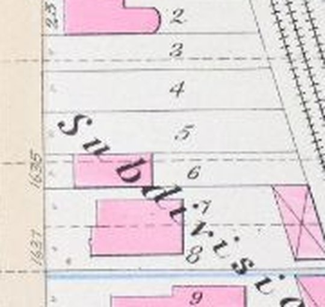

# 1635 Prairie on 1 July 1904: the Forsyth house, standing and empty — T-2443

The 1911 Sanborn sheet draws three unbuilt, unnumbered strips between 1625 and 1637
(`prairie_1625_1637_a/b/c`, census row `s20-vacant-east-1625-1637`). Robinson's 1886 atlas prints
**1635** against a narrow brick building on lot 6, the strip next north of 1637 (`_c`), with lots 3-5
open beside it. T-1840 placed the house there and left whether it stood on the target date to
T-1870, whose third piece this is. **Ruling: it stood, empty.** The scene stands it as the district
draft `forsyth_house_1635_prairie`, read off the 1886 plate. The ruling is inferred, and liberty
`L-1635-forsyth-standing-empty-2443` says so.

The 1886 plate, north up, Prairie Avenue at the left: '1635' printed up the street line beside
lot 6, the pink (brick) house filling lot 6 from line to line, lots 3-5 open to the north, and
1637's larger house on lots 7-8 to the south.

## The evidence, line by line

All of it is in the Prairie library (`chicago/prairie_1904_v1/data/images.json` and `library.json`);
the ids are its own.

| evidence | what it says | id | bears on 1904 |
|---|---|---|---|
| Glessner House Museum, *Early History of Prairie Avenue, Part IV* (2020) | completed 1863 "for Col. Robert Forsyth", "a more modest home"; "passed through several owners and occupants and was demolished by the early 1900s"; "there are no known photos of the house"; a neighbour remembered the grounds' lawn, fountain and four white statues | `B-early4` (library `pa-1635-48`) | a retrospective "by the early 1900s", with no year and no source given |
| Lakeside directories, 1874-1885 | the Herrick family at 1635 | `cgn-1635-text` | standing to 1885 |
| Robinson's atlas, 1886, plate 10 | '1635' against a narrow pink (brick) building on lot 6, lots 3-5 open | `cgn-1635-robinson-1886`, `robinson_1886_chicago_plate_10` | standing 1886; its outline |
| Tribune rent list, 20 Apr 1886 | "1635 Prairie-av., 10 rooms, brick" | note on `np-1635-tribune-1893-03-19-to-rent-15-room-brick` | brick |
| Tribune, 1892 (many ads) | Warren Springer offers the lot "for lease for 99 years ... suitable for nice apartment house" | same | the owner wants it rebuilt |
| Tribune, 19 Mar 1893 | "To Rent — 15-room brick house, No. 1635 Prairie-av. ... plate glass windows; with large barn", Warren Springer | `np-1635-tribune-1893-03-19-to-rent-15-room-brick` | brick; let, not left empty |
| Illinois Staats-Zeitung, 23 Jul 1894 | Mrs Warren Springer "of No. 1635 Prairie Ave." | `np-1635-staatszeitung-1894-07-23-springer` | standing, occupied 1894 |
| Tribune, 28 Jul 1895 | a 99-year lease of the 70 ft lot, "improved with a two-story frame building", for an eight-storey apartment building | `np-1635-tribune-1895-07-28-springer-lease-70x200` | two storeys; "frame" against every other source |
| American Architect, 12 Sep 1896 | Turnock's plans for a $250,000 flat building for Springer at 1625-1635 | `dw-aabn-1896-springer-flats-1625-1635` | never built (the 1911 sheet) |
| Chicago Blue Book, 1895-1902 | "Springer Warren, 1635 Prairie av." every year | note on `np-1635-womens-clubs-directory-1903-04-springer` | **occupied into 1902** |
| Chicago Blue Book, 1903 and 1904 | Springer at 85 Rush; the 1904 Prairie Avenue street list has nobody at 1635 | `npo-1635-bluebook-1904-springer-at-85-rush`, `npo-bluebook-1904-p186-prairie-avenue-1600-1816` | the family gone; the house not mentioned |
| Women's clubs directory, 1903-04 | "Springer Mrs W 1635 Prairie Av" | `np-1635-womens-clubs-directory-1903-04-springer` | a stale entry (the Blue Book moved them a year earlier); not leaned on |
| full-text search, all years | no rent or sale advertisement for 1635 after 1895 | the library's note on the 1904 Blue Book | silence |
| Sanborn 1911, sheet 20 | the strip unbuilt and unnumbered | `sanborn_1911_chicago_v3_sheet_20` | **gone by 1911** |

## Why standing

The house is documented standing and lived in at every date anyone looked from 1874 to 1902, and
documented gone only in 1911. 1 July 1904 falls about two years after the last positive record and
seven before the first negative one, and **nothing in between dates a demolition**: no wrecking
permit, no advertisement, no item in the press. What 1903 and 1904 do say is that the Springers had
moved to 85 Rush. T-1870's brief rules on exactly that: *"do not treat occupant relocation as
demolition proof."* The 1904 Blue Book's silence at 1635 is that relocation again, not a second fact.

**Against it**, and weighed: the museum's "demolished by the early 1900s" — retrospective, undated,
with no source of its own, and true under either ruling (1905 is the early 1900s too); and Springer's
motive — he had wanted the lot rebuilt since 1892. Motive is not an event, and the flat building he
commissioned in 1896 was never built: the strip is still open in 1911. A developer between projects
had as much reason to keep a house earning (he let it in 1893) as to pay to pull it down.

**Why empty.** The Blue Book is a society register, so a tenant outside it would be silent too; but
no source puts anyone there after 1902, and "empty" is the reading that claims least. The model
shows no sign of it either way.

## What is built, and from what

- **Plan.** The plate's outline on lot 6, read in its own pixels on 4x and 11x enlargements (x 571 to
  614.5, y 1264.5 to 1284, about ±1 px) and carried by its T-1250 fit: about 15 m deep, its front about
  5 m back from the street line and about 5 m before 1637's. The plate draws the house filling lot 6
  wall to wall, and its lot 6 is 6.7 m wide where the 1911 strip is 5.7 m (18.7 ft), the fit carrying it
  about 2 m south across the line into 1637's lot and into T-2447's garden wall. So the depth and
  set-back are the fit's, and the width is the strip's own (`fills_lot`, a new option on the draft's
  plate rows).
- **Storeys, material.** Two storeys, from the 1895 lease report, the only storey count any source
  gives. Brick, from the plate's pink and two advertisements; the same 1895 report's "frame" is the
  one dissent.
- **Form.** T-1870's brief for the house: "a compact earlier villa with simple bracketed cornice,
  high stoop and bounded rear service roof" — the draft's Italianate brackets under a low hip (built
  in 1863, the same years as 1637's "typical two-story brick Italianate"), two bays, the door on the
  north flank toward the open lots. All reconstructed.
- **Not built.** The 1893 "large barn" (the 1886 plate draws none on lot 6); the grounds' fountain and
  statues; anything to say the house stood empty.

## What it changes

- The census row `s20-vacant-east-1625-1637` in `chicago/prairie_1904_v1/data/sheet_census/sheet-20.json`
  now reads `backcast_1886` with this reasoning; lots 3-5 (`_a`, `_b`) stay open ground.
- `tools/draft_prairie_1904.py` learns to stand a plate house on a census `vacant_ground` row
  (`vacant_id`), which has no frontage of its own, and the `fills_lot` option above. Every other draft
  record is byte-identical.
- **1637's garden wall.** T-2447 stopped it at the lot line and left "whether the wall runs on north"
  to this ruling. It does not: it meets the 1635 house's south flank, whose front stands near the
  wall's own line. Nothing in 1637's record moves.
- Liberties: `L-1635-forsyth-standing-empty-2443` (new); `L-draft-prairie-16-18-east-2335` ("1635,
  nothing" no longer holds); `L-k01-1637-spalding-garden-2447` (the wall's north end); `L264`'s count.

## What would overturn it

A demolition permit for 1635 dated before July 1904, a 1903-1906 Sanborn or a directory read by
address, or a Tribune real-estate item on the lot after 1902. If the house was gone, delete the plate
row `r1886-1635-f` from `data/components/prairie_1904/draft_prairie_1904.json` and return the census
row to `phase_unresolved` or open ground.
