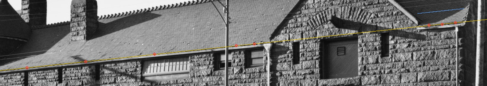

# T-3148 — Glessner's north-face eave either side of the stable gable

The second piece of T-3139. Through HABS 15's refitted camera T-3147 found the print drawing
the 18th Street eave at one height on both sides of the stable's north gable, where the build
stepped from the north range's 23.1 ft east of the gable (sheet 4) to T-2231's 25.2 ft west of it
(`stable_roof_rework.north_west_eave`, read from the owner's west and north-west reference views
at about +/-1 ft). Rendered, that put the tiles' edge about 26.2 ft up west of the gable.

**Acceptance, stated before the work:** read the tiles' lower edge on both sides of the gable in
HABS 01 (through T-2758's stable-fitted camera) and HABS 15; rule whether the eave steps; if it
does not, build the eave west of the gable to the height east of it and say what else moves with it.

    python3 docs/RESEARCH/glessner-north-eave-T-3148/read_eave.py   # readings.json, habs01-eave-line.jpg

## The test that needs no camera

A level line on one flat face projects to one straight line through any pinhole, wherever the
camera stands. So: fit the straight line the tiles' edge draws along the 18th Street range east of
the gable, where sheet 4 measures the eave, and see where the edge west of the gable falls against
that line extended. Each pick is a column's brightness profile (5 px wide): the tiles' last course
is a dark line over the bright gutter.

| print | fitted on | west of the gable, off the line | what the built 2.1 ft step would draw |
|---|---|---|---|
| **HABS 01** (1963, from the north-west) | W 60-124, 5 stations, 0.26 px RMS | **-0.9, -0.1, -0.2 px** (W 156, 158, 160) | 32-33 px |
| HABS 15 (1965, square on) | W 118-124, 3 stations | -6.9, -6.0, -6.5 px | 37-38 px |
| Cornell (c. 1887, from the north-west) | u 230-450, 4 picks, 0.02 px RMS | -3.4, -4.6, -3.8 px | about 50 px |

(Negative: the edge west of the gable stands that far *above* the line.) HABS 01's line runs 1,000
px across the gable and lands on the west edge within 1 px. HABS 15's and the Cornell print's east
lines are short (100-220 px) and carried 500-600 px out, so their few pixels are the extrapolation's;
neither comes within a fifth of the step. **All three prints, 1887 to 1965, draw one eave.**

*HABS photograph 1. Red: the picks. Yellow: the straight line through the five picks east of the
gable, extended. Blue: where the edge would run west of the gable if the eave stood at 25.2 ft.*

## The height

Through T-2758's stable-fitted HABS 01 camera the edge reads **24.07-24.23 ft on the face east of
the gable and 24.02-24.08 west of it**; the gutter's foot 23.49-23.68 and 23.41-23.56. Sheet 4
gives 23.1 ft where the roof meets the 18th Street wall. The prints are not asked for the absolute
height: the visible edge stands proud of the wall line, and the cameras disagree with each other by
about that much at eave height. HABS 15's refit reads the same level line at 25.00-25.26 ft east
of the gable and 23.79-23.99 west, 1.2 ft apart. That is its heading, which its one-face controls
barely fix (T-3147). So the measured drawing sets the height, and the prints rule only that the
eave is level: **23.1 ft on both sides**.

## What was built

| | before | now |
|---|---|---|
| north-face eave west of the gable (`north_west_eave`) | 25.2 ft | **23.1 ft**, the range's |
| the gable's west foot, the alley parapet's north foot, the cross roof's north foot | 25.2 ft | 23.1 ft (all read `north_west_eave`) |
| cross ridge (`cross_ridge`, S 12.31) | 36.5 ft | **36.17 ft** |
| the cross roof's north plane | 42.5 deg | 46.7 deg |

T-3096 built the cross roof's north plane as the alley gable's north rake, so the wall line is never
under the roof and the coping clears the tiles. With the foot at 23.1 ft and the gable's apex held
at 38.6 ft on S 14.6, that rake crosses S 12.31 at 36.17 ft, so the cross ridge comes down 0.33 ft
(0.10 m). That is inside the 0.3 m within which T-3096's measured cameras place the ridge roll's
foot. The gable, its apex, the cupola, the alley gable's apex and every opening are unmoved.

**What this costs T-3095's course count.** T-3095 counted 41-44 courses on that slope in both early
prints. It put the eave "where every camera puts it", but those cameras read it 0.0-0.45 m under
the 25.2 ft build. The slope from the new eave to the lowered ridge is 1.2 ft longer than T-3096's,
which adds about three courses at 5 in. Wherever the eave stands, the three prints above draw it
level with the range, and a 2.1 ft step at the street is plainer than three courses up a slope.
The three courses are the geometry's (1.2 ft of slope at 5 in), not a re-count: T-3080's `read_slope.py` was not
re-run here. They are recorded within tolerance in HABS 01's match record.

`tools/test_glessner_roof_envelope.py` now holds the level eave, the 46.7 degree plane and the 36.17 ft ridge.
