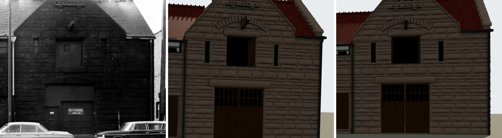

# T-3147 — Glessner's stable end through cameras fitted at the stable

A piece of T-3139. HABS photograph 15 (1965, the stable's 18th Street end, square on)
carried T-2200's frozen pinhole camera, imported unchanged by T-2228 and never refitted:
about 1.3 degrees of roll, 13-20 px off at the loft, and so the hoist stone drawn about
15 px west of the print's (T-2849, T-3136). HABS photograph 1 (1963, from the north-west)
carries a whole-house camera fitted at the Prairie corner, 141 ft from the stable (T-2758).

**Acceptance, stated before the work:** HABS 15's camera re-solved on measured controls at
the stable and committed; the hoist stone read through it and through HABS 01's
stable-fitted camera against the build; what the refitted cameras show at the stable end
written into both match records; anything that needs building filed.

## The camera

`tools/glessner_stable_end_read.py` re-solves HABS 15 on 16 measured controls in the
north face (S 0): sheet 2's doorway jambs (W 134.9-147.0), sheet 5's 12.6 ft soffit and
the threshold, sheet 3's loft (W 137.5-144.7) and flanking-light jambs (132.4-133.6,
149.1-150.3), and the north-west arris (W 161.25). Picks are read at 3-5x with the
contrast stretched, about +/-2 px.

| fit | RMS px (max) | roll | what is free |
|---|---|---|---|
| committed (T-2200) | 17.9 (35.7) | 1.3 deg | nothing |
| **stable_level** (committed now) | **3.3 (5.8)** | 0 | eye position, heading |
| stable_level_roll | 2.5 (4.1) | -0.9 deg | + roll |
| stable_level_shift | 3.2 (5.2) | 0 | + the lens's lateral shift |

The print's verticals stand within 2 px over 150-340 px (the north-west arris, the
doorway's east jamb), so the committed fit is level. Freeing roll lowers the RMS by
leaning the arris against its own two picks, so it is not taken.

**What this print cannot measure.** Every control lies in one face, seen square. That
fixes scale (17.4 px/ft at the doorway), level and the eye's height (1.76 m), but not the
lens's focal length (held at T-2200's) or its lateral shift (held at the principal point;
freed, its one sigma is 253 px and the eye's place along the face +/-5.6 m). Anything
standing off the face is placed by exactly those two.

*HABS photograph 15 (left), the render through T-2200's camera (middle) and through the
refitted one (right). The doorway, the flanking lights, the loft, the relieving arch and
both gable slopes now lie over the print's.*

## The hoist stone

| | HABS 15 committed | HABS 15 stable_level | HABS 01 stable (T-2758 doorway, eye height free) |
|---|---|---|---|
| foot at the wall (du, dv px) | 19.7, -1.7 | **0.5, -1.6** | in its own cast shadow |
| nose top | 31.3, -16.3 | -14.0, -13.1 | **0.0, -4.1** |

The foot lies in the face and now reads within 2 px (0.1 ft): the 15-20 px was the camera.
The nose stands 4.0 ft off the wall, so in HABS 15 its place is the lens's (6-17 px east and
9-13 px high across the three fits). HABS 01 sees the cantilever obliquely from the
north-west, where the projection draws the nose about 24 px east of its foot, and its lit
end face (u 1218-1225, top v 491) takes the built nose within 4 px. **The 4.0 ft stone
stands; nothing is rebuilt.**

HABS 01's committed camera is not replaced: T-2758's stable fit costs the north tower's
finial check (1.5 px to 8.7) that the whole-house view is judged on.

## Found: the eave either side of the gable (T-3148)

Through the refitted camera the print draws the north-face eave level on both sides of the
gable, its tiles ending at v 278 west of it (u 1450-1500) and about 278-287 east of it
(u 870-890). The render's ends at v 249 west (about 1.7 ft higher) and 303 east (about
1.1 ft lower): the build steps from 23.1 ft east of the gable (the 18th Street eave) to
about 26.2 ft west of it. A level camera keeps a level line level, so the step is the
roof's whatever the vertical scale. It is a roof ruling against HABS 01 and the sheets,
filed as T-3148.

## Re-deriving

    python3 tools/glessner_stable_end_read.py            # the table
    python3 tools/glessner_stable_end_read.py --check    # data/comparisons/glessner/stable-end.json
    python3 tools/glessner_stable_end_read.py --camera   # rewrite HABS 15's camera from the fit
