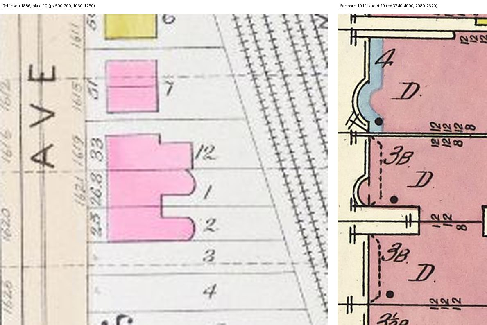

# John H. Hamline's house: 1621 Prairie, not 1619 — T-2436 (T-2439)

T-2420 built the left-hand house of Treat & Foltz's Building Budget drawing ("J. H. Hamline Esq.",
`building_budget_1886_06_hamline_farwell_houses`) at **1619** Prairie, on the Inter Ocean's
"removed to their new residence, No. 1619 Prairie avenue" (18 Apr 1886). T-2433, placing Granger
Farwell's house at 1623, found the evidence on Hamline's number split and filed the question. This
note weighs it. **Ruling: the house stood at 1621**, the north unit of the attached group 1621-1625
on the 1911 sheet. T-2440 moves the build; nothing is rebuilt here.

## The evidence, line by line

| evidence | what it says | where | points to |
|---|---|---|---|
| American Architect, 3 Oct 1885 | "J. H. Hamlin, two-st'y dwell., 1621 Prairie Ave.; cost, $10,000; architects, Treat & Foltz" | Prairie library `dw-aabn-1885-hamlin-1621-farwell-1626-treat-foltz` | 1621 |
| directories, 1884-87 | Hamline at 1621 (as the library records them; the earlier two years precede the permit, so they are reported here and not leaned on) | the library's note on `cgn-1619-text` and on `cgn-1619-1625-building-budget-hamline-farwell` | 1621 |
| Inter Ocean, 18 Apr 1886 | the Hamlines "removed to their new residence, No. 1619 Prairie avenue" | `cgn-1619-text` | 1619 |
| Conzen & Knox, *Chicago's Prairie Avenue Elite in 1886* (Encyclopedia of Chicago map 16b, 1886 occupants from directories and social registers) | east side: 1619 Joseph L. McBirney; **1621 John Hamline**; 1623 Granger Farwell | `a16-newberry-conzen-prairie-elite-1886-map` | 1621 |
| 1619's own record, 1871-91 | an existing 14-room mansard brick dwelling on a 33 ft lot offered for sale in Oct 1880; Joseph McBirney its occupant 1884-89; J. Foster Rhodes pays $18,000 for the lot, 33½ ft, in July 1891 and "contemplates improving" it | `cgn-1619-text`, `cgn-1619-tribune-1883-furniture-auction-ad` | not Hamline's |
| Robinson's atlas, 1886, plate 10 | prints **1619** against the 33 ft sublot 12, whose house is stepped back at the rear and shaped like nothing beside it, and **1621** against sublot 1 (26.8 ft), the first of an identical PAIR of new houses on sublots 1 and 2 (1621 and 1623), each with a half-round rear end and a notch between them | `robinson_1886_chicago_plate_10`, committed raster px 500-700 x 1060-1250 (below, left) | 1621 |
| Building Budget drawing, June 1886 | Hamline's house and Farwell's drawn as one commission, side by side, Hamline's on the left (north), a passage lettered "Driveway" between their plans, Hamline's south wall seen along it | `building_budget_1886_06_hamline_farwell_houses` | the pair's two lots adjoin |
| 1904 Blue Book | John H. Hamline at 1621; Howard E. Perry at 1619 | `npo-bluebook-1904-p186-prairie-avenue-1600-1816`, the sheet census `frontage-20-027` | 1621 |
| Sanborn 1911, sheet 20 | 1619: '4' storeys, stone (blue) front with a broad curved bay, a half-round frame piece at the rear. 1621: '3B' brick with a smaller curved bay at the SOUTH end of its front, and south of it a passage left open from the street wall to about a third of the depth, between it and 1623 | `sanborn_1911_chicago_v3_sheet_20`, raster px 3740-4000 x 2080-2620 (below, right); census `s20-1619-f`, `s20-1621-f` | 1621 |

Left, the 1886 plate: Prairie Avenue at the left, north up; "1619" at the 33 ft lot 12, "1621" at
lot 1, and the matched pair on lots 1 and 2. Right, the 1911 sheet at the same lots: 1619's '4'
storey stone front, 1621's '3B' with its bay, the open passage, and 1623.

## Why 1621

Every source that is about the house rather than the family's move agrees: the permit Treat & Foltz
filed for it (1621), the occupant map of the year it was finished (1621), the atlas plate of that same
year, which prints 1621 on the first of a pair of new, identical houses beside 1623 — Farwell's, the
other half of the commission, which T-2433 placed at 1623 on the 1890 photograph of McBirney's house —
and the 1904 Blue Book (1621). The drawing draws two houses for one commission side by side; at
1621 and 1623 they are side by side, and the 1911 sheet still leaves the passage between them that
the drawing's plan letters "Driveway", with 1621's bay at the south end of its front against it,
where the drawing puts the bow, the south wall seen along the passage. At 1619 none of that holds:
the lot is the 33 ft one that held an older mansard house, lived in by Joseph L. McBirney from 1884
to 1889, and sold as a building lot to J. Foster Rhodes in 1891 — which is the likeliest origin of the
'4' storey stone front the 1911 sheet draws there, and is why T-2420 could not reconcile that '4' with
the drawing's two storeys over a raised basement. 1621's '3B' (three storeys over a basement) is the
drawing's two and its roof storey under the gable.

**Against it** stands one line: the Inter Ocean's "No. 1619". It is a society paragraph about a move,
set in type once, and it disagrees with the permit, the directories, the atlas and both occupant
lists. It is recorded as the disagreement and not followed.

**What this corrects in T-2433.** Its liberty and README read the 1885 permits as running "one lot
behind" 1904's, Hamlin's "1621" with them, and so put Hamline at 1619. The permit for Hamlin's house
and the atlas agree on 1621, so the offset is not a rule of the 1885 numbers: Farwell's "1625" (and
the once-printed "1626") is the permit's own error for 1623, which the 1886 occupant map gives
him. Farwell's number is unchanged.

## What the ruling changes now, and what it leaves to T-2440

- **The cards.** 1621's card names John H. Hamline's house and says its front is still the district
  draft's (`tools/draft_prairie_1904.py`, the frontage row's `household`). 1619's card no longer calls
  the house Hamline's: it says the front standing there is, for now, the drawing of his house next
  door, and liberty `L-1619-wears-hamline-front-2436` records that.
- **The build is not moved here.** Moving it is a camera re-solve, a rebuild on another footprint and
  a bake of two houses, and T-2428's wall gable (PR #749) is still landing on 1619. T-2440 does it,
  after T-2428.
- **For T-2440: the scale is not copied.** T-2420 scaled the plate on 1619's 3.76 m bow and found the
  drawing's floor bands agreed to about 10 %. 1621's bay on the 1911 sheet is about 2.45 m across and
  1 m deep, at the south end of a front about 6.3 m wide at the street wall, with about 3.8 m of wall
  north of it. Either the drawing's bow was built narrower than drawn, or the sheet's bay is a later
  one; the camera at 1621 must be solved on 1621's own lines and the disagreement stated, not hidden
  by borrowing 1619's.
- **For T-2434: the house without a picture is 1619**, not a third house of the 1621-1625 group,
  each of which now has one.
