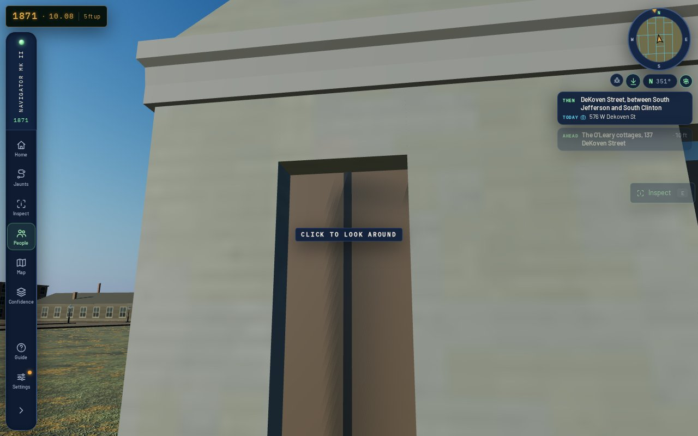
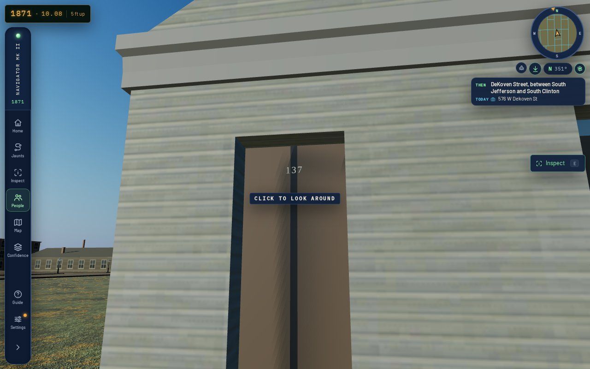
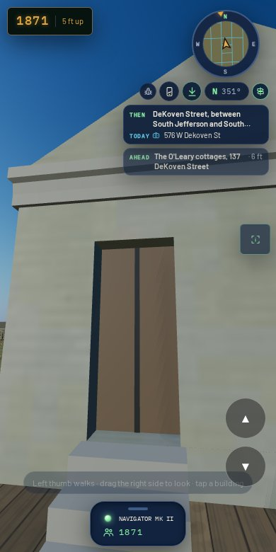
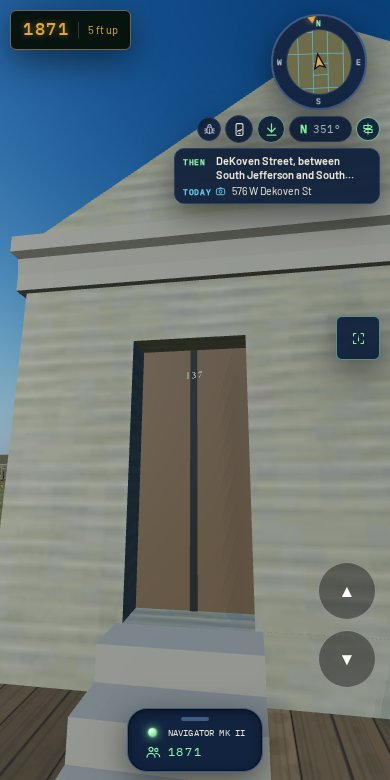

# T-3738 — the 1871 house numbers, before and after

Rendered by `tools/qa_house_numbers_1871.mjs` in the published `/1871/` app (1280×800 full, 390×780 light), each stand
once with the numbers hidden and once shown. The layer's census at both viewports: 4 numbers, 4 placed, 1 draw,
24 triangles, 0 page errors.

| | before | after |
|---|---|---|
| desktop, the O'Leary door (No. 137) |  |  |
| phone, the O'Leary door |  |  |

Also: `after-desktop-sullivan-door.jpg` (No. 134, across the street) and `after-mobile-dekoven-north-side.jpg` (the
north side from the street: the 4 in figures are a door's detail, not read from across the road).

Which numbers, and why only these: `tools/place_1871_house_numbers.py`'s docstring and `docs/LIBERTIES.md`
L-1871-house-numbers-3738.
