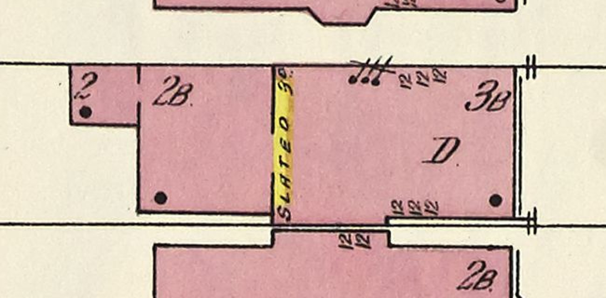

# 1604 Prairie refined from the district draft to a K01 brick house with its traced rear range (T-2343)

Piece 3 of T-1859 (Refine 1600, 1604 and 1608 north-west frontage). 1608 (T-2341) and 1600
(T-2342) went first; 1604 waited because K01 built one rectangle and nothing behind it, and this
house is three pieces. The draft T-2334 stood is refined **in place**: `house_1604_prairie` keeps
its id, its archetype changes from `prairie_draft` to `k01_frontage`, and the draft rules' `skip`
names `s20-1604-f`, so the draft builder stands no second building there.

## What the sheet draws

Sheet 20 of the 1911 Sanborn (vol. 3), 1604 in the middle, Prairie Avenue to the right. Read
with the T-1840 census rows and measured off the raster through the T-1250 fit:

| piece | sheet | census | built as | u (m) | v (m) |
|---|---|---|---|---|---|
| front block | `3B`, `D` | s20-1604-f, '3B brick dwelling (D)' | the K01 main body | 0 to 12.2 | 0 to 8.2 |
| entry strip | yellow, 'SLATED' | s20-1604-a1, 'joined by a narrow frame (yellow) entry strip' | folded into the range | -0.97 to 0 | 0 to 8.2 |
| rear range | `2B` | s20-1604-a1, '2B brick rear wing behind the front' | wing `rear_range` | -8.33 to 0 | 0 to 8.2 |
| west block | `2` | s20-1604-a2, '2-storey brick rear block, the westernmost piece' | wing `west_block` | -12.04 to -8.33 | 4.98 to 8.2 |

(u toward the street from the front block's rear wall, v north from its south wall.) The draft
had fitted its largest rectangle to the whole outline and stood one three-storey hip 20.5 m deep
over it; the `3B` the sheet prints covers only the front 12.2 m. So the record's position moves
8.40 m toward the street and 0.60 m south, onto the front block's rear-south corner.

## The builder change: K01 rear wings

K01 built one rectangle. It now takes `rear_wings`: rectangles behind the main body, each

- standing on the main rear wall (u = 0) or on the rear wall of a wing listed before it, inside
  that wall's length — the host wall is not drawn behind it (the K01 wall's own hole rule), and
  its string course and K08 gaps stop there, so nothing is drawn twice;
- with its own floors (`floor_m`, `storey_heights_m`) and its own K06 windows on its south,
  north and rear walls (`windows`, `sash_by_storey`), each under a K03 brick head chosen against
  the wing's own wall top, as the main walls' are against the soffit;
- with the K03 second-floor string course carried round its south and rear walls, stopped short
  of the main south wall's own course so the two never overlap;
- under a flat deck of K04 painted tin with a fascia and soffit, run out over its three free
  walls, and closed at the front wherever it passes the ends of its host wall.

A host opening the wing stands in front of, below its deck, is not cut (as a K08 bay's); one a
junction would cut in half is refused. `python3 generators/k01_emit.py --check` holds every K01
asset to its bytes: 1808, 1600, 1608 and 1612 are unchanged, and the kit assets that hash the
K01 module (1729's conservatory, 1638's front, 1812's coach house) were re-emitted for the code
hash only; their GLBs are byte-identical.

## What the house is

The front block is K01's plain brick front (T-2341): three storeys and a basement, three bays,
the door on the north one (the draft rules' side), heads diminishing up the front — K09's
restrained surround, its cornice-hood lintel, then K01's flat lintel — so 1604 repeats neither
neighbour. K07 door and stoop (8.97 m to the walk), K10 bracketed cornice, a 34-degree K04/K05
hip in painted standing-seam tin with two stacks on its short ridge, copper gutters and two
downpipes. Its rear wall's first two storeys are behind the range; only the third storey's two
windows are cut, above the range's deck at 9.1 m.

The rear range stands two storeys over a basement on the main body's own floors, so its string
course runs on at the same course; two windows a storey on each side and two in its rear. The
west block stands two storeys from 0.3 m, one window a storey on each free wall. Liberty
`L-k01-1604-rear-range-2343`; 1604 is retired from `L-draft-prairie-16-18-west-2334`.

**Folded:** the yellow frame entry strip is built as part of the brick range (K01 lays brick
only). **Not followed:** the range's south wall traced about 0.2 m inside the front block's
(built flush), and the trace's 0.4 m step south on the front block's rear half.

**K05 note.** At 30 to 33 degrees the K05 roof graph on this short-ridged plan (12.2 by 8.2 m)
leaves a rear hip with no covering plane either side and the build refuses; at 34 it closes. The
pitch is therefore 34, still inside the contract's ordinary range. The fault is K05's, on this
plan, and is noted here rather than worked round in the kit.
