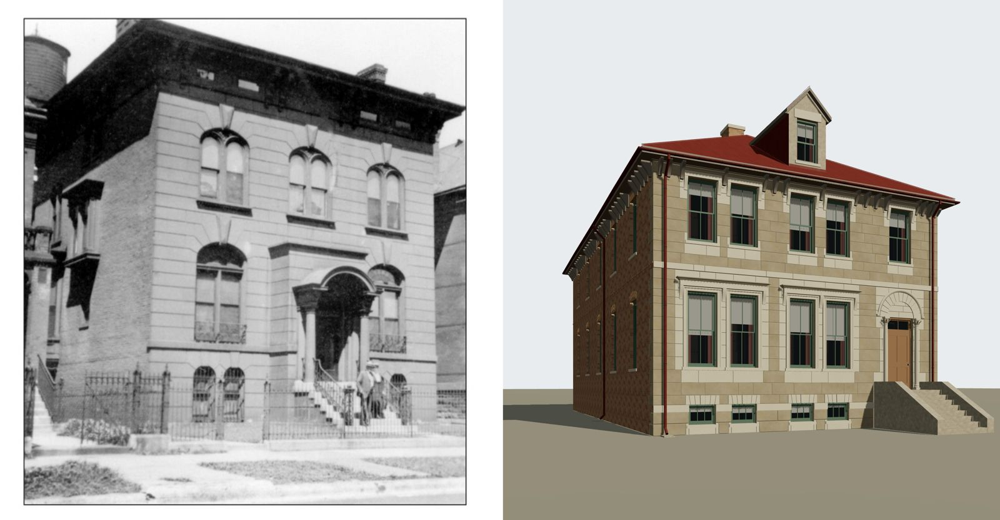
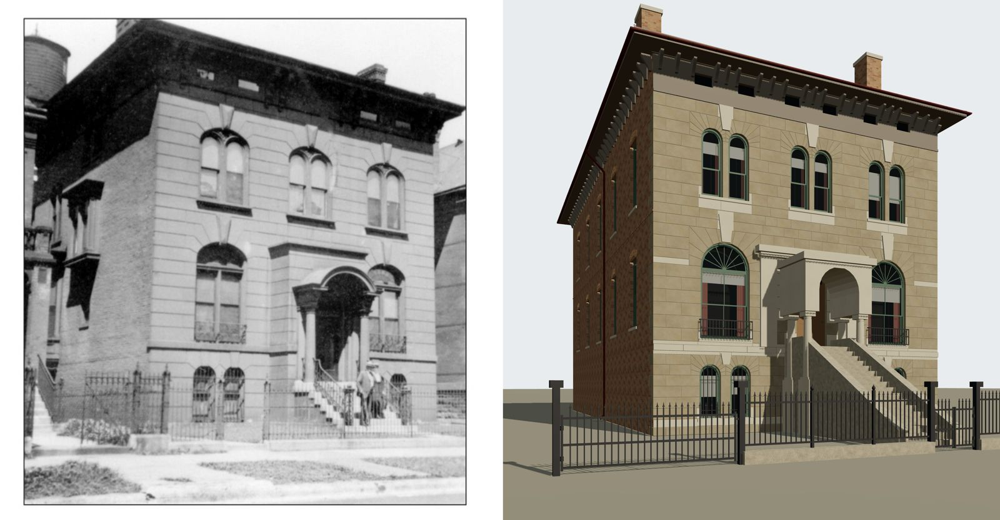

# T-2366 — 1612 Prairie rebuilt from its own photograph

T-2344 refined 1612 Prairie from the Prairie library's one-line summary of the house ("paired
segmental windows, arched columned entrance, high stoop, bracketed cornice and basement
lights") and the 1911 Sanborn. The library also linked the house's photograph, marked "link
only", and nothing downloaded or opened it. The owner supplied it on 2026-10-11
(`chicagology_1612_prairie_photo`), and the house bore little resemblance to it.

## Before and after, from the photograph's own camera

`tools/photo_match.mjs` renders the committed GLB from the camera solved for the print
(`data/reference_views/goodman_house_1612_prairie/front_from_southeast.json`) and puts it
beside the print. Neutral daylight, no terrain or neighbours.

Before (dev at T-2344): five flat-headed windows a storey, a north door, a dormer.

After (T-2366):

## The camera

A level camera (the print's verticals are vertical), its principal point on the horizon at
y 1550 px and taken at the print's centre in x; the front's courses converge on a vanishing
point near x 5900 px. The Sanborn's 11.25 m front is the one length. Least squares over the
two front corners and the course spacing at four columns gives f = 2293 px, a heading 24.2
degrees off square and the eye 17.2 m before the front, 4.4 m south of its south corner and
1.58 m above grade. Projected back, the solved camera puts the stone's top (10.64 m) on the
print's line to within a few pixels along the whole front.

## What was read through it

| reading | value | where in the print |
|---|---|---|
| bays | 2.40 / 5.625 / 8.85 m, entered in the middle | south bay's lights at x 805-1000 px |
| belt course (the principal floor) | 2.65-2.85 m | y 1395 px at x 900 |
| basement lights | 0.5 m to crowns at 2.24 m, paired 0.34 m apart | y 1467-1685 px |
| principal windows | 1.7 m wide, 3.06 m to crowns at 6.2 m | y 975-1367 px |
| upper lights | paired, 1.66 m across, 7.62 m to crowns at 9.85 m | y 517-803 px |
| keystones | to 10.64, 7.1 and 2.6 m | |
| stone's top | 10.64 m, level along the front | y 366-608 px, x 640-1700 |
| frieze lights | about 11.15-11.5 m, two to a bay | y 280-355 px |
| frontispiece hood | 5.87-6.2 m, 3.9-7.8 m across | y 990-1030 px |
| portico | arch radius about 0.75 m springing at 4.6 m, columns about 2.0 m apart, 1.7 m before the wall | solved on its own plane |
| stack tops | about 15.4 m, south and north | x 470-540 and 1430-1540 px |

What the solve cannot give, and so is reconstructed and admitted in
`L-k01-1612-goodman-2366`: the roof (nothing of it shows over the cornice, which any hip under
about 37 degrees gives from this camera), the north bay (taken as the south's mirror), the
colours (the print is monochrome), the depth of everything on the line of sight (the stacks'
places in plan, the portico's rear columns) and every moulding's section.

## What the kits learned

- **K01** lays a stone front's round-arched groups (`street_front_openings`) and its dress
  (`street_front_dress`): `generators/archetypes/k01_arched_front.py` cuts each group's
  voussoir block into wedges from each light's centre along K06's own head vertices, so the
  intrados is the reveal's edge, and runs each wedge out to the block's rectangle so its joint
  radiates into the banded coursing. It also lays the keystones, the frieze and its lights, the
  frontispiece, the portico and the iron. The contract's principal-floor range now binds a
  reconstructed floor only; a read one stands on its source.
- **K06** has three round-headed variants: paired lights, a wide parlour window with a fanlight,
  a basement light.
- **K10** stands no bracket over a frieze light.
- **K11** builds a boundary with no side wall, and hangs gates on iron posts where a record says so.

## Not yet built

The canted bay on the south wall's front, which the photograph shows; the south frame porch and
the rear one-storey piece (K01 builds one rectangle); the cornice's paired brackets.
