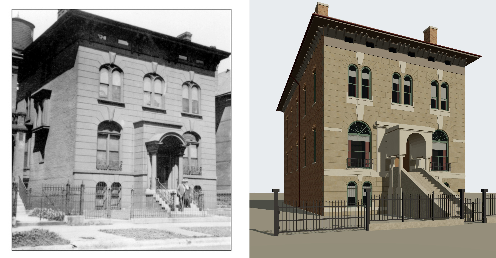
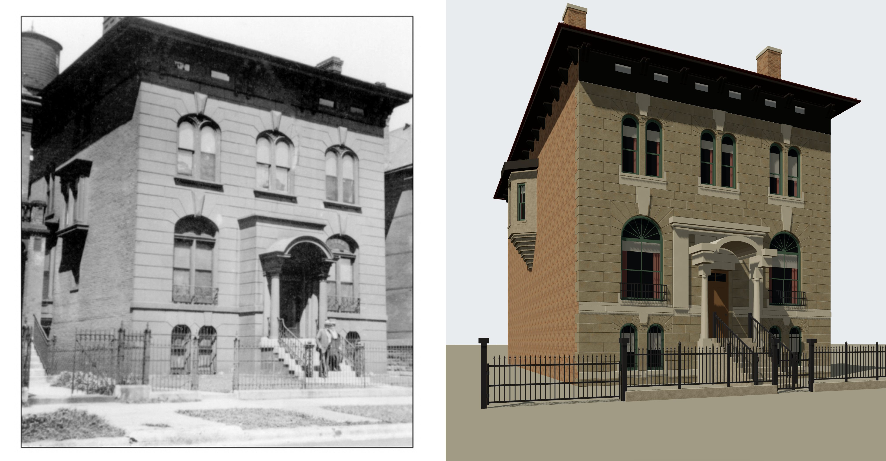
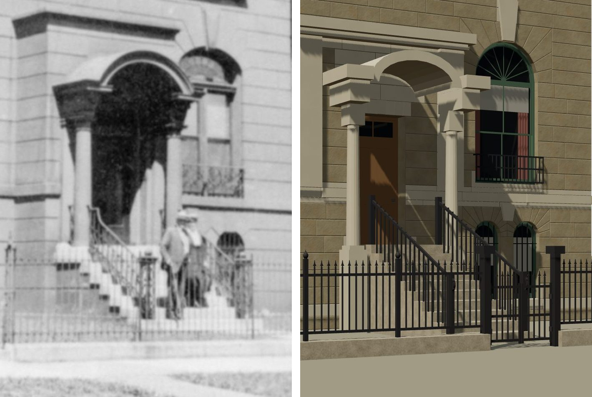
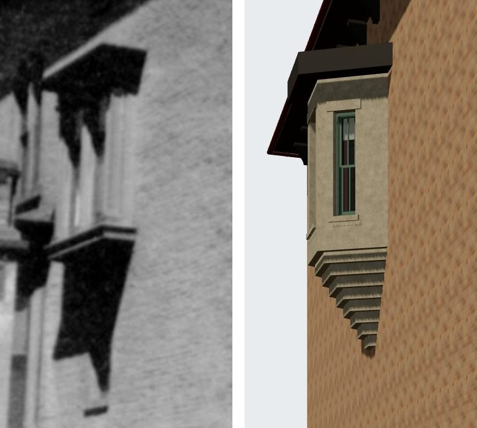
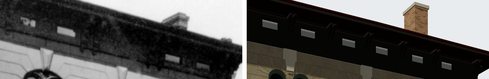
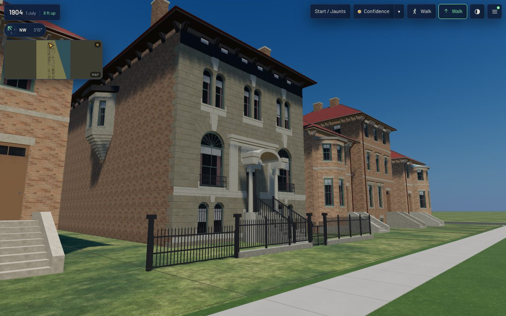
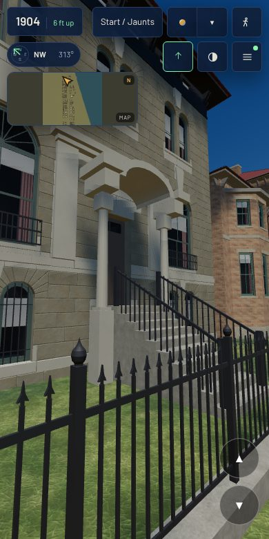
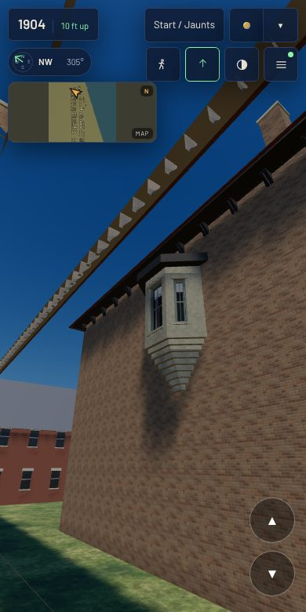
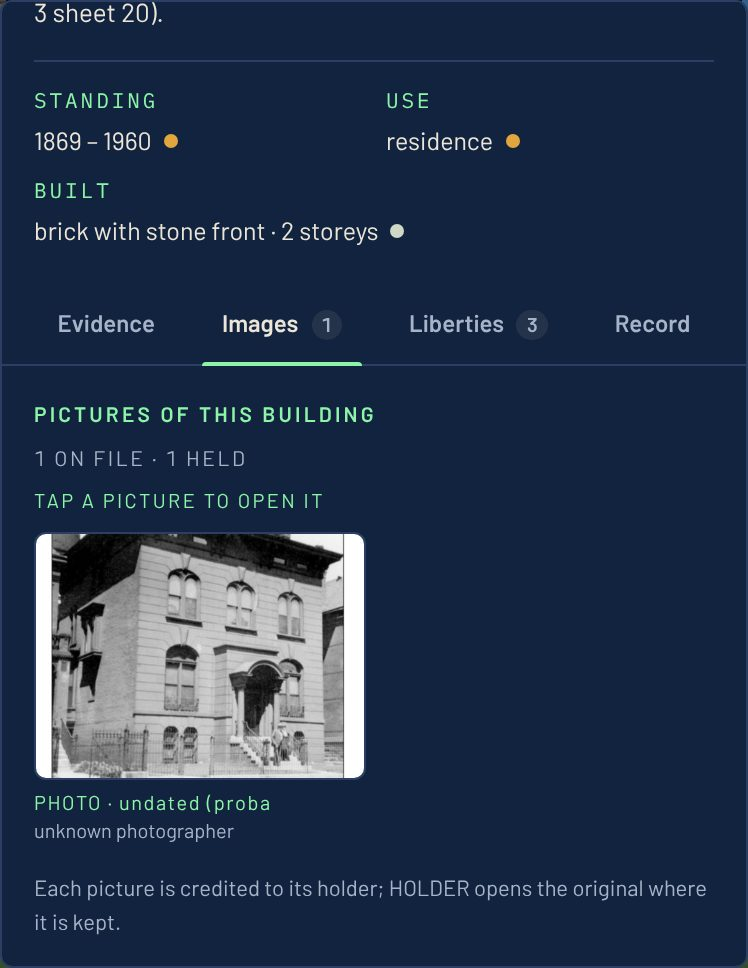

# T-2369 — 1612 Prairie finished against its photograph

T-2366 rebuilt 1612's front from its photograph (`chicagology_1612_prairie_photo`) and left
four differences open in the match record: the cornice's brackets, the south wall's canted
bay, the stoop and the portico's depth. This closes them, looks again at the whole print, and
sets the record's verdict to `matches`
(`data/reference_views/goodman_house_1612_prairie/front_from_southeast.match.json`).

The Prairie library holds no other picture of the house: its other 1612 items are maps
(Robinson 1886, the 1886 elite map, an atlas crop), newspaper items and directory pages.

## Before and after, from the photograph's own camera

Before (dev at T-2366):

After (T-2369), lit from the print's own sun (`sun_uvy` in the camera file, new in
`tools/photo_match.mjs`), so the portico's shade is compared as well as its shape:

1:1 crops, print left, render right:

## What changed

| difference | how it was read | what the build does now |
|---|---|---|
| cornice | brackets in pairs on the piers between the frieze's lights; the cornice dark from frieze to crown | K10 lays paired brackets (`pairs.spacing_m` 1.6) and paints the eave dark (`paint`); the frieze between the lights is a dark panel |
| south wall | a canted oriel on the upper storey, its hood under the cornice, light faces between pilasters, a dark wedge below | K08's canted corbelled oriel on the south wall (K01 now takes `oriel` with `base_m`, a sized `plan` and a sized hood `eaves`), stone faces, 3.1 m storey from the 7.0 m floor, 1.1 m out on eight corbel courses (the kit's oversail rule and light-tier cost bound it) |
| stoop | the stoop's ends step down from about 1.66 m at the columns to the walk in nine or ten risers | the door is at 1.7 m (`entrance_floor_m`, new in K01), ten risers, 1.7 m wide, no stone cheeks, between the K11 kit's iron stair rails (newels, a sloped rail, two balusters a tread, a scroll at the foot) |
| portico | shafts at X 1177 and 1412, the ring's outer edges at X 1222-1443, its crown at Y 1070 | a barrel from the wall to 1.4 m under an elliptical ring (0.85 m radius, 0.47 m rise) springing at 4.8 m, impost blocks 4.4-5.05 m, columns 0.9 m before the wall |
| fence | the lot's south corner post at X 350, the gate posts beside the stoop's foot | the fence line 4.7 m from the front (was 6.9 m) |

## What the print does not show

Recorded in the match record as `not shown` and in `L-k01-1612-goodman-2369`: every colour
(the door reads black in the portico's shade, the render's brown); the oriel's corbelling,
seen only in shadow; the centre bay's frieze lights and the frieze's surface, hidden by what
may be a vine; the fence's foot, which reads about 0.5 m above the walk where the walk, the
yard's grade and a coping cannot be told apart (the kit's 0.25 m curb is kept); the south
wall behind the oriel and the north bay.

## In the app

`node tools/qa_k01_t2369.mjs` in the published /1904/ app, T-2366's stands plus one on the
stoop's line and one under the oriel: desktop 1280x800 at full detail and phone 390x780 at
light, no page errors, no failed requests, every stand within budget
(`browser-validation-after-desktop.json`, `browser-validation-after-mobile.json`).

The card's Images tab at 390x780 (`tools/qa_images_tab_t2389.mjs` narrowed to this house, the
store's two files served from the owner-supplied copy because this container cannot reach the
store): one picture, credited, a thumbnail until tapped, no page errors.

