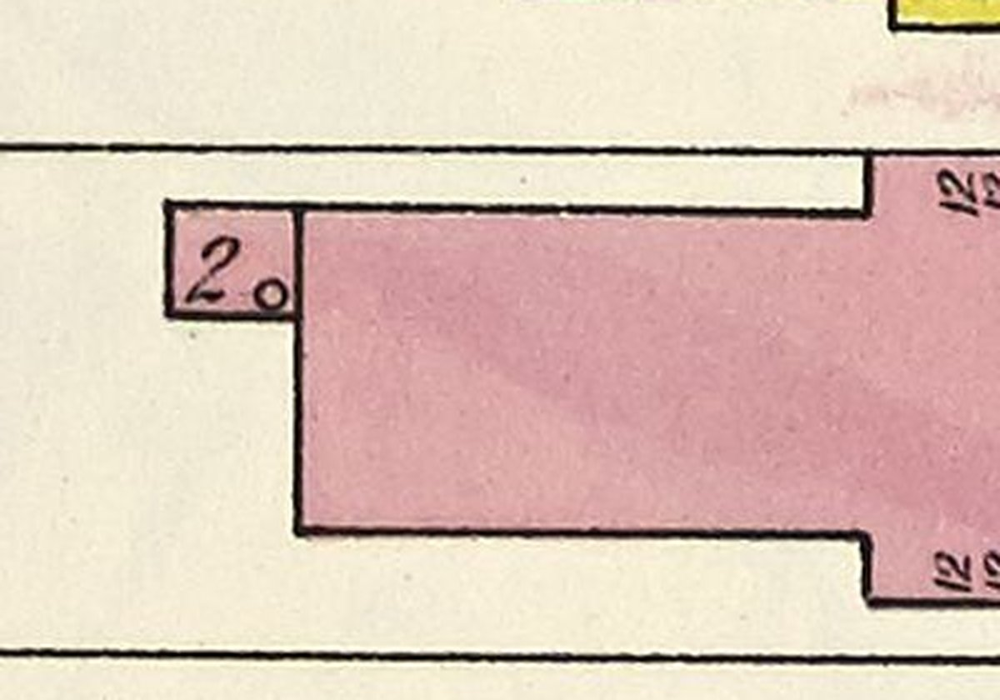

# 1616 Prairie's rear range stood on K01's rear wings (T-2354)

Piece 2 of T-2345. T-2353 refined 1616's main body onto K01 and could not keep the range the
sheet draws behind it: K01 built one rectangle. T-2343 has since taught K01 `rear_wings`
(`docs/RESEARCH/k01-1604-rear-range-2343`), so the range stands on one, wing `rear_range` of
`house_1616_prairie`. Liberty `L-k01-1616-brick-front-2353` now covers it (`rear_wings`).

## What the sheet draws

Sheet 20 of the 1911 Sanborn (vol. 3), the rear of 1616 at three times the raster's scale, the
alley side to the left. A clean rectangle against the north end of the main body's rear wall,
coloured brick and lettered **`2`** with no `B`, beside a small circle. The T-1840 census reads it
the same way (s20-1616-a1, '2-storey brick rear piece').

| | the draft (T-2334) | built here |
|---|---|---|
| storeys | 1 (the draft rules' default for a range) | **2**, no basement — the sheet's `2` |
| u (out from the rear wall) | -2.75 to -0.25 | -2.6 to 0 |
| v (north from the south wall) | 5.0 to 6.5 | 4.3 to 6.5, flush with the main north wall |

Measured off the T-2328 trace (`s20fp-1616-b1` p2) through the T-1250 fit, in the record's frame:
the outer wall's line at u -2.74 against the main rear wall's at u -0.14, the north line at 6.55
(the main body's own), the south line at 4.3-4.5. The trace's south line steps to v 5.0 for the
0.9 m nearest the house and is notched in two places; those are the `2` and the circle printed
inside a 2.6 by 2.2 m outline, not walls (the raster above shows a plain rectangle). That
notching is also why the draft's fit came out 1.5 m along. **The ticket's title says
one-storey; that was the draft's rule, not the sheet's reading, and the sheet is followed.**

## What is built, and what moved for it

- The range: K03 brick, floors at 0.3 and 3.5 m (3.2 and 3.0 m storeys, as 1604's two-storey
  west block), one K06 sash a storey in its south wall (s 1.3) and its rear (s 1.1), a blank
  north wall as the main body's, and a flat K04 painted-tin deck on a 0.25 m fascia with a
  0.15 m overhang, no gutter. Its upper floor is not on the house's (5.4 m); nothing reads
  either, and a service range on its own levels is ordinary.
- The main rear wall's windows: T-2353 had them at s 1.75 and 4.75 m. The north one stood
  where the range joins, and K01 refuses a junction that cuts an opening in half, so the pair
  moves to s 3.4 and 5.3 m, centred on the 4.3 m of wall the range leaves free.
- The rear north downpipe moves off the corner the range now stands against to s 2.45 m.

Not modelled: the small circle the sheet prints in the range.

## Before and after, the same stands (`tools/qa_k01_t2354.mjs`)

The actual published `/1904/` app; *before* is `dev` at 7b2bb0416, *after* this branch.
Desktop 1280×800 at full detail, phone 390×780 at light. Stands: rear (1616's own yard),
rear-north (from the north-west, by the alley), rear-oblique (12 m over the yard), roof (the
air, north-east). 0 page errors and 0 failed requests on all four runs; every stand within the
scene budget.

| | load to ready | JS heap | draw calls | triangles | frame (median of 12) |
|---|---|---|---|---|---|
| desktop before → after | 29.0 → 26.8 s | 30.9 → 30.9 MB | 128-146 → 130-148 (+2) | 1.887-2.674 M → 1.891-2.678 M (+4.1 k) | 3.20-4.62 → 3.24-4.60 s |
| phone before → after | 16.7 → 16.5 s | 30.8 → 30.9 MB | 86-97 → 88-99 (+2) | 474-502 k → 478-506 k (+4.1 k) | 0.95-1.34 → 0.97-1.34 s |

The master is 3.12 MB (from 2.91) and the web derivative 1.07 MB (from 1.00). Frame times are
software GL on the runner, a relative reading, not a device claim; desktop load swings by
seconds between runs.

Screens: `before-*.jpg`, `after-*.jpg`; readings: `browser-validation-{before,after}.json`.

## Limits

- No photograph, plate or description of 1616 has been read; every form is the kits'. No
  picture of 1616 was found by address in the Prairie library (T-2368's note on the ticket).
