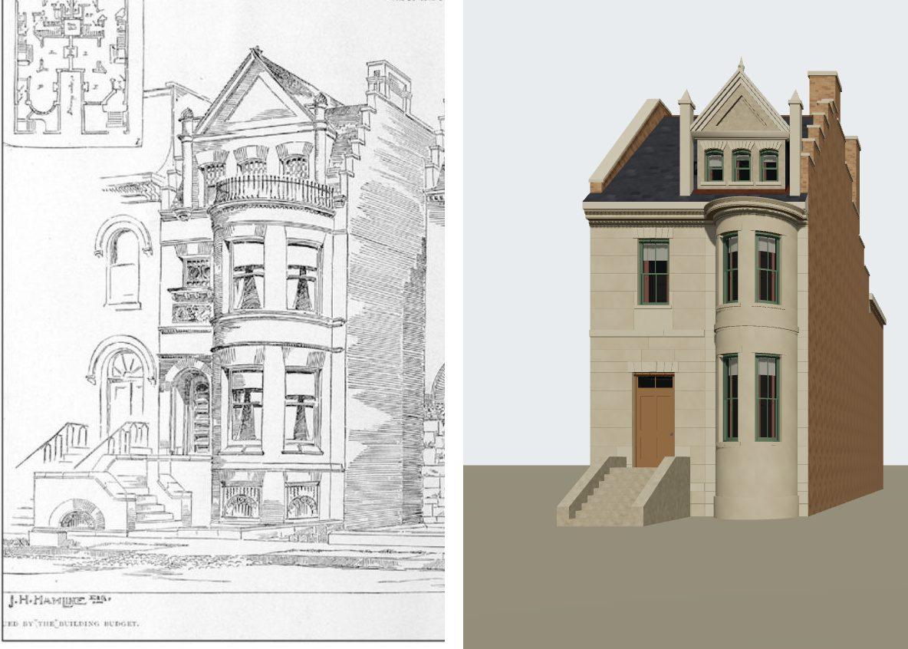

# 1619 Prairie (John H. Hamline) on K01, from its drawing — T-2420

Piece 1 of T-2419 (of T-1868). The district draft's grey box at 1619 Prairie becomes a K01
stone-front house built against the house's one picture, Treat & Foltz's pen perspective of the
Hamline and Farwell houses in *The Building Budget*, June 188- (probably 1886; source
`building_budget_1886_06_hamline_farwell_houses`), read against the 1911 Sanborn sheet 20, which
controls the plan. Liberty `L-k01-1619-hamline-swell-front-2420`.

## What the drawing shows of 1619

Read off the plate itself (`data/sources/assets/hamline_1619_drawing_t2420/`), the left-hand house,
lettered "J. H. Hamline Esq.":

- a narrow **north strip** holding a recessed round-arched entrance up a stoop, with a small ornate
  light over a carved panel at the second floor;
- a **full-height swell bay** rising from the raised basement (two segmental lights with iron
  grilles) through the principal and second storeys, two lights a storey either side of a pier,
  string courses at each floor, to a moulded cornice carrying a **balcony rail**;
- above it, set back on the wall, a **roof storey** of three short segment-headed lights under a
  steep **pedimented wall gable**, with a finial and two pinnacle shafts;
- a **slated roof** behind, and the **south side wall** in shade, its parapet stepping up from the
  front to a tall stack.

The plate's inset plan (`drawing-inset-plan-3x.jpg`, enlarged 3x from the display copy) settles
what the shaded panel south of the bow is: the two houses' plans stand either side of a passage
lettered "Driveway", so it is Hamline's south wall seen along that driveway, and the camera stands
in front of it.

## The camera

`data/reference_views/house_1621_prairie/building_budget_front.json` (at `house_1619_prairie` until T-2440 moved the build to 1621). Level and square to the front;
the bow's two edges (its 3.76 m chord on the sheet) give 46 px/m at the front's plane, which the
drawing's own floor bands agree with to about 10 %; the eye at 1.6 m, 20 m out, and 3.5 m south of
the south wall, in front of the driveway, the only place from which that wall shows as deep as the
drawing draws it. Residuals and their reasons are in its `solve`.

## Where the drawing and the sheet disagree, and what is built

| | drawing (1886 design) | 1911 sheet | built |
|---|---|---|---|
| front north of the bow | about 1.4 m (inset plan: about a third of the front) | 3.79 m | the sheet's |
| front south of the bow | not drawn | 0.91 m | the sheet's |
| storeys | two over a raised basement, a third in the roof under the gable | '4' | the drawing's |

The plan is the sheet's because it is the survey of what stood, 25 years after the design was
published, and the image gate's rule is that a later state is argued, not copied. The storey count
is the drawing's because the drawing shows nothing a fourth walled storey could be: the gable's
lights are about 0.9 m high against the second storey's 2.2 m, a roof storey's. The sheet's '4' is
left unexplained — it may count the raised basement and the roof storey, or the house may have been
raised after 1886 — and a photograph after 1886 decides it.

## Match record

`data/reference_views/house_1621_prairie/building_budget_front.match.json` (moved from 1619 by T-2440), verdict **differs**:
massing, the bow's lights and the storey lines are `fixed` (the bow's edges within 3 px, its top
within 5 px, the bands within about 15 px); the wall gable, the stepped parapet and the stone
cornice are `open` for **T-2421**; the balcony rail, the arched entrance and carved panel, the side
stoop and the grilled basement arches are `open` for **T-2422**, which brings the record to
`matches`. The strip's width, the south pier, the storey count and colour are `not shown`, argued
above.

## What K01 could not do here, for the next pieces

- a front **wall gable** rising from the wall plane (K01's dormer sits on the hip and carries one
  sash; the K01 contract caps sash at 1.15 m wide and a hip at 45 degrees);
- a **bay that reaches the cornice**: K10 refuses a bay whose roof meets the wall above its bed
  moulding, which is why the second storey is 3.9 m and the bow stops at 8.2 m under a 9.2 m eave,
  where the drawing carries the bow to the cornice itself;
- a **stepped parapet** on a side wall, and a balcony rail on a bow's deck.
- **lights in a bay's basement**: the K08 kit's own gate (`tools/check_bay_kit.py`) refuses a
  window below a bay's clear wall (its plinth), so the bow's basement is blind until T-2422 teaches
  the kit the drawing's grilled segmental lights.

## The wall gable (T-2428)

Piece 1 of T-2421. The dormer that marked the roof storey is now the drawing's **wall gable**, built
by `generators/archetypes/k01_wall_gable.py` from the record's `dormer.wall_gable`: the K05 dormer
with its face on the street wall's plane (no setback), so the wall is carried up over the bow and the
face, cheeks and gabled roof stay one closed solid with the hip.

Read off the plate through the camera (46 px/m at the front's plane, eye 1.6 m up):

| | drawing (px in the panel) | through the camera | built |
|---|---|---|---|
| gable's centre across the front | x ≈ 331-335 | v ≈ 5.1-5.2 (0.47 m north of the bow's centre) | v 5.2 |
| face's width | x 255-410 | about 3.4 m | 3.3 m |
| pediment's foot (horizontal cornice) | y ≈ 170-175 | about 10.9 m | 10.9 m |
| apex (finial's foot) | y ≈ 70 | about 13.1 m | 13.05 m |
| lights | three, about 33-37 px wide, 1.1-1.2 m apart | 0.75 m wide, heads about 10.4 m | 0.75 × 0.95 m, 1.1 m apart, sills 9.5 m |
| voussoir blocks' tops | y ≈ 187 | about 10.6 m | 10.65 m |
| pinnacles | x ≈ 244 and 418, caps y ≈ 142 and 122 | 3.78 m apart, caps about 11.5 and 11.9 m | 3.9 m apart, caps 11.65-11.75 m |

The lights are K06's one-over-one segmental sash, cut into the union to K06's own hole so the head is
the reveal's edge; each wears a block of seven stones whose joints radiate from the head's centre
(`k01_arched_front.wedges`' cut, for an arc that springs above its centre). The pediment's cornices
are K10's dormer face, unchanged; inside them a panel is recessed 0.08 m. Built level and plain
where the drawing is not: the two pinnacles' tops (drawn about 20 px apart in height) and their carved
caps (square pyramids here). Every K01 house but 1619 builds byte-identical.

Left for **T-2429**: the slates behind the gable as steep as it, the crow-stepped south parapet
rising to its stack, and the moulded stone cornice at the bow's top (K10's bracketed timber cornice
still runs at 9.2 m, under which the bow stops at 8.2 m). Left for **T-2422**: the balcony rail in
front of the lights, the arched entrance, the side stoop and the basement arches.

## The roof behind the gable (T-2459)

Piece 1 of T-2429. K01's hip could not carry the drawing's roof: its south face falls away from the
side wall, and the drawing's south wall rises with the roof in crow steps to a tall stack. So the roof
is now a **gable whose ridge runs along the front** (`roof_form: "gable"`, built by
`generators/archetypes/k01_gable_roof.py`): the hip's own street plane (45 degrees from the wall head)
rising to a ridge 4.23 m back, both side walls carried up as parapets from the soffit, and the K05
wall gable cut into the street slope as before. Read off the panel through the camera:

| | drawing (px in the panel) | through the camera | built |
|---|---|---|---|
| parapet's head, where it meets the stack | x ≈ 470-488, y ≈ 138-147 | about 13.5 m up, about 4 m behind the front | 13.73 m (the ridge 13.43 m + K05's 0.3 m upstand), 4.23 m back |
| crow steps up the street slope | five, kneeler blocks at y ≈ 225, 205, 185, 165, 145 | | five, coped, 0.76 m going |
| stack's top | y ≈ 80 | about 15.0 m | 15.03 m |
| stack's left edge | x ≈ 478 | | 477 |
| ridge behind the gable | y ≈ 137 | | y ≈ 147 |

The steps stand about 35 px right of the drawing's at the corner because the build's front carries
the 1911 sheet's 0.91 m pier south of the bow, which the drawing does not draw (the match record's
row on it). What the drawing cannot show is reconstructed under L-k01-1619-gable-roof-2459: the rear
slope (25 degrees, to the rear wall's head) and its five steps, the north wall's plain coped parapet,
the second stack, the stacks' plain shafts. The house hangs no gutter now; the drawing draws none.
Under the gable K10's bracketed cornice runs along the street front alone, corner to corner, as under
a flat roof, since the side walls rise into parapets.

Left for **T-2460**: the moulded stone cornice at the bow's top, with the bow carried up to it.

## The stone cornice (T-2460)

Piece 2 of T-2429. K10's bracketed timber cornice (scrolled brackets and a bed moulding under the
eave) is gone; in its place is the moulded stone cornice the drawing runs round the bow's top, where
it carries the balcony, and along the front at the same line. K10 learns it as data:
`k10.cornice.moulded_stone`, whose one section (`moulded_stone_eave` in
`data/components/prairie_1904/k10_cornices.json`) is swept along the street front under the K05
soffit and capped at both corners. The bow carries the **same section** as its own eaves (the bay
record's `eaves: {"cornice": …}`, which `k01_frontage_params` resolves from the K10 kit and K08
sweeps round the plan in the bay's stone), so the two read as one moulding and the front's stops at
the bow's junctions. `k10_frontage` refuses a bay that reaches the cornice without carrying its
section and meeting its foot.

Read off the plate through the camera (the bow's face is 1.02 m nearer the eye than the front's, so
48.5 px/m there):

| | drawing (px in the panel) | through the camera | built |
|---|---|---|---|
| the bow's cornice, foot | y ≈ 280 | about 8.2 m | 8.24 m (y ≈ 278) |
| the bow's cornice, top (the balcony's deck) | y ≈ 263 | about 8.55 m | 8.6 m at the nose (y ≈ 255) |
| the north strip's cornice | y ≈ 277-290 | about 8.3-8.6 m | 8.24-8.6 m |

The bow's wall top rises from 8.2 to 8.24 m (its second storey 2.9 to 2.94 m) to meet the cornice's
foot. The section's members are reconstructed (L-k01-1619-stone-cornice-2460): a fillet and ovolo
bed, a plain band where the drawing draws a dentil course, a corona with its drip and a cyma recta,
0.36 m deep and 0.32 m proud, inside the eave's 0.4 m overhang. The eave's timber over it is painted
to read as the stone, since the drawing shows one stone cornice and no timber eave above it; its
0.2 m fascia still shows as a top member over the moulding.

Left for **T-2422**: the balcony rail on the cornice, the arched entrance, the side stoop and the
basement arches.
