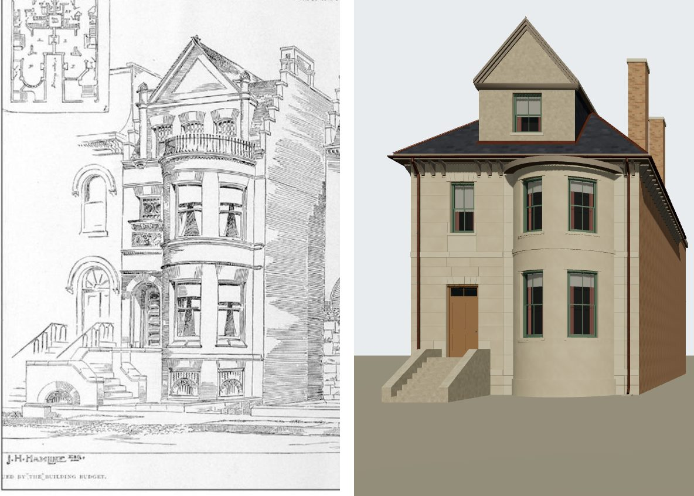

# 1619 Prairie (John H. Hamline) on K01, from its drawing — T-2420

Piece 1 of T-2419 (of T-1868). The district draft's grey box at 1619 Prairie becomes a K01
stone-front house built against the house's one picture, Treat & Foltz's pen perspective of the
Hamline and Farwell houses in *The Building Budget*, June 188- (probably 1886; source
`building_budget_1886_06_hamline_farwell_houses`), read against the 1911 Sanborn sheet 20, which
controls the plan. Liberty `L-k01-1619-hamline-swell-front-2420`.

## What the drawing shows of 1619

Read off the plate itself (`data/sources/assets/hamline_1619_drawing_t2420/`), the left-hand house,
lettered "J. H. Hamline Esq.":

- a narrow **north strip** holding a recessed round-arched entrance up a stoop, with a small ornate
  light over a carved panel at the second floor;
- a **full-height swell bay** rising from the raised basement (two segmental lights with iron
  grilles) through the principal and second storeys, two lights a storey either side of a pier,
  string courses at each floor, to a moulded cornice carrying a **balcony rail**;
- above it, set back on the wall, a **roof storey** of three short segment-headed lights under a
  steep **pedimented wall gable**, with a finial and two pinnacle shafts;
- a **slated roof** behind, and the **south side wall** in shade, its parapet stepping up from the
  front to a tall stack.

The plate's inset plan (`drawing-inset-plan-3x.jpg`, enlarged 3x from the display copy) settles
what the shaded panel south of the bow is: the two houses' plans stand either side of a passage
lettered "Driveway", so it is Hamline's south wall seen along that driveway, and the camera stands
in front of it.

## The camera

`data/reference_views/house_1619_prairie/building_budget_front.json`. Level and square to the front;
the bow's two edges (its 3.76 m chord on the sheet) give 46 px/m at the front's plane, which the
drawing's own floor bands agree with to about 10 %; the eye at 1.6 m, 20 m out, and 3.5 m south of
the south wall, in front of the driveway, the only place from which that wall shows as deep as the
drawing draws it. Residuals and their reasons are in its `solve`.

## Where the drawing and the sheet disagree, and what is built

| | drawing (1886 design) | 1911 sheet | built |
|---|---|---|---|
| front north of the bow | about 1.4 m (inset plan: about a third of the front) | 3.79 m | the sheet's |
| front south of the bow | not drawn | 0.91 m | the sheet's |
| storeys | two over a raised basement, a third in the roof under the gable | '4' | the drawing's |

The plan is the sheet's because it is the survey of what stood, 25 years after the design was
published, and the image gate's rule is that a later state is argued, not copied. The storey count
is the drawing's because the drawing shows nothing a fourth walled storey could be: the gable's
lights are about 0.9 m high against the second storey's 2.2 m, a roof storey's. The sheet's '4' is
left unexplained — it may count the raised basement and the roof storey, or the house may have been
raised after 1886 — and a photograph after 1886 decides it.

## Match record

`data/reference_views/house_1619_prairie/building_budget_front.match.json`, verdict **differs**:
massing, the bow's lights and the storey lines are `fixed` (the bow's edges within 3 px, its top
within 5 px, the bands within about 15 px); the wall gable, the stepped parapet and the stone
cornice are `open` for **T-2421**; the balcony rail, the arched entrance and carved panel, the side
stoop and the grilled basement arches are `open` for **T-2422**, which brings the record to
`matches`. The strip's width, the south pier, the storey count and colour are `not shown`, argued
above.

## What K01 could not do here, for the next pieces

- a front **wall gable** rising from the wall plane (K01's dormer sits on the hip and carries one
  sash; the K01 contract caps sash at 1.15 m wide and a hip at 45 degrees);
- a **bay that reaches the cornice**: K10 refuses a bay whose roof meets the wall above its bed
  moulding, which is why the second storey is 3.9 m and the bow stops at 8.2 m under a 9.2 m eave,
  where the drawing carries the bow to the cornice itself;
- a **stepped parapet** on a side wall, and a balcony rail on a bow's deck.
- **lights in a bay's basement**: the K08 kit's own gate (`tools/check_bay_kit.py`) refuses a
  window below a bay's clear wall (its plinth), so the bow's basement is blind until T-2422 teaches
  the kit the drawing's grilled segmental lights.
