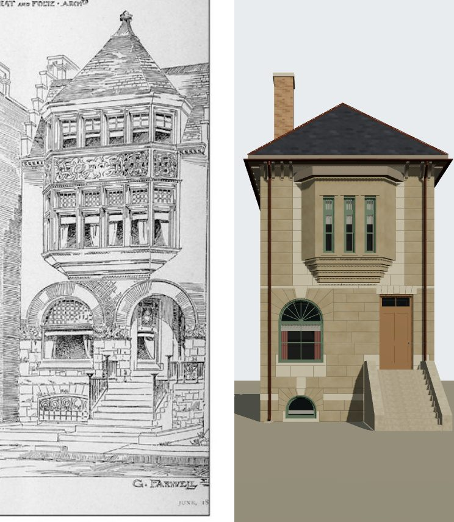

# 1623 Prairie (Granger Farwell) on K01, from its drawing — T-2433

Piece 2 of T-1869. Two questions: which number Granger Farwell's 1886 house stood at, and then its
front, built on the K01 frontage assembly against its one picture, Treat & Foltz's pen perspective of
the Hamline and Farwell houses in *The Building Budget*, June 188- (probably 1886; source
`building_budget_1886_06_hamline_farwell_houses`, the right-hand house, lettered "G. Farwell Esq."),
read against the 1911 Sanborn sheet 20, which controls the plan. Liberty
`L-k01-1623-farwell-oriel-front-2433`.

## Which number: 1623

| evidence | what it says | where |
|---|---|---|
| American Architect, 19 Sep and 3 Oct 1885 | "G. Farwell, two-st'y dwell., 1625 Prairie Ave." (one printing "1626", a misprint: even numbers are the west side); "J. H. Hamlin, two-st'y dwell., 1621 Prairie Ave." | Prairie library `dw-aabn-1885-hamlin-1621-farwell-1626-treat-foltz` |
| Inland Architect, Nov 1885 | "For Granger Farwell, at 1625 Prairie avenue, residence, cost $11,000" | `dw-inland-1885-11-farwell-1625-treat-foltz` |
| Chicago Tribune, 6 May 1889 | "H. J. McBirney, three-story dwelling No. 1627 Prairie avenue" | the library's note on `cgn-1625-mcbirney-inland-1890-copy` |
| Inland Architect plate, Jan 1890 | McBirney's new house, and at its left (north) the neighbour's two-storey oriel and round-arched entrance — Farwell's front as the drawing draws it | `cgn-1625-mcbirney-inland-1890-copy` (= `a16-inland-1890-hj-mcbirney-residence`) |
| 1904 Blue Book | Hugh J. McBirney at 1625; John H. Hamline at 1621 | `civic-bluebook-1904` (OCR) |
| 1911 Sanborn sheet 20 | 1621, 1623 and 1625 one attached group, 1621 sharing a light well with 1623; 1623 "3B brick dwelling", its front flat on the plan | `s20-1621-f`, `s20-1623-f`, `s20-1625-f` |

The 1890 photograph is the fixed point: whatever the numbers were, Farwell's house stood directly north
of McBirney's, and McBirney's is 1625 in 1904 and on the 1911 sheet. Its north neighbour on the sheet is
1623, so Farwell's house is **1623**. The printed numbers agree once they are read as one lot behind
1904's: in 1885 Farwell's lot was "1625" and Hamline's "1621", and in 1889 McBirney's was "1627" — each
two higher than the lot's 1904 number. The 1911 sheet agrees in form too: an oriel over an arched base
leaves no mark on a footprint, and 1623's front is flat on the plan, where 1621's has a curved bay.

**What this leaves open at 1619 and 1621, for the ticket that owns it.** Farwell's number does not
settle Hamline's, and the evidence on it is split. For **1619** (as T-2420 built it): the Inter Ocean's
"removed to their new residence, No. 1619 Prairie avenue" (18 Apr 1886), and the same two-lot offset
read on the 1885 permit's "1621"; and the lot between, 1621, could then be the drawing's driveway,
built on later against Farwell's north wall (the light well the sheet draws them sharing). For **1621**:
the 1904 Blue Book lists John H. Hamline there; the library records an 1891 report of J. Foster Rhodes
buying the 1619 lot to build; the sheet's '4' storeys at 1619 are the disagreement with the drawing
T-2420 could not reconcile, while 1621 is '3B' with a curved bay on the plan. Nothing at 1619 or 1621 is
changed here; the question is filed as its own ticket after this one.

**Settled by T-2439 (piece 1 of T-2436): Hamline's house was 1621**, on the permit, the 1886 occupant
map, the 1886 Robinson plate's printed '1621' on the first of the matched pair with 1623, and the 1904
Blue Book; so the 1885 numbers do NOT run uniformly one lot behind 1904's, and Farwell's "1625" is the
permit's own error for 1623 (`docs/RESEARCH/hamline-1621-2436/README.md`).

## What the drawing shows of Farwell's front

Read off the plate (`data/sources/assets/farwell_1623_drawing_t2433/building_budget_1623_panel.jpg`,
the plate's x 540-900, y 90-946, unscaled):

- a **rusticated stone base** in big rock-faced blocks, a raised basement with a broad segmental light
  behind an ornamental iron grille under the north bay;
- **two round arches** at the principal storey: the north one a broad window under a lattice transom, the
  south one the entrance, deep, up a straight stoop between iron rails and newels;
- over them, on **corbelling**, a **canted oriel** nearly the front's width: four tall transomed lights
  to its front and one to each cant at the second storey, a **carved frieze**, then an **upper stage** of
  shorter lights under a **steep conical roof** with a finial, its eave above the main cornice;
- the **main cornice**, moulded, at about 9.7 m south of the oriel; a **slated roof** behind; a tall,
  stepped **stack** on the north wall.

## The camera

`data/reference_views/house_1623_prairie/building_budget_front.json`. A plate has one station point, so
the camera keeps T-2420's for 1619 on the same plate: level and square to the front, f = 920 px (46 px/m
at a front 20 m off), the principal point at the plate's x 669, y 708. It is placed in 1623's own
frame: the eye 20 m in front of the stone face and 1.6 m up, and 1.88 m south of the north wall, which
puts the front's middle where the drawing does. Residuals and their reasons are in its `solve`.

## Match record

`data/reference_views/house_1623_prairie/building_budget_front.match.json`, verdict **differs**. Fixed:
the massing (the front's edges within about 7 px, the eave within 3), the raised basement and principal
floor, the arched window's sill and crown, the oriel's place and sill, the stoop
in the south bay, the slate and the stack. Open for **T-2435**: the oriel's width and depth, its lights (three to the front where the drawing has four, the cheeks blind), its frieze,
upper stage and cone; the entrance arch; the openings' places under the oriel; the basement grille; the
stoop's rails; the rock-faced blocks. Not shown: colour.

## What K01 could not do here, for T-2435

- **an opening under a street-front oriel.** The assembly (`generators/archetypes/k01_frontage.py`,
  the K08 bay loop) refuses any opening whose centre falls inside a bay's span and whose sill is below
  the bay's roof — right for a bay on grade, wrong for an oriel standing over the arches. The parameter
  module already skips openings whose heads clear the corbelling; the assembly does not. So the oriel
  stands between the window's and the door's centres, 3.38 m at the wall against the drawing's 4.8 m.
  Teaching it changes `k01_frontage.py`, which every K01 GLB hashes — Glessner's included — so it waits
  on the Glessner occlusion atlas (T-2431) and a K01 rebake.
- **an oriel through the eave.** K01 keeps an oriel's top a metre under the main eave; Farwell's upper
  stage and its cone rise past the cornice.
- **a deep oriel low on the front.** Four 0.2 m corbel courses fit between the second floor and the
  door's head, and K08's oversail rule lets four carry 0.5 m.
- **an arched entrance.** The K07 door is flat-headed; the named-opening front lays arched windows only.
- **a two-bay named-opening front.** `street_front_openings` builds three bays entered in the middle,
  so a blank third bay stands at the south corner.
