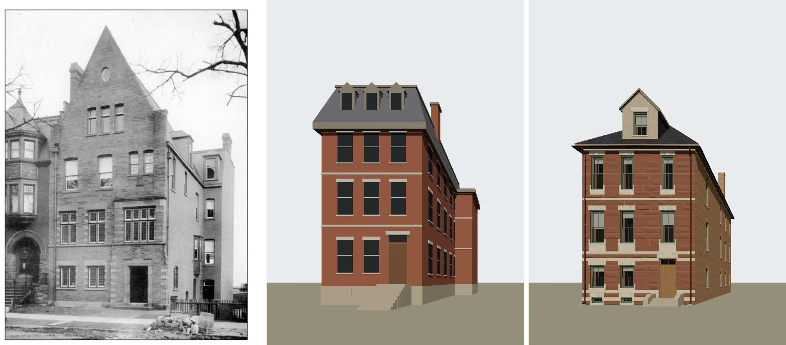
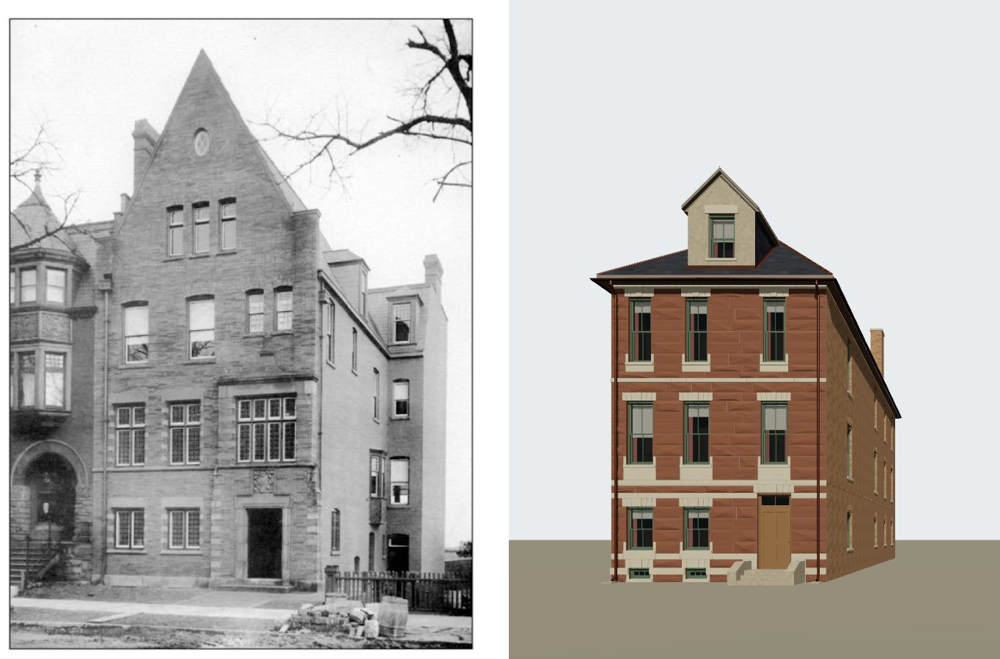
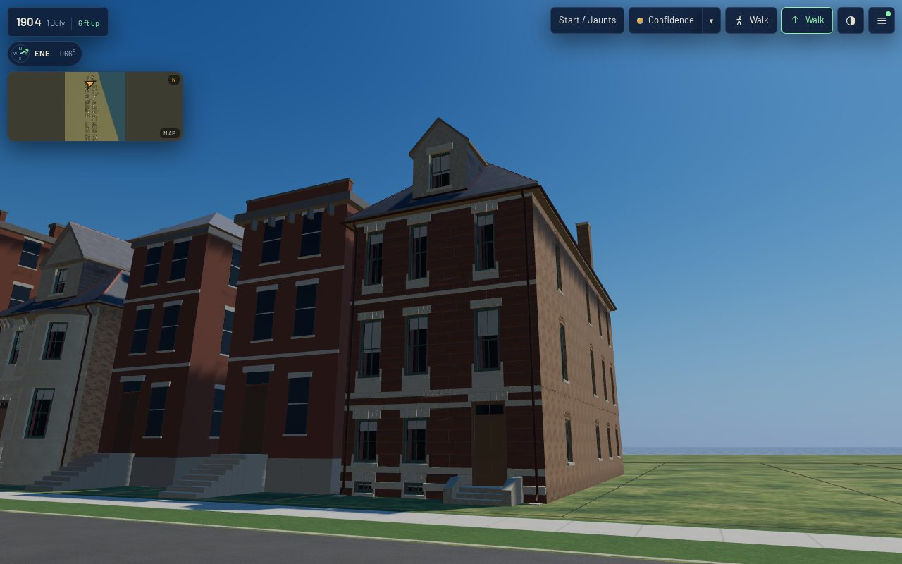

# 1625 Prairie (Hugh J. McBirney) on K01, from its photograph — T-2432

Piece 1 of T-1869 (1621, 1623 and 1625, the attached group of sheet 20). The district draft's box
at 1625 Prairie becomes a K01 stone-front house built against the house's one picture: the
photograph of the newly finished house that The Inland Architect published in January 1890,
"Residence for Hugh J. McBirney, Chicago" by Burling & Whitehouse (source
`inland_architect_1890_01_mcbirney_residence`; credited copy in
`data/sources/assets/mcbirney_1625_photo_t2432/`), read against the 1911 Sanborn sheet 20, which
controls the plan. Liberty `L-k01-1625-mcbirney-tudor-2432`.

## What the photograph shows of 1625

Read off the plate itself, at 2x:

- a narrow street front of **rock-faced coursed stone**, three storeys and an attic, its **ground
  floor near grade** (two low steps to the door; the Tribune's "entrance at ground level", which
  chicagology quotes);
- the **north part two windows wide**: ground- and first-floor windows of two leaded lights under a
  transom, mullioned, in dressed quoined surrounds; single one-over-one sash under segmental heads
  on the second floor;
- the **south part a shallow frontispiece**: the flat-headed entrance under a carved panel, a
  four-light mullioned and transomed window over it under a hood mould, two narrow segment-headed
  lights above;
- the whole front carried up as a **steep coped wall gable** (about 57 degrees, apex about 18.8 m)
  with three segment-headed attic lights and an **oculus**; a tall stack on the north party wall;
- the **south side wall in brick** with single windows, and behind it the **four-storey rear
  section** stepping out to the south under a mansard with a dormer and a stack;
- at the left edge, the **Farwell house's oriel and arched entrance** adjoining it on the north —
  the right-hand house of Treat & Foltz's 1886 drawing, which T-2433 placed at 1623.

## The camera

`data/reference_views/house_1625_prairie/inland_architect_front.json`: level and square to the
front, 38.6 px/m at its plane (the front's two edges are the sheet's 7.6 m), the eye 17.45 m out
and 4.6 m south of the south wall, fitted to how far the south wall recedes. Its `solve` gives the
readings and how far each can be trusted.

## What is built, and what is not

| | photograph (1889) | 1911 sheet | built |
|---|---|---|---|
| front width | 7.6 m (scale) | 7.6 m (trace) | 7.6 m (the draft's fit had stopped at 6.75 m) |
| storeys | three and an attic in the gable | '3½B' | three; the attic lit by a dormer |
| ground floor | near grade | — | 0.45 m, three risers |
| floors | about 3.6, 7.2, 11.0 m | — | 3.6, 7.2, 11.0 m |
| roof | steep front wall gable, side eave about 13 m | — | 45-degree slate hip, eave 11.0 m |
| rear section | stepping out south, mansard | 4 storeys, 1.3 m wider over the rear 7.6 m | not built |

K01 cannot yet raise a front as a wall gable: its hip is capped at 45 degrees, and a dormer may not
rise past the hip's ridge, 3.8 m over the eave on a 7.6 m front, where the photograph's gable
rises about 7.7 m. So a single pedimented dormer stands on the front's centre line, its light at
the gable lights' height. T-2428 (PR #749, in review) teaches K01 a wall gable for 1619; T-2435
uses it here. K01's rear wings stand only behind a main body and inside its width, so the rear
section that steps out to the south is not built either, where the draft had stood it.

## Match record

`data/reference_views/house_1625_prairie/inland_architect_front.match.json`, verdict **differs**:
massing, storey lines, the north part's windows and the entrance are `fixed` (front edges within
3 px, sills and heads within about 5 px); the wall gable, the side eave, the windows' kind, the
frontispiece, the base, the front stack and the rear section are `open` for **T-2435**; the fence
and colour are `not shown`.

## In the app (`tools/qa_k01_t2432.mjs`)

The actual published `/1904/` app at 1280x800, full detail: ready in 24.6 s, JS heap 33.4 MB,
zero page errors and no failed requests, every stand inside the frame budget (165-228 draw calls,
2.0-3.6 M triangles; software GL, a relative reading). `after-desktop-*.jpg` are the five stands
(front, the photograph's own spot, oblique from the north walk, rear, roof);
`browser-validation-after-desktop.json` holds the readings. The 390x780 viewport is gated by the
renderer smoke for this diff; the stand set was not re-shot on it in this run.

