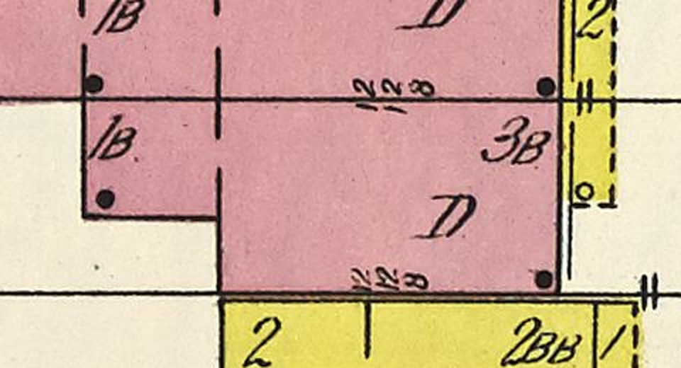

# 1628 Prairie's '1B' rear piece on K01's rear wings (T-2391)

Carried out of T-2347. T-2355 stood 1628's main body on K01 and could not keep the draft's wing,
because the draft builder skips a whole traced building or none of it. This piece stands the wing
again, on the rear wings K01 learned for 1604 (T-2343) and used for 1616 (T-2354) and 1634
(T-2347). The K01 generator is unchanged. The work is in the record.

*Sanborn 1911 vol. 3 sheet 20, raster px 2740-3220 × 2880-3140, enlarged 2×. 1628 is the lower
of the two pink houses: its main body is the large block lettered `3B` and `D`, and its rear piece
is the small block lettered `1B` at the upper left. The street (east) is to the right, and the line
across the top third is the party line with 1626, whose own `1B` piece stands against 1628's on the
far side of it. The yellow `2` / `2BB` below is 1630.*

## What the sheet says, and what the draft had

| piece | sheet | census | built as | u (m) | v (m) |
|---|---|---|---|---|---|
| main body | `3B` | s20-1628-f | K01 main body (T-2355) | 0 to 12.25 | 0 to 6.0 |
| rear piece | `1B` | s20-1628-a1, '1B brick rear piece' | wing `rear_piece` | -4.75 to 0 | 1.95 to 6.0 |

Measured in the record's own frame, through the T-1250 fit and the T-2328 trace (`s20fp-1628-b1`
p2, read with `tools/draft_prairie_1904.py`'s `lot_frame`/`to_uv` and the record's origin at lot
u 33.75, v -2.75). The trace's outer (west) wall of the piece is at u -4.75 to -4.81, and its south
wall at v 1.93 to 1.94. Its north wall is on the party line at v 6.2, and it is built flush with the
main body's north wall at v 6.0, because K01's wing rule refuses a wing past its host wall and the
main body was fitted 6.0 m wide (T-2355).

**The draft was wrong about the storeys.** It drew the piece (its `r2`, u -4.5 to 0, v 2.0 to
6.25) as THREE storeys, its rules' count for a wing inside the main part, and T-2355's notes
carried "three storeys" forward. The sheet letters the piece `1B` and the census row says '1B
brick rear piece': one storey over a basement. The ticket asked for the census row to be read
before trusting the draft, and the row settles it.

## Built

- `rear_piece`: one storey over the basement. Its floor is the main body's principal floor
  (1.4 m), and its storey is the main body's first (4.0 m), so its deck, a flat painted-tin
  deck on a 0.3 m fascia with a 0.15 m overhang, stands at 5.7 m. That is under the main body's
  second-storey sills at 6.15 m. It has two K06 sash in its south wall over 1630's side yard and one
  in its rear wall. Its north wall is blank, because it is the party wall with 1626's piece.
- The main rear wall's northern window (s 1.0 m) is behind the piece on the principal storey and is
  not cut there (`_rear_wings` drops it). That is the opening into the piece. On the two upper storeys
  it is a window above the deck.
- **Two things on the main body moved to make room, both reconstructed:** the southern rear window
  went from s 4.1 to s 5.1, because at 4.1 its head straddled the piece's south wall (s 4.05),
  which K01 refuses. It now stands in the 1.95 m of wall south of the piece, 0.9 m in from the
  south corner, as the northern one is 1.0 m in from the north. The north rear downpipe moved off the corner the piece
  now stands against to s 4.25, just south of it, as T-2354 moved 1616's.
- The dot the sheet prints in the piece's south-west corner is not modelled.

## After, the same stands (`tools/qa_k01_t2391.mjs`)

Actual published `/1904/` app, this branch. Desktop 1280×800 at full detail, phone 390×780 at
light. Stands: the yard behind the piece, from above the yards to the south-west, and the roof
(the air). Both runs had 0 page errors and 0 failed requests, and every stand was `withinBudget`.

| | load to ready | JS heap | draw calls | triangles |
|---|---|---|---|---|
| desktop | 21.7 s | 31.7 MB | 152-166 | 2.01-3.21 M |
| phone | 10.5 s | 31.7 MB | 110-152 | 524-883 k |

The master grows from 2.56 MB to 2.67 MB, and the web derivative from 0.94 MB to 0.99 MB. Frame
times and load come from software GL on the runner, so they are a relative reading.

## Limits

- No photograph, print or drawing of 1628 or the pair is known (T-2355's search), so there is no
  image gate. Every form but the piece's place, size, storey count and brick is the kit's.
- 1626's own `1B` piece is not built here. 1626 is T-2356's.
