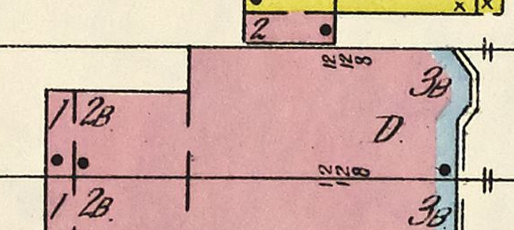

# 1634 Prairie's rear wing and its one-storey end on K01's rear wings (T-2347)

Piece 2 of T-1863. T-2350 stood 1634's main body on K01 under a flat roof and could not keep the
draft's wing: the draft builder skips a whole traced building or none of it. This piece stands the
wing again, on the rear wings K01 learned for 1604 (T-2343) and used for 1616 (T-2354). The K01
generator is unchanged; the work is in the record.

*Sanborn 1911 vol. 3 sheet 20, raster px 2620-3200 × 3200-3460, enlarged 2×. 1634 is the upper
house. The street (east) is to the right, and the party line with 1636 is the lower lot line.*

## What the sheet says, and what the draft had

| piece | sheet | census | built as | u (m) | v (m) |
|---|---|---|---|---|---|
| main body | `3B`, stone front | s20-1634-f | K01 main body (T-2350) | 0 to 13.75 | 0 to 6.75 |
| rear wing | `2B` | s20-1634-a1, '2B brick rear wing with a 1-storey end' | wing `rear_wing` | -6.7 to 0 | 0 to 4.25 |
| its end | `1`, behind a drawn cross wall | the same row's '1-storey end' | wing `one_storey_end` | -8.2 to -6.7 | 0 to 4.25 |

Measured in the record's own frame, through the T-1250 fit and the T-2328 trace (`s20fp-1634-b1`
p2 and p3, read with `tools/draft_prairie_1904.py`'s `lot_frame`/`to_uv`). The trace's north edge
of the wing is at v 4.2-4.3. The cross wall is at about raster px 2702, 1.5 m in from the rear
line at px 2672 (about 19.7 px/m along this lot).

**The draft was wrong about the storeys.** It drew the wing (its `r2`, u -6.5 to 0) as THREE
storeys under a hip. Its rules give a wing inside the main part the main part's storey count. The
sheet letters the wing `2B` and its end `1`, and the census row says the same, so the ticket's
"three storeys like the main body" was the draft's number and not the map's. That also means the
deck no longer has to squeeze under the main roof. At two storeys the wing's deck is at 9.3 m,
well under the main rear wall's head (soffit about 12.08 m), and the main body's third-storey rear
windows stand above it.

## Built

- `rear_wing`: two storeys over the basement. Its floors are the main body's first two (1.4 m and
  5.4 m, 4.0 m and 3.6 m storeys), so the string course runs on at one course. It has K06 sash two a
  storey in its north wall (over 1630's side yard) and one in its rear wall above the end. The
  south wall is a blank party wall. The flat painted-tin deck sits on a 0.3 m fascia with a 0.15 m
  overhang.
- `one_storey_end`: one storey from near grade (floor 0.3 m, 3.0 m storey), standing on the wing's
  rear wall. It has one window in its rear wall and its own lower deck. Its north wall is 1.5 m long,
  too short for a K06 sash inside K01's 0.3 m corner rule, so it is blank.
- The main rear wall's southern window (s 4.6 m) is behind the wing on the two lower storeys and
  is not cut there (`_rear_wings` drops it). On the third storey it stands above the wing's deck.
- The two dots the sheet prints in the end are not modelled.

## The party line, not resolved here

The sheet stands the wing, like the whole house, on the party line with 1636 at v -0.7. K01 fitted
the main body's south wall 0.7 m inside that line (T-2350), and T-2348's finding is that the pair
shows a slot between two blank party walls as a result. The wing is built flush with the main
body's south wall (v 0), not on the line. K01's wing rule refuses a wing past its host wall, and
house and wing should keep one south wall. Moving the main body onto the line moves its origin,
which `tools/draft_prairie_1904.py --check` re-derives from the trace. That is the pair's question
(with the front line at u 15.3 against 13.75), and it is filed as T-2392. When it moves,
the wing moves with it, since its rect is in the record's frame.

## After, the same stands (`tools/qa_k01_t2347.mjs`)

Actual published `/1904/` app, this branch. Desktop 1280×800 at full detail, phone 390×780 at
light. Stands: the yard behind the wing, 1630's side yard to the north, oblique from above the yards
to the north-west, and the roof (the air). Both runs had 0 page errors and 0 failed requests, and
every stand was `withinBudget`.

| | load to ready | JS heap | draw calls | triangles |
|---|---|---|---|---|
| desktop | 29.0 s | 31.2 MB | 124-151 | 1.88-3.22 M |
| phone | 17.3 s | 31.2 MB | 90-109 | 465-666 k |

The master grows from 3.40 MB to 3.62 MB, and the web derivative from 1.48 MB to 1.55 MB. Frame
times and load come from software GL on the runner, so they are a relative reading.

## Limits

- No photograph, print or drawing of 1634 or the pair is known (T-2350's search of the Prairie
  library), so there is no image gate. Every form but the wing's place, size, storeys and brick is
  the kit's.
- 1628's wing, which T-2355 left waiting on this ticket, is not built here. It is T-2391.
