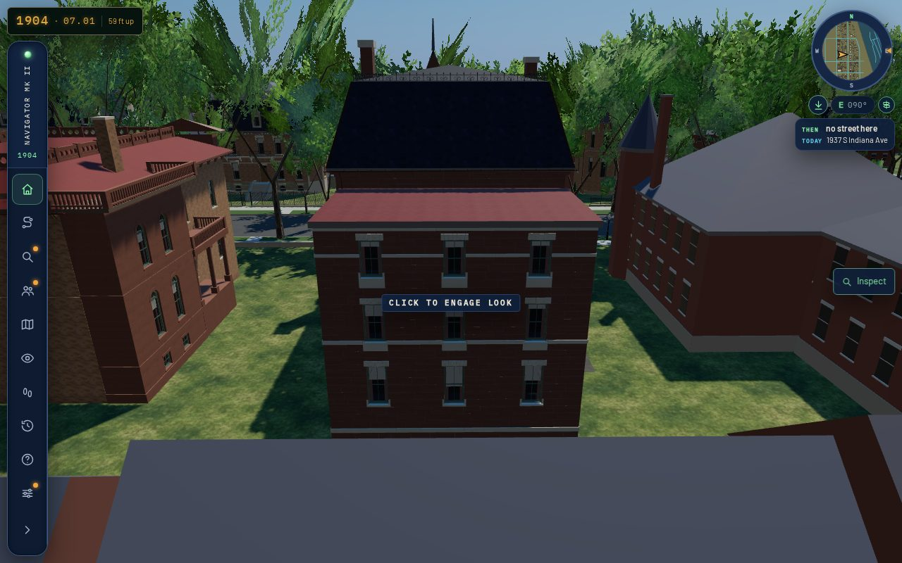
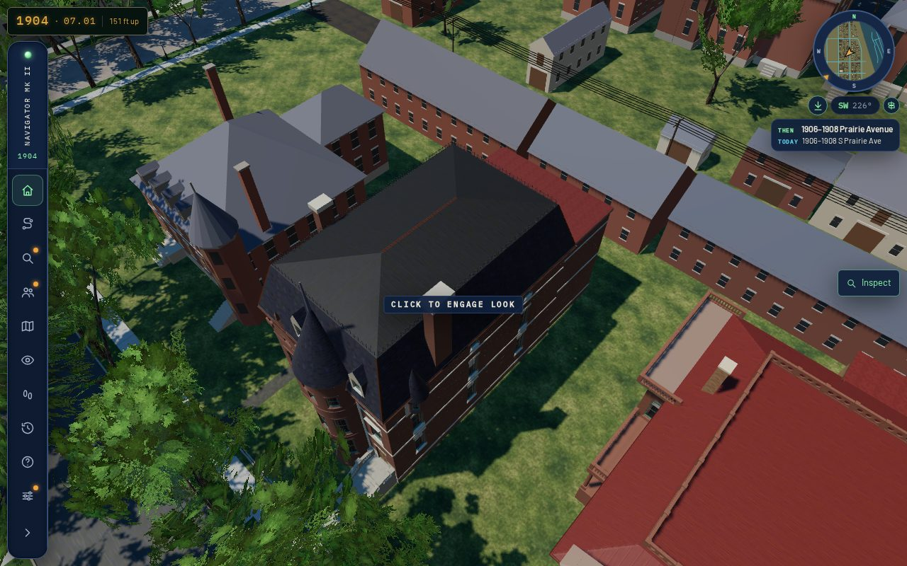
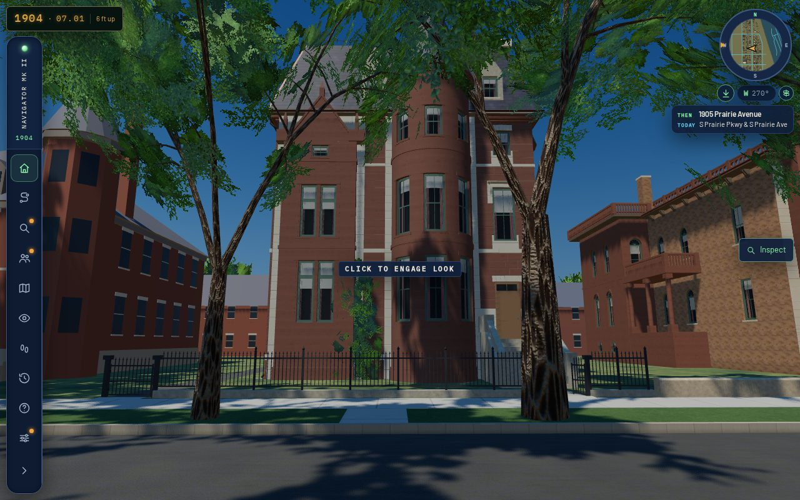

# 1912 Prairie — the rear and roof faces, and the browser views T-1899 asks for (T-3291)

Piece 2 of 2 of T-3288, which is piece 2 of T-3278, which is piece 2 of T-1899 (the
Moulton/Lowden house's envelope). T-3290 built the north flank's corner turret. This piece
covers the rest of T-1899's acceptance item 3: *"Verify the actual browser result with
repeatable front, oblique, rear and roof views, including 1280×800 desktop and 390×780
mobile. Record scene load, texture/mesh and draw/frame costs; fix visible defects before
closure."* It also covers the rear and roof faces T-3288 named.

**Acceptance, as stated before the work:** the actual published `/1904/` app, shot from
repeatable front, oblique (both walks), rear and roof stands at 1280×800 full and 390×780
light. The run needs zero page errors and zero failed requests, and every stand inside the
renderer's frame budget. Load, JS heap, the house's GLB bytes, triangles, draw calls,
textures and frame time are recorded. The rear and roof faces must read as one coherent
envelope from those stands, and any visible defect is fixed or named.

## The rear and roof faces: what stands, and why nothing was changed

No picture shows 1912's rear or roof: not the photograph, not the 1883 plate, not the
elevations drawing. So this piece's question is whether the faces T-3277 reconstructed read
as a coherent house from behind and from above, not whether they match a picture. Their
liberty is `L-k01-1912-moulton-3277`, which covers `form.rear_bays`, `form.roof_pitch_deg`
and `form.service_wall_brick`. They do read that way:

- **Roof.** K05's convex mansard runs on all four faces of the front block: a 72° lower
  face 4.5 m high, from the moulded stone cornice to a 10° deck behind iron cresting. The
  street face carries the two gabled dormers read off the photograph. The rear and the two
  flanks are plain slate, and no picture argues for dormers there. Both stone stacks clear
  the roof: the north one off the flank behind the corner block (the photograph's) and the
  south one on the sheet's chimney breast. The corner turret's cone and the tower's cone
  stand clear of the mansard (`after-desktop-roof.jpg`, `after-mobile-roof.jpg`).
- **Rear.** The sheet's two brick ranges (`rear3B`) stand as one three-storey brick wing
  across 12.7 m of the block's 13.0 m rear wall. It has a flat painted-tin roof with its
  deck at 12.05 m, three lights a storey on its rear face and one on its south face. The
  block's own rear wall shows only its top 1.2 m of brick over that deck, under the cornice.
  K01 drops a host light whose sill stands under a wing's deck, so the record's one rear
  column (s 3.0) stands wholly behind the wing at every storey. No light is buried in the
  wing or cut by its roof (`generators/archetypes/k01_frontage_params.py`, the rear-wing junction rule). Seen
  square on from over the alley, the wing, the cornice strip, the rear slate face, the
  cresting and both stacks stack up without a gap or a collision (`after-desktop-rear.jpg`).
  Seen from the north-west, the north flank runs back into the wing at its 0.3 m inset
  (`after-desktop-rear-alley.jpg`).

No visible defect was found on these faces, so no geometry or record changed and nothing
was rebaked. The front's open differences in the three match records (dormers, south gable,
entrance, tower top, finial, ivy and the turret's 0.55 m) stay with **T-1900**, whose
image gate closes the building.

## In the app (`tools/qa_k01_t3291.mjs`)

The actual published `/1904/` app, normal boot, animation held after readiness:

| viewport | detail | ready | JS heap (after GC) | page errors | failed requests |
|---|---|---|---|---|---|
| 1280×800 | full | 64.9-65.0 s | 83.5-83.6 MB | 0 | 0 |
| 390×780 | light | 41.8 s | 109.4-109.7 MB | 0 | 0 |

The house's payload is one GLB: `moulton_lowden_house_1912_prairie__as_mapped_1904.glb`,
1,707,520 bytes (meshopt + basisu). It holds 128,570 triangles in 23 primitives, with 23
materials and 15 textures. The coach house's draft GLB is 18,960 bytes and 920 triangles.
The two together are 1,726,480 bytes, as the 390×780 street run read off the wire. The
earlier runs read 0 because the harness's server sent no Content-Length; it does now.

| viewport | stand | draw calls | renderer calls | triangles | textures | frame (median) | in budget |
|---|---|---|---|---|---|---|---|
| desktop | front | 3995 | 112 | 1.19 M | 1055 | 8.2 s | yes |
| desktop | oblique-south | 5425 | 479 | 4.36 M | 1266 | 13.1 s | yes |
| desktop | oblique-north | 5420 | 114 | 1.27 M | 1276 | 9.1 s | yes |
| desktop | rear | 2458 | 237 | 2.00 M | 1128 | 10.4 s | yes |
| desktop | rear-alley | 3519 | 205 | 1.94 M | 1194 | 10.0 s | yes |
| desktop | roof | 1867 | 130 | 1.17 M | 1194 | 5.8 s | yes |
| mobile | front | 1367 | 95 | 0.53 M | 1380 | 2.1 s | yes |
| mobile | oblique-south | 2893 | 210 | 0.84 M | 1436 | 2.4 s | yes |
| mobile | oblique-north | 1560 | 91 | 0.52 M | 1442 | 2.2 s | yes |
| mobile | rear | 2106 | 166 | 0.85 M | 1378 | 2.5 s | yes |
| mobile | rear-alley | 2354 | 128 | 0.71 M | 1400 | 2.4 s | yes |
| mobile | roof | 1645 | 108 | 0.65 M | 1406 | 2.4 s | yes |

Frame times come from this runner's software GL (SwiftShader). Each is the median of five
renders, each waited on with a one-pixel read. They compare stands with each other; they
are not a claim about any device. "In budget" is the renderer's own `stats().withinBudget`.
`browser-validation-after-*.json` hold every reading.

### The stands (scene-local metres: east, north, height above the ground there)

The front block stands at e 1365.8-1386.2, n -3401.1 to -3388.1. Its rear ranges reach back
to e 1358.4, and the coach house stands across the yard at e 1341.0-1350.3. Following
T-3290's notes, the street stands are on the avenue's roadway rather than 30 m out, which
lands in the opposite yard behind its fence and trees. Every raised stand is a fly
teleport.

| stand | eye | target |
|---|---|---|
| front | 1409, -3394.6, 1.7 | 1376, -3394.6, 8 |
| oblique-south | 1399, -3418, 1.7 | 1378, -3396, 6 |
| oblique-north | 1405, -3373, 1.7 | 1378, -3393, 7 |
| rear | 1335, -3394.6, 18 | 1364, -3394.6, 7 |
| rear-alley | 1334, -3376, 14 | 1362, -3396, 8 |
| roof | 1394, -3374, 46 | 1372, -3395, 8 |

The harness runs by parts so each part fits one 600 s foreground command:
`QA_VIEWPORT=desktop|mobile QA_PART=a|b node tools/qa_k01_t3291.mjs` after
`tools/publish.sh`. Measured on this runner, a desktop part took 301-343 s and a mobile part
107-112 s. A desktop part with twelve timed frames a stand took 567 s, which is why five
are timed now.

