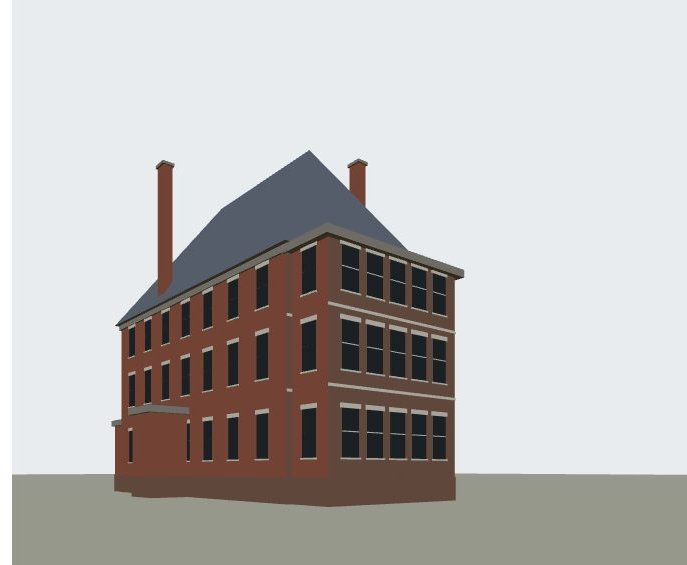
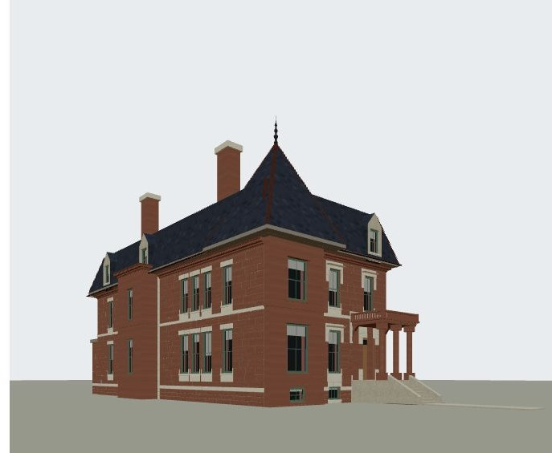
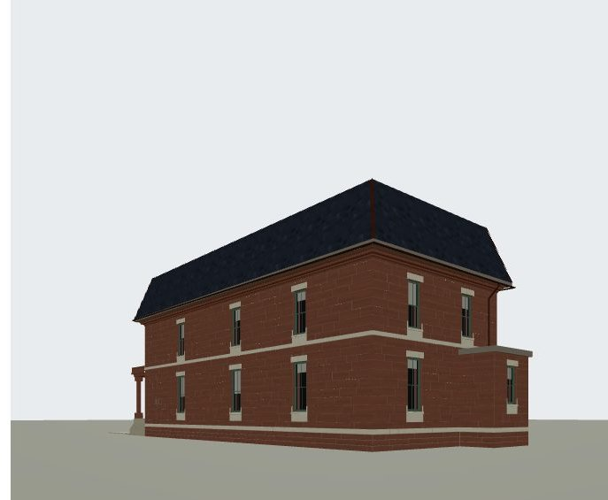

# T-3790 — 2008 Calumet, the Hanford house, on K01 from the 1911 sheet and the 1883 Inland Architect plate

Piece 1 of T-1940 (the X02 package of the T-1837 programme; piece 2, T-3791, solves the plate's camera, works the
photo-match down and carries the parent's image gate). The district draft (T-2982) is refined in place, under its own
id (`hanford_house_2008_calumet`), onto the K01 frontage assembly (`generators/k01_emit.py`), on the pattern of 1827
Prairie's Doane house (a steep mansard with a pavilion under a pointed hip crown); liberty `L-k01-2008-calumet-3790`.
The alley coach house (`hanford_house_2008_calumet_coach_house`) is untouched.

## What was read

**The 1911 Sanborn sheet 35** (`chicago/reference/prairie-avenue/sanborn-1911-and-robinson-1886/sanborn_1911_vol3_sheet_35.jpg`),
read at full size by classifying pixels (pink brick, blue stone, outline) along rows 390-471 and columns 1295-1455
(0.1859 m a pixel; the committed trace `data/traces/prairie_1904_footprints_s35x.json`, building `s35xfp-calumet_2008-b1`).
Plan frame: u from the main rear wall toward Calumet (east), v from the south wall (north is +v).

| reading | raster (column / row) | plan (u, v) |
|---|---|---|
| Calumet front, outer face of the stone band | column 1438 | u 24.1 (the trace's 10.35 m behind the street line) |
| main body's rear wall | column 1303-1305 | u 0 (the draft's) |
| south wall / north wall | rows 456.5 / 400.5 | v 0 / 10.4 (the draft's 10.5 kept) |
| stone along the south flank | rows 458-462 | the flank faced in stone, as the front |
| stone projection on the south flank (p4) | columns 1350-1374, rows 458-467, corners cut | u 7.6-11.9, about 1.2-1.7 m out: **built square** |
| projection across the front's south-east corner | columns 1438-1447, rows 447-463 | about 1.7 m proud over 3 m: **not built** |
| small brick projection on the north flank | columns 1372-1405, rows 393-400 | u 11.8-17.9, 1.3 m out: **not built** |
| one-storey brick range at the rear (p6) | columns 1298-1308, rows 434-459 | u -2.0-0, v 0.25-3.75 (the draft's r3) |

**The plate** (`data/sources/inland_architect_1883_12_hanford_plate.json`): Paul C. Lautrup's pen perspective of
Jaffray & Scott's design, The Inland Architect and Builder, December 1883, p. 147, printed sideways; drawn from the
south-east, the Calumet front on the right, the south flank on the left. Read at the front's 10.5 m width (the front's
three bays measure about 200, 140 and 180 px on the rotated crop, so about 4.05, 2.8 and 3.6 m):

- two storeys over a rusticated basement, about equal in height, and a third storey in a steep slated roof;
- a corner pavilion at the front's south end, stepped forward, one wide light a storey, under a tall pointed hip roof
  with an iron finial;
- a window bay; then the entrance bay behind a porch of round columns with an entablature and a balustraded balcony,
  its stoop running north along the front;
- moulded hoods over the front's lights, a moulded stone cornice round the front and the south flank;
- gabled stone dormers: one on the street face over the entrance bay, two on the south face;
- on the south flank: a round oriel on corbels at the chamber storey, a projecting bay further back under a gabled
  dormer, two tall panelled stacks (behind the pavilion, and over the projecting bay).

The Glessner House blog's engraving (`a20-glessner-hanford-engraving`) is the same drawing, cropped. Simmerling's
1953 demolition painting (`a20-ghm-simmerling-hanford-demolition-1953`) is later evidence and was not built from.

## Built

| draft, front from the south-east | built, front from the south-east | built, rear from the north-west |
|---|---|---|
|  |  |  |

A render from a throwaway review camera placed by eye beside the plate (not committed: the camera is not solved,
and T-3791 solves the real one) shows the plate's forms in place: the pointed roof over the corner pavilion, the
steep roof and its dormers, the columned porch and balcony at the north end, the two south stacks.

## Not built, or built otherwise (recorded in the liberty)

- the round oriel on the south flank's chamber storey;
- the sheet's projection across the front's south-east corner, and the north flank's small brick projection;
- the south flank's projecting bay is built square and flat-topped, where the sheet cuts its corners;
- the stoop runs straight out to the walk: K01's side stoop refuses a flight whose foot passes the front's corner,
  which is where the plate's runs;
- the north flank and the rear are laid in the front's stone (K01's all-stone house), where the sheet draws brick;
- the pavilion's quoins, the stacks' panels, the pavilion's own dormer and the rear gable's triple lights.

## Checks

The kit refused the first builds seven times, each fixed in the record: the front wall's thickness (K01's 0.45 m
ceiling), the porch's columns on its terraces (in the front's own s), the stacks inside the south wall, the pavilion
stopped at the crown's soffit (9.0 m), the crown's end clear of the main curb (pitches 64/65 degrees, a 0.9 m eave),
the south dormer clear of the west stack, and the porch's soffit under the balcony window.
