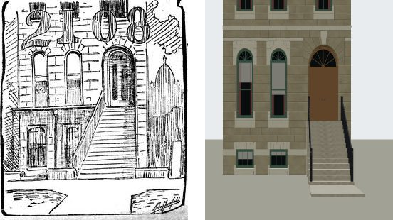

# T-3667 — 2108 Prairie on K01: the Mark Kimball house

Piece 1 of T-1921 (the S11 package of the T-1837 programme: 2108 and 2112). The district draft (T-2351)
is refined in place, under its own id (`mark_kimball_house_2108_prairie`), onto the K01 frontage assembly
(`generators/k01_emit.py`); liberty `L-k01-2108-kimball-3667`. The coach house 2108 shared with 2110 on the
alley (`mark_kimball_house_2108_prairie_coach_house`) is T-1937's and is untouched. Not W. W. Kimball's house
at 1801.

## The pictures

| picture | what it shows | how it is used |
|---|---|---|
| Chicago Tribune, 9 January 1898, the strip's 2108 vignette (`cgs-tribune-1898-01-09-death-strip`; source `chicago_tribune_1898_01_09_residence_district`, public domain) | the front square-on: three bays, two tall round-headed lights and a round-arched double door at the north end, radiating voussoirs over all three, the parlour floor's ledge, a basement storey with two tall barred lights, the straight stoop square out from the door with its south rail, and an open walk before it (no fence) | the image-gate camera, `data/reference_views/mark_kimball_house_2108_prairie/tribune_1898_front.json`, and its match record |
| the 2100 block looking north-west, early 1890s (`a20-glessner-2100-block-west-side-1890s`; source `glessner_blog_2100_block_looking_nw_1890s`, rights unresolved: forms only) | 2108 between 2110's curved bay and 2100's brick: a pale coursed-ashlar front, the round-arched door with a man in it, a round-headed light south of it, two square-headed upper lights, a railed landing and the stoop's two iron rails | the front's stone, the upper lights' heads and the rails (cross-check; no camera) |
| the Rees coach house, 2014 (`a20-glessner-rees-coach-house-2014`) | the alley coach house 2108 and 2110 shared, not the house | ruled out for this structure in `data/structure_grades.json` |

**Brick or stone?** The 1911 sheet colours 2108 pink (brick) and marks no stone front, where it marks 2110's
next door. The draft kept the sheet's brick and left the choice to T-1921 (its frontage note: "The to-let
notice calls it a stone front and the sheet colours it brick"). Both pictures show a stone front, so the
street face is K02 limestone and the party walls and rear stay the sheet's brick.

## What was read off sheet 35

Sheet 35 of the 1911 Sanborn, read at full size with dark-line profiles, carried into the lot frame through
the committed trace's affine fit (`data/traces/prairie_1904_footprints_s35.json`, 0.186 m a pixel) and
`draft_prairie_1904.lot_frame` (u toward the street, v north on this side).

| reading | raster (column / row) | lot frame |
|---|---|---|
| north lot line | row 1121 | v 3.94 |
| main body's north wall (and the rear range's) | row 1124 | v 3.35 |
| main body's south wall, on the lot line with 2110 | row 1162.5 | v -3.8 |
| front | column 730 | u 47.35 (7.27 m behind the 1904 street line, u 54.62) |
| main body's rear wall | column 663.5 | u 35.0 |
| rear range's south wall | row 1149.5 | v -1.34 |
| rear range's rear wall (its corners chamfered about 1.2 m) | column 614.5 | u 25.9 |

So the main body is 12.35 x 7.15 m (the draft's largest rectangle had 12.25 x 5.5 m) and the '2B' rear
range 9.1 x 4.7 m against the north wall.

## The match

`node tools/photo_match.mjs data/reference_views/mark_kimball_house_2108_prairie/tribune_1898_front.json`
renders the GLB through the cut's camera: the front's edges at x 25 and 205 px, the lights' centres at
x 56 and 103.5 and the door's at 166 against the cut's 167, the lights' heads at y 68 against 71 and the
door's crown at y 63. The cut is a sketch drawn tall (its pixel aspect 0.743, where the 2035 panel of
the same strip is drawn wide), so its heights are read as which storey a thing stands in. Verdict
`differs`, one item open: the basement lights, which K02's base courses hold to 0.8 m where the cut draws
them about twice that, and without the cut's bars. The image gate stays on T-1921 and is asked by its
last piece (T-3668, 2112).

