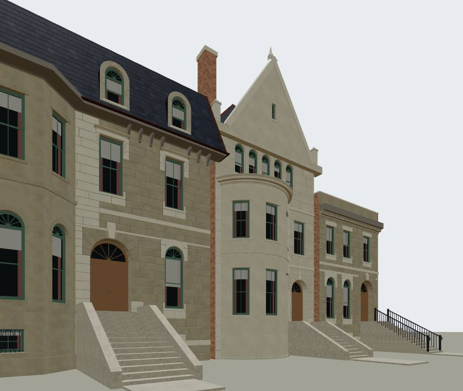
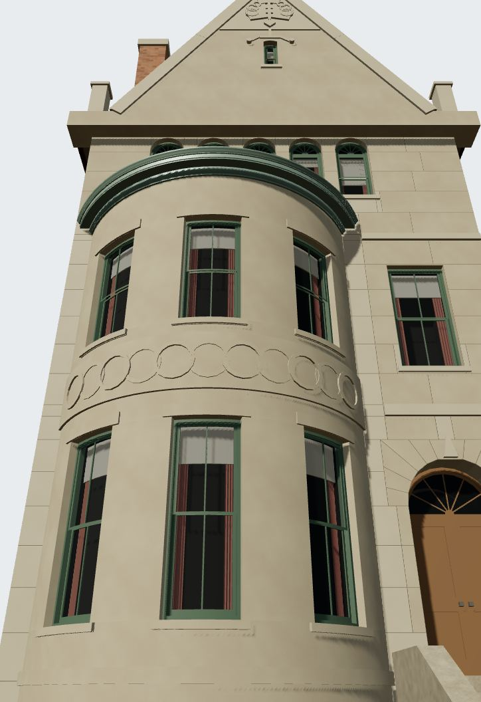
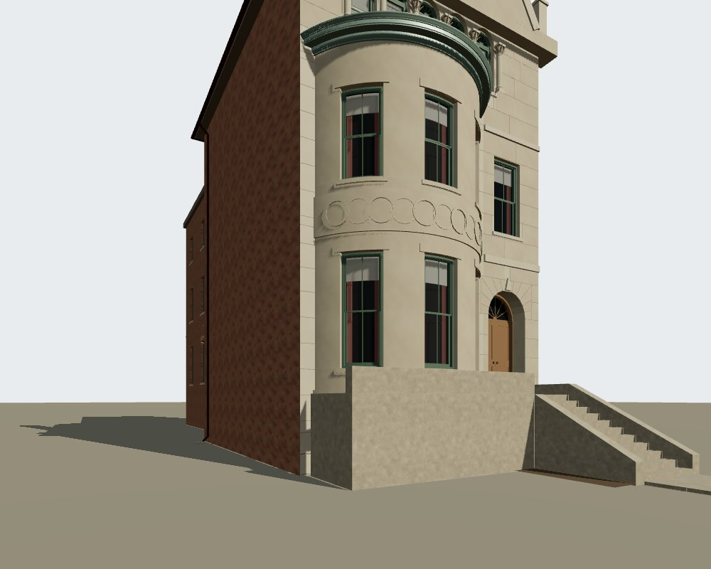
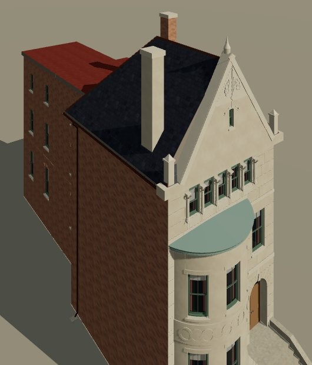

# T-1922 — 2110 Prairie on K01: the Harriet Rees house

The S12A package of the T-1837 programme. The district draft (T-2351) is refined in place, under its
own id (`rees_house_2110_prairie`), onto the K01 frontage assembly (`generators/k01_emit.py`); liberty
`L-k01-2110-rees-1922`. The coach house 2110 shared with 2108 on the alley
(`mark_kimball_house_2108_prairie_coach_house`) is T-1937's and is untouched. The carving, the loggia's
colonettes, the bow's copper cornice and the image gate are T-1923's. The house stood here from 1888
until it was moved in November 2014; every picture used is of it on this site.

## The pictures

| picture | what it shows | how it is used |
|---|---|---|
| the 2100 block looking north-west, early 1890s (`a20-glessner-2100-block-west-side-1890s`; source `glessner_blog_2100_block_looking_nw_1890s`, rights unresolved: forms only) | 2110 between 2112's stoop and 2108's door: the bow with its carved band at the upper floor, a pale ashlar front, the arched door north of the bow, the stoop between solid stone cheeks ending in a pedestal at the walk, a landing parapet across the bow's foot, a carriage post at the curb, no fence; the trees and the picture's top cut off the loggia and the gable | the period witness: the forms it shows are 1904's, and the later pictures are read only where it agrees or is cut off |
| Ryerson & Burnham Archives, c. 1980s (`a20-aic-rees-c1980s-photo`; new source `aic_rees_2110_c1980s_photo`, rights check_required: forms only) | the whole front, looking up: the gable over the full width with coped rakes, kneelers, finial, carved tympanum and one narrow light; the loggia's five round arches on colonettes; the bow's three lights a storey, its carved band and copper cap; the door at the north end with one square-headed light over it; a stack on the south flank behind the gable | the gable, loggia, bow, door and stack; the storeys' proportions; the bow's chord (0.62 of the front's width at the band) |
| Glessner House Museum, January 2012 (`a20-glessner-rees-exterior-2012`; new source `glessner_blog_rees_2110_gable_2012`, copyright: forms only) | the gable and loggia close to: smooth dressed ashlar, the rake near 50 degrees, the carved corbels under the kneelers, the copper cap green with age, slates on the north flank | the stone's dressing, the rake, the cap's copper, the slate |
| the 2014 move (`a20-glessner-rees-house-move-2014`) | the house in its cage on dollies | cross-check only: the same front |

No camera is solved: the two later pictures are under unresolved rights, read for forms only, and the
1890s photograph shows the house edge-on behind trees. T-1923 solves the cameras for its image gate.

**Is the 1980s front the 1888 front?** Where the early-1890s photograph shows the front (the bow and
its band, the stone, the door, the stoop), the later photographs agree with it. The gable and loggia
are the register's own description of Cobb & Frost's 1888 design (row frontage-35-066: "limestone front,
tall gable with carved tympanum and finial, arcaded upper loggia, bowed oriel with copper cap/frieze,
arched entry/transom and high stoop"), and nothing records a change to them. The bow's iron window
guards and the basement door under the landing in the 1980s picture are not carried to 1904.

## What was read off sheet 35

Sheet 35 of the 1911 Sanborn, read at full size, carried into the lot frame through the committed
trace's affine fit (`data/traces/prairie_1904_footprints_s35.json`, 0.186 m a pixel) and
`draft_prairie_1904.lot_frame` (u toward the street, v north on this side).

| reading | raster (column / row) | lot frame |
|---|---|---|
| north wall, on the lot line with 2108 | row 1163.5 | v 4.05 |
| south wall of the front block | row 1205 | v -3.75 |
| front | column 730 | u 47.35 (7.3 m behind the 1904 street line) |
| the bow's crown (the blue half-round, rows 1175-1205) | column 741 | u 49.4 |
| the front block's rear, where the south wall steps in | column 678 | u 37.7 |
| the rear body's south wall | rows 1197-1199 | v -2.3 |
| the north wall's step in | column 650, row 1170 | u 32.5, v 2.9 |
| the rear body's rear wall | column 612 | u 25.4 |
| the one-storey piece ('1') | columns 586-610, rows 1170-1187 | u 20.6-25.4, v -0.3-2.9 |

So the front block is 9.65 x 7.8 m (the draft's largest rectangle had 20 x 6.25 m), the rear body
12.3 m long behind it, and the piece 4.8 x 3.2 m. The sheet's bow symbol spans about 5.6 m and rises
2 m; the c. 1980s photograph puts its chord at 0.62 of the front's width at the band, where the chord
ends stand on the wall's plane and perspective does not widen them, so the bow is built 4.8 m across
and 1.5 m out, between the two.

## Built

Rendered with `node tools/photo_match.mjs` through an approximate camera on the walk before the house
(not committed: the picture's rights are unresolved). Against the c. 1980s photograph the front reads
as the picture does: gable, kneelers and finial; the loggia's five arches over the bow's cap; the bow's
three lights a storey; the door at the north end with the light over it; the stoop.

## Left for T-1923 (the image gate)

- the tympanum's carving, the kneelers' corbels, the finial's leaves;
- the loggia's colonettes and carved capitals, and the carved band over its arches;
- the bow's carved band (a plain string course here) and its copper cornice (a moulded stone eave under a copper cone);
- the landing's parapet across the bow's foot, the stoop's pedestal;
- the stack's stone (K01 lays stacks in brick);
- the roof behind the gable: K01 builds a hip, so its ridge starts about 2.3 m behind the apex where the true roof runs on to the gable;
- the cameras of the three pictures and their match records.

## T-3714 — the carved stone (piece 1 of T-1923)

Rendered with `node tools/photo_match.mjs` through an approximate camera on the walk, sunlit (not committed:
the pictures' rights are unresolved, so no side-by-side is kept). Liberty `L-k01-2110-rees-carving-3714`.

- **The gable's carved head** (`shaped_gable.tympanum`, new in `k01_shaped_gable.py`): a dressed triangle
  from 15.35 m up into the apex, 0.03 m inside the coping, carrying a stem, pairs of leaves each rolling
  into a curl, a boss and a fleuron; and the carved drop under it over the light, its arms 1.0 m across.
  Read off the 2012 detail: the field's level base a little over the light's head (about 0.4 m by the
  light's own 0.95 m), and the drop's two curled arms either side of the light.
- **The bow's carved band** (`carved_band`, a new K08 storey option): 0.9 m deep about the upper floor line,
  from a little over the parlour lights' heads to the upper lights' sills, as the c. 1980s photograph shows
  it, carrying K08's guilloche. The photograph's carving is scrolled foliage; the rings stand for it.
- **The bow's copper cornice** (`eaves.in_cap_covering`): the moulded section run in the cap's copper,
  green with age in the 2012 detail.

Left for T-3715: the loggia's colonnettes and carved capitals, the landing's parapet, the stack's stone and
the roof run on to the gable. Left for T-3716's photo-match: the kneelers' carved corbels, the finial's
leaves, the carved fleurons over the bow's upper lights, and the carving's density against the pictures.

## T-3715 — the loggia's colonnettes, the landing's parapet, the stone stack and the roof (piece 2 of T-1923)

Rendered with `node tools/photo_match.mjs` through approximate cameras (not committed: the pictures' rights are
unresolved, so no side-by-side is kept). Liberty `L-k01-2110-rees-3715`.

- **The loggia's colonnettes** (`street_front_trim.loggia`, new in `k09_frontage.py`): six of K09's foliate
  colonnettes, engaged in the piers, one beside each outer arch and one between each pair, from the lights' sill
  (10.3 m) to their springing (11.65 m), as both later photographs show them.
- **The landing's parapet across the bow's foot** (`entrance_kit.terrace`, side `left`): the landing carried south
  from the stoop to the bow's south end at its own height, faced to grade, 1.95 m out as the landing now is, its back stepped round the
  bow, behind a solid stone parapet 0.5 m high whose top stands at the parlour lights' sills (the early-1890s
  photograph's level ledge; the c. 1980s photograph's block beside the stoop's south cheek, its face where the
  cheek begins to fall, so the landing is deepened to the same 1.95 m). A solid parapet is `holes` [0, 0], newly
  allowed.
- **The stack's stone**: the south stack is `fabric: "stone"` (T-3003's), the gable slab's stone.
- **The roof run on to the gable** (`shaped_gable.roof_to_gable`, new in `k01_shaped_gable.py`): the hip's attic
  carried on from the block's middle 0.02 m into the slab's back, so the ridge runs straight on to the gable and
  the slates show beside the rake behind each kneeler, as in both photographs. The rear stays hipped.

Left for T-3716's photo-match: the kneelers' carved corbels, the finial's leaves, the carved fleurons over the
bow's upper lights, the carved band over the loggia's arches, the capitals' leaves against the pictures', and
the cameras and match records of the pictures.
