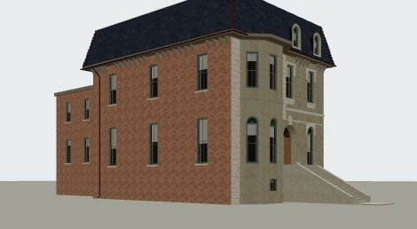

# T-3668 — 2112 Prairie on K01: the Max M. Rothschild house

Piece 2 of T-1921 (the S11 package of the T-1837 programme: 2108 and 2112). The district draft (T-2351)
is refined in place, under its own id (`rothschild_house_2112_prairie`), onto the K01 frontage assembly
(`generators/k01_emit.py`); liberty `L-k01-2112-rothschild-3668`. The alley building
(`rothschild_house_2112_prairie_coach_house`, lettered AUTO in 1911) is T-1937's and is untouched.

## The pictures

| picture | what it shows | how it is used |
|---|---|---|
| Sanborn 1911 vol. 3 sheet 35 (`sanborn_1911_chicago_v3_sheet_35`, public domain) | the plan: a '3B' main body with a stone front and a canted stone bay at its south end, a dashed curb joined to the outline's corners by hips, a '2B' rear range, a one-storey frame porch on the south flank | the plan, the bay, the roof's form |
| the 2100 block looking north-west, early 1890s (`a20-glessner-2100-block-west-side-1890s`; source `glessner_blog_2100_block_looking_nw_1890s`, rights unresolved: forms only) | 2112 first on the left, its upper storey cut off by the frame: a pale ashlar front; the canted bay with tall round-headed lights between colonnettes and a barred basement light; north of it a round-arched door at the head of a broad stoop between solid stone cheeks ending in pedestals; a round-headed light beyond; a heavy hood over the upper lights; quoins at the north corner; an open walk with two carriage posts at the curb | the front's forms, cross-checked against the sheet. No camera is solved: the rights are unresolved, so nothing is derived from the image as an asset (banked in `tools/rights_derivation_baseline.json`, as for 2108) |

## What was read off sheet 35

Sheet 35 of the 1911 Sanborn, read at full size with dark-line profiles, carried into the lot frame through
the committed trace's affine fit (`data/traces/prairie_1904_footprints_s35.json`, 0.186 m a pixel) and
`draft_prairie_1904.lot_frame` (u toward the street, v north on this side; the lot runs v -7.49 to 7.49 and
its 1904 street line is at u 54.69).

| reading | raster (column / row) | lot frame |
|---|---|---|
| north lot line (with 2110) | row 1207 | v 7.43 |
| main body's north wall | row 1209 | v 7.1 |
| main body's south wall | row 1272 | v -4.6 |
| south lot line | row 1288 | v -7.6 |
| stone front | column 731 | u 47.55 (7.14 m behind the street line) |
| main body's rear wall | column 653 | u 33.05 |
| canted bay at the wall | rows 1243-1267 | v 0.74 to -3.72 (4.46 m) |
| canted bay's face | column 737, rows 1250-1261 | u 48.67 (1.1 m out), 2.04 m across |
| rear range | columns 601-653, rows 1215-1259 | u 23.4-33.05, v -2.1 to 6.08 (9.65 x 8.2 m) |
| frame porch on the south flank (not built) | columns 657-683, rows 1272-1278 | about 4.8 x 1.1 m |

The main body is 14.5 x 11.7 m. The draft's largest rectangle (11.25 x 8 m) had been fitted inside the
rear range, because the trace split the main body along the sheet's dashed curb.

**The roof.** Inside the main body's outline the sheet draws a dashed square, inset about 1.1 m, joined to
the four corners by diagonals: a curb and its hips. With the sheet's '3B', which on this sheet counts a
mansard's attic as the third storey (2017, 2026, 1816 and 1620 are read the same way), the house is built
as two full storeys over a high basement under a slated mansard. The photograph's frame cuts off the wall
head, so it can neither confirm nor refute this.

## The build

The render is the committed GLB from a review camera in the roadway south-east of the house. The camera
is not solved and is not committed. It shows the pale front and its canted bay, the round-arched door and
light, the stone-cheeked stoop, the mansard and its two dormers, the south flank's common brick and the
rear range.

## Not built

- The south flank's one-storey frame porch, and the dashed '1/2 AT' outline behind it. K01 has no side porch.
- The quoins at the front's north corner and the colonnettes between the bay's lights.

## The image gate

T-1921's `## Image gate` names only 2108's pictures. 2108's match record still says `differs`, with one
item open: its basement lights, which K02's base courses hold to 0.8 m where the Tribune's cut draws them
about twice that and barred. This piece does not change 2108.
