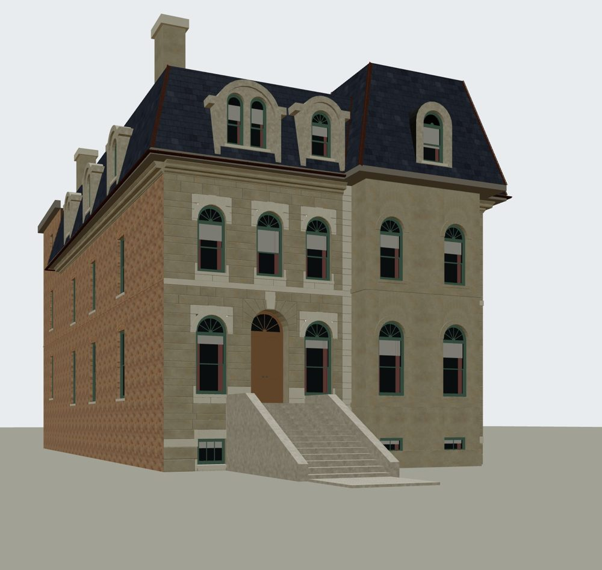

# T-3712 — 2115 Prairie, the Kelley/Armour house, on K01

Piece 1 of T-1925 (the S14 package of the T-1837 programme). The district draft (T-2352) is refined in place,
under its own id (`armour_house_2115_prairie`), onto the K01 frontage assembly (`generators/k01_emit.py`);
liberty `L-k01-2115-armour-3712`. The coach house (`armour_house_2115_prairie_coach_house`) is the R-series' and
is untouched. The pictures' cameras, the photo-match and the image-gate sign-off are T-3713's.

## What was read

Sheet 35 of the 1911 Sanborn (`chicago/reference/prairie-avenue/sanborn-1911-and-robinson-1886/sanborn_1911_vol3_sheet_35.jpg`),
read at full size, 0.186 m a pixel, north up and Prairie Avenue on the left (the street line at raster column
878; the parcel's lot lines at rows 1202.6 and 1301.6, `data/street_grid/1904.json`):

| reading | raster (column / row) | in the record |
|---|---|---|
| stone front (blue band) | column 918 | 7.44 m from the street line, on 2109's front line; K01's street front, u 18.51 |
| main body's north wall | row 1205.5 | 0.55 m inside the parcel's north line; K01 v 0 |
| main body's south wall ('3B') | row 1273.5 | 12.64 m wide |
| main body's rear | column 1017.5 | 25.95 m from the street line, 18.51 m deep; K01 u 0 |
| the front's band bowed out | column 913, rows 1242-1268 | the pavilion, 0.95 m proud, 4.8 m wide, centred 9.3 m from the north wall |
| '3B' rear range | columns 1017.5-1049, rows 1205.5-1255 | rear wing 5.86 m deep, 9.2 m wide |
| '2B' south piece | columns 921-968, rows 1273.5-1288 | **not built** (below) |
| frame bay on the south flank (yellow) | columns 986-1008, rows 1274-1277 | not built |

The draft's trace (`s35fp-2115-b1`) had read the body as a 12.5 m deep block with a 3 m "bay" before it, on a
coarser copy; at full size the stone front runs straight across the north 6.9 m and the projection is the
pavilion's 0.95 m.

The Armour photograph (`data/sources/chicagology_2115_armour_photo.json`, forms only; committed with T-3666's
reference copy at `data/sources/assets/roloson_2109_photo_t3666/`), taken in winter from the west walk, north
of the house. Its scale is taken from the stoop: about twelve risers from the walk to the landing (y 1215 to
1035 px), each taken as 0.18 m, so about 83 px a metre at the door's plane. Read off it:

- a front of smooth pale stone laid in bands over a panelled basement storey, quoined at the corners;
- two storeys of round-headed lights in moulded architraves with carved keys: two bays north of the door, the
  door's column (the door below, a light over it), and two in the pavilion; a third light column beyond, in the
  '2B' piece;
- the door: a pair of leaves under a fanlight in a round-arched opening deep in a moulded surround with a carved
  crest (x 1085-1180, y 815-1035 px, about 1.4 x 3.2 m);
- a broad straight stoop between solid stone cheeks stepped down in blocks;
- a deep moulded cornice over a frieze of carved panels, carried round the north flank;
- a slated mansard about 3 m high, banded in two tones, with a paired round-headed dormer over the north bays,
  a single one over the door and three on the north flank, each under a carved hood rising to a point; iron
  cresting round the deck with small corner finials; a tall carved stack at the north front corner;
- over the pavilion, a taller mansard crown with its own dormer, cresting and finials;
- the north flank pale and plain, one tall round-headed light near the front;
- no fence: the yard open to the walk behind a low kerb.

The Tribune's "Famous Homes" photograph of 8 July 1928 (`chicago_tribune_1928_07_08_armour_famous_homes`) is
dark, but it agrees on the round-arched lights, the dormered mansard, the cresting and the straight flight.

## Built

Rendered with `node tools/photo_match.mjs` through an approximate camera (T-3666's solved camera on 2109,
moved into 2115's frame; not committed, because T-3713 solves the real one). Beside the photograph, the front
reads as the picture does: two bays and the door north of the pavilion, round heads in both storeys, the stoop,
the cornice, the mansard with its paired and single dormers, the taller crown over the pavilion, and the stack
at the north front corner.

## Not built, for T-3713 (recorded in the liberty)

- **the '2B' south piece**, 2.7 m past the south wall, with a light in its street face and cresting on its flat
  roof. No K01 part stands a wing beside the main body (rear wings stand behind it; a pavilion is held to 1.2 m
  proud), so it wants a kit addition. A visitor would notice it, so it is the first open item for the sign-off;
- the deck's iron cresting and finials: K01 lays a deck's cresting only where no mansard crown stands on it;
- the pavilion's scalloped plan (square-faced here), the front's channels and long-and-short quoins, the
  basement's segment-headed lights (0.85 m tall here, about 1.1 m in the photograph);
- the carved frieze and modillions, the lights' architraves and keys, the door's surround, crest and pediment,
  the stoop's stepped cheeks, the dormers' pointed hoods, the slate's banding, the crown's cresting, the stack's
  carving, the kerb.
