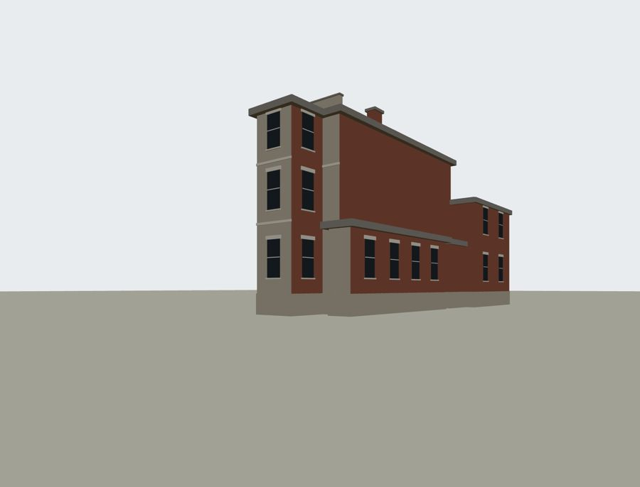
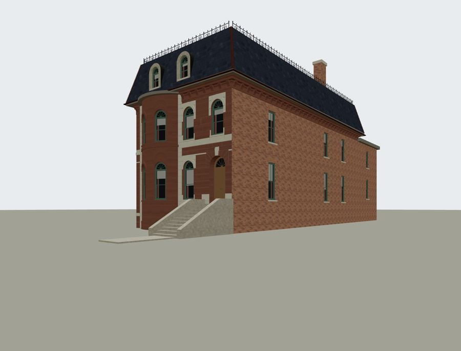
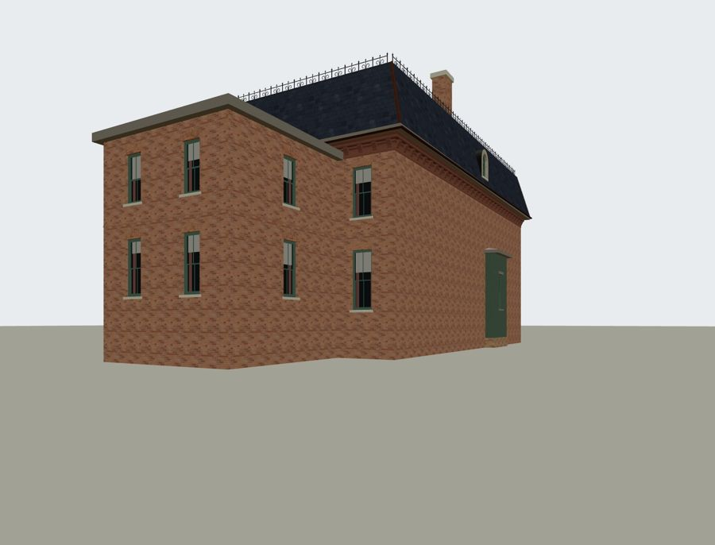

# T-3724 — 2123 Prairie on K01: the brick house with a brownstone front, a stone bow and a slated mansard

Piece 2 of T-1930 (the S18 package of the T-1837 programme; piece 1, T-3723, was the frame house at 2125, and piece
3, T-3725, solves the Armour photograph's camera on this house and carries the parent's image gate). The district
draft (T-2352) is refined in place, under its own id (`house_2123_prairie`), onto the K01 frontage assembly
(`generators/k01_emit.py`), on the pattern of 2115 next door (T-3712); liberty `L-k01-2123-prairie-3724`. The alley
garage (`house_2123_prairie_coach_house`) is T-1938's and is untouched.

## What was read

Sheet 35 of the 1911 Sanborn (`chicago/reference/prairie-avenue/sanborn-1911-and-robinson-1886/sanborn_1911_vol3_sheet_35.jpg`),
read at full size by classifying pixels along rows and columns (0.1858 m a pixel), and carried into the record's frame
through the committed trace's fit (`data/traces/prairie_1904_footprints_s35.json`). Plan frame: u from the main rear
wall toward Prairie (west), v from the north wall (+v is south on this side of the avenue). K01's sides run in that
frame: its 'south' wall is this house's north flank, its 'north' wall the south flank, and `front_bays` count from the
north corner.

| reading | raster (column / row) | plan (u, v) |
|---|---|---|
| street line | column 878 | the front 7.43 m behind it, on 2115's front line |
| stone front (outer edge of the blue band) | column 918, as 2115's is read | u 21.47 |
| main body's rear wall | column 1033.5 | u 0 |
| north wall / south wall ('3B') | rows 1304.5 / 1355.5 | v 0 / 9.48 (the draft's fit: 5.75) |
| the blue band bowed out | column 912-913, rows 1309-1330 | a bow 0.93 m proud on a 3.9 m chord, centred v 2.79 |
| dashed line inside the whole outline | about 1 m inside every wall | the key's mansard roof, all round |
| the front's south-west corner cut back | to column 928, rows 1343-1355.5 | the entrance corner, 1.9 m deep, 2.4 m wide: **not built** |
| south wall stepping in | row 1349 from column 1003 | 1.2 m in over the rear 5.6 m: **not built** |
| frame bay on the north flank (yellow, no count) | columns 950-966, rows 1302-1304.5 | u 12.5-15.5, about 0.55 m out: **not built** |
| '2B' rear range (pink) | columns 1033.5-1070, rows 1320-1355.5 | u -6.78-0, v 2.79-9.48 |
| lot lines | rows 1301.6 / 1368.8 | v -0.54 / 11.95 |

The Armour photograph (`data/sources/chicagology_2115_armour_photo.json`, forms only; the reference copy committed
with T-3666), taken in winter from the west walk north of 2115, shows this house at its right-hand edge
(x 1500-2000 px of 2000): the north half of the front and the top of the north flank over 2115's south piece. Its
scale at this front is about 65 px a metre (the principal lights taken as 2.6 m). Read off it:

- a front far darker than 2115's limestone in the same light, smooth, with dressed mouldings: brown sandstone;
- round-headed lights in both storeys under moulded hoods with keys: a pair in the bow (x 1760-1890 px) and a single
  light beside it (x 1920-1980 px); square-headed basement openings between piers (y 1060-1150 px);
- a deep cornice on blocks over a plain frieze, carried round the north flank (y 510-565 px);
- a straight slated mansard about 3 m high, two round-headed dormers on the street face (x 1840-1865, 1915-1950 px)
  and one on the north flank part way back (x 1580-1615 px), iron cresting with small finials round the deck;
- one tall brick stack on the north wall, well back from the front (x 1545-1610, y 255-370 px);
- the north flank plain and unlit; the yard open behind a low kerb.

The photograph stops short of the door's end of the front.

## Built

| draft, front from the south-west | built, front from the south-west | built, rear from the north-east |
|---|---|---|
|  |  |  |

`approximate-armour-camera.jpg` is the house rendered through 2115's solved Armour camera moved into this house's
frame: an approximate camera, not committed under `data/reference_views/`, because T-3725 solves the real one.
Beside the photograph it shows what the photograph shows: the dark front with its stone bow at the north corner,
round heads in both storeys, the plain north flank, the slated mansard with its cresting, a dormer on the north slope.

## Not built (recorded in the liberty)

- the small frame bay on the north flank: K08 cuts no light in a bay 0.55 m deep (its recess reaches the house wall) and
  refuses a blind one (its light tier cannot be cheaper than its full); it stands in the 0.6 m gap beside 2115;
- the entrance corner's recess: K01 lays a rectangular body, so the door stands on the front plane at v 8.3;
- the south wall's step in over the rear 5.6 m;
- a third street dormer over the door, and any north-flank dormer beyond the one the photograph shows;
- the hoods' keys and the cornice's carving beyond K10's moulded stone cornice and blocks.

## Checks

`node tools/photo_match.mjs` with throwaway review cameras: the front from the south-west and the rear from the
north-east (rendered before the frame bay was dropped, so it still shows it in green), and the draft from the same front pose. The first builds were refused by the kit four times, each fixed in
the record: a stack within the north wall's thickness,
the rear wall's lights where the range covers it, and the chamber storey's round heads reaching the cornice's frieze
(the second storey taken 0.1 m higher, the frieze 0.3 m and its blocks 0.3 m).
