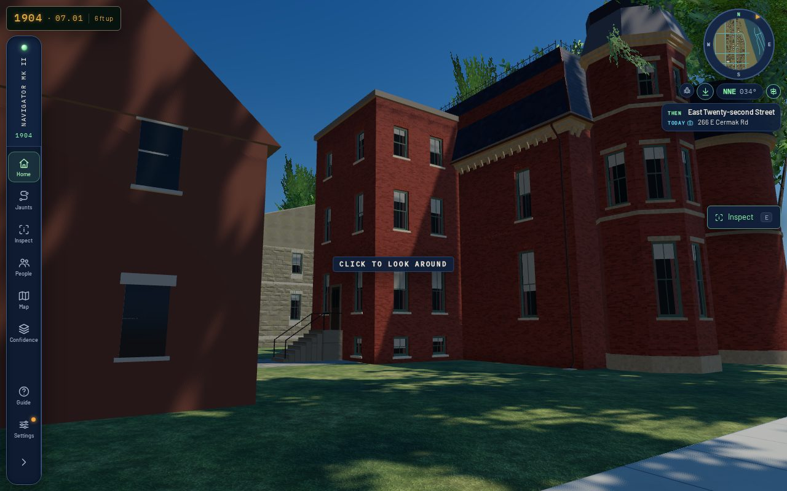
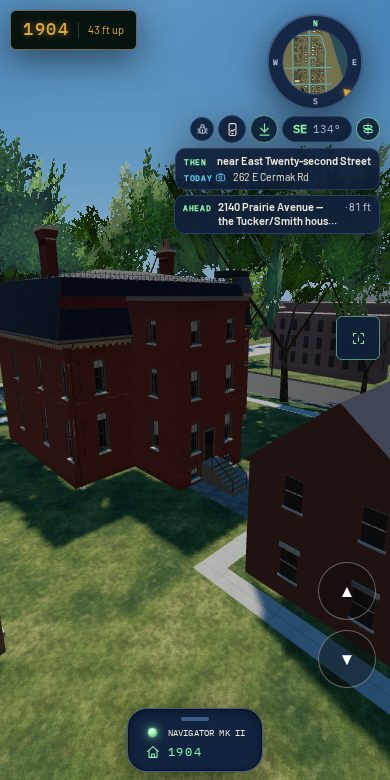

# T-3772 — 2140 Prairie's '3SB' rear range lit on its yard faces, and the house read in the app

Piece 3 of 3 of T-1928 (S17A). Piece 1 (T-3770, `docs/RESEARCH/k01-2140-tucker-3770/`) put the house on K01 and
stood the sheet's '3SB' rear range behind the main body's north half with one light a storey; piece 2 (T-3771) built
the porch, the dormers' gables and the stack's pots. This piece covers the rear range's lights and the rest of what the
1911 sheet draws on the house's rear and flanks, and T-1928's acceptance item 3: the actual browser result from
repeatable front, oblique, rear and roof stands at 1280×800 and 390×780, with the scene's costs. T-1929 solves the
cameras and closes the image gate. Liberty `L-k01-2140-tucker-3772`.

**Acceptance, as stated before the work:** the rear range's three yard faces carry lights, and the back yard's kitchen
door stands clear of them; whatever the sheet draws on the rear that is not built is named, with the reason; the
published `/1904/` app, shot from front, both obliques, rear, the range's 22nd Street side and the roof at 1280×800
full and 390×780 light, with zero page errors and zero failed requests, every house stand inside the renderer's frame
budget, and load, JS heap, the house's GLB bytes, triangles, draw calls, textures and frame time recorded.

## What was read

Sheet 35 of the 1911 Sanborn at full size (`sanborn_1911_vol3_sheet_35.jpg`, 0.1858 m a pixel) against the volume's
key (`sanborn_1911_vol3_key.jpg`):

| mark | raster (column / row) | the key's reading | built? |
|---|---|---|---|
| '3SB' range, pink | 644-672.5 / 1586-1622 | three storeys and basement, brick | piece 1 |
| filled dot inside the range | 649.5 / 1621 | composition or gravel roof (the main body's open circle by its south-east corner is slate or metal) | no: K01 decks a wing in K04's painted tin only |
| double tick across the range's south wall line at its south-west corner | 639-642 / 1621-1629 | fire wall twelve inches over the roof | no: K01 has no parapet on a flat wing |
| hatched stair lettered 'F.E.' against the range's rear wall, north part | 626-644 / 1592-1615 | fire escape | no |
| hatched stair lettered 'F.E.' on the main body's north flank near the front | 722-737 / 1544-1559 | fire escape | no |
| narrow yellow strip beside it | 704-720 / 1552-1559 (about 3 × 1.3 m) | frame; its lettering is too small to read on this scan | no |
| outline in the main rear wall's south half | 666-674 / 1626-1641 | uncoloured: an areaway or a step, not resolved | no (piece 1's one-rectangle body) |

No picture shows the rear, the range or the north flank. Nothing dates either fire escape before the 1911 sheet, and a
house of the 1870s carrying none until a later code or a later use is the likelier reading for July 1904.

## What is built

The range's lights (`data/structures/tucker_smith_house_2140_prairie.json`, `rear_wings`), reconstructed as a service
range's, K06 sash at piece 1's sizes (0.9 m wide; 2.2, 2.0 and 1.6 m high, storey by storey):

- **rear wall** (6.69 m, read from its north end): two lights a storey at s 1.6 and 5.1, where it had one in its middle;
- **south face** (5.3 m toward 22nd Street, from the range's rear end): two a storey at s 1.5 and 3.8 — the face a
  visitor on 22nd Street sees across the yard;
- **north face** (5.3 m, from its front end): one a storey at s 2.65;
- **basement**: square-headed lights 0.9 × 0.9 m on a 0.3 m sill under the rear and south lights, as the main body's are.

`tools/lay_prairie_1904_back_yards.py` re-laid the kitchen door on the range's rear wall a metre south (n -3729.77),
between the two rear lights, its eight stone steps down to the terrace; `tools/prairie_people.py` re-derived
`data/humans/doors_1904.json` (the door's barrier now also holds the basement lights' wells). The house's master is
re-emitted by `generators/k01_emit.py` and its web derivative by `tools/web_derivatives.sh`.

## In the app (`tools/qa_k01_t3772.mjs`)

The actual published `/1904/` app, normal boot, animation held after readiness; frame times are the median of five
renders each waited on with a one-pixel read, on this runner's software GL (SwiftShader) — they compare stands with each
other, not a device claim. "In budget" is the renderer's own `stats().withinBudget`.

| viewport | detail | ready | JS heap (after GC) | page errors | failed requests |
|---|---|---|---|---|---|
| 1280×800 | full | 61.2-101.7 s | 122.8-123.7 MB | 0 | 0 |
| 390×780 | light | 41.2-41.7 s | 121.9-142.0 MB | 0 | 0 |

The house is one GLB, `tucker_smith_house_2140_prairie__as_mapped_1904.glb`: 1,153,588 bytes on the wire (meshopt +
quantised), 10,044,084 bytes as the uncompressed master.

| viewport | stand | draw calls | triangles | textures | frame (median) | in budget |
|---|---|---|---|---|---|---|
| desktop | front | 615 | 1.04 M | 1651 | 7.8 s | yes |
| desktop | oblique-south | 3169 | 5.36 M | 2032 | 16.3 s | no (see below) |
| desktop | oblique-north | 505 | 1.17 M | 2059 | 7.5 s | yes |
| desktop | rear (first pose) | 850 | 1.52 M | 1683 | 9.3 s | yes |
| desktop | rear-south | 2480 | 3.06 M | 2398 | 10.8 s | yes |
| desktop | roof | 551 | 1.11 M | 2413 | 7.2 s | yes |
| mobile | front | 494 | 0.39 M | 2540 | 1.9 s | yes |
| mobile | oblique-south | 2504 | 0.68 M | 2561 | 2.7 s | yes |
| mobile | oblique-north | 371 | 0.46 M | 2585 | 1.9 s | yes |
| mobile | rear | 358 | 0.40 M | 2596 | 1.7 s | yes |
| mobile | rear-south | 3301 | 0.93 M | 2697 | 2.6 s | yes |
| mobile | roof | 519 | 0.47 M | 2713 | 2.6 s | yes |
| mobile | draft-south-walk | 10667 | 2.75 M | 2746 | 5.8 s | no (see below) |
| mobile | draft-air | 1785 | 0.82 M | 2760 | 2.7 s | yes |

Two stands are over the frame budget, and both are the length of the avenue rather than this house: **oblique-south**
at desktop looks up Prairie from the 22nd Street crossing (the exemption every K01 harness since T-3607 carries), and
the district draft's own **south-walk** pose at mobile looks up the whole west side from 22nd Street. The draft read
that pose at 0.59 M triangles and 53 draw calls in October (`prairie-draft-20-22-west-2351/browser-validation-after-mobile.json`);
it reads 2.75 M now because every house along it has since been refined off the draft. The harness exempts both by
name, and says so.

The desktop **rear** stand was shot first from over the alley (1350, -3730, 14 m), where the alley building's roof
fills the foreground (`after-desktop-rear.jpg`); the harness now stands it over 2130's back yard (1356, -3712, 13 m),
where the mobile shot was taken (`after-mobile-rear.jpg`). The range's south face and the kitchen door read best from
22nd Street (`after-desktop-rear-south.jpg`).

### Before and after

The **before** is the district draft (T-2351), from the same poses: its committed `after-*-south-walk.jpg` and
`after-*-air.jpg` in `docs/RESEARCH/prairie-draft-20-22-west-2351/` against this piece's `after-mobile-draft-south-walk.jpg`
and `after-mobile-draft-air.jpg`. Where the draft stood an 8.5 × 14 m block with square-cornered projections and one
round tower, the house now stands on the sheet's full 13.4 × 18.6 m plan with its three towers, banded brick, slated
mansard, porch and lit rear range (pieces 1-3).

### The stands (scene-local metres: east, north, height above the ground there)

The main body stands at e 1378.7-1392.0, n -3740.4 to -3721.8 (its rear south-west corner the record's anchor); the
rear range at e 1373.4-1378.7, n -3733.5 to -3726.8.

| stand | eye | target |
|---|---|---|
| front | 1412, -3731, 1.7 | 1388, -3731, 7 |
| oblique-south | 1408, -3758, 1.7 | 1386, -3732, 7 |
| oblique-north | 1410, -3705, 1.7 | 1386, -3730, 7 |
| rear | 1356, -3712, 13 | 1376, -3731, 6 |
| rear-south | 1362, -3752, 1.7 | 1376, -3731, 6 |
| roof | 1420, -3700, 45 | 1384, -3731, 8 |
| draft-south-walk | 1399.5, -3778, 1.7 | 1386, -3722, 8 |
| draft-air | 1445, -3560, 75 | 1365, -3640, 0 |

Run by parts, each inside one 600 s foreground command, after `tools/publish.sh`:
`QA_VIEWPORT=desktop|mobile QA_PART=a|b|c node tools/qa_k01_t3772.mjs`. A desktop part took about 5.5 minutes on this
runner, a mobile part about 2.

## Not built here

The fire escapes, the range's gravel deck and fire wall, and the north flank's frame strip (above, and
`L-k01-2140-tucker-3772`); the main rear wall's set-back south half and cut corner (piece 1's one rectangle); the
round-arched heads, carved hoods, the cameras and the photo-match (T-1929); the corner fence (T-1945).
