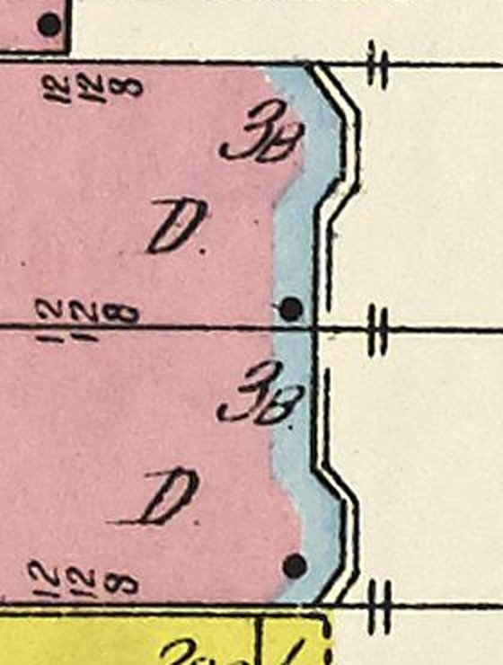
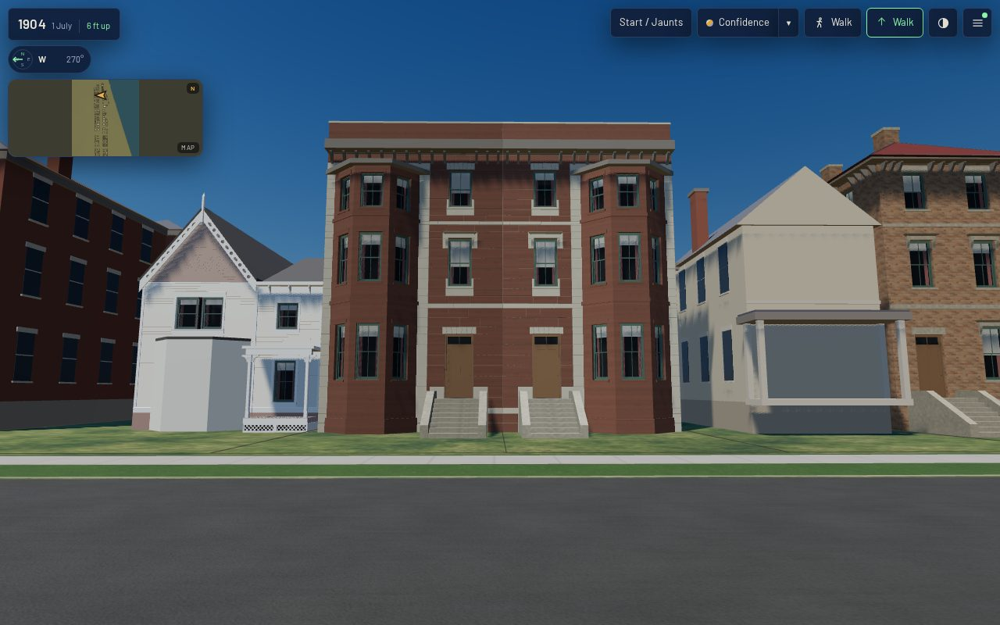
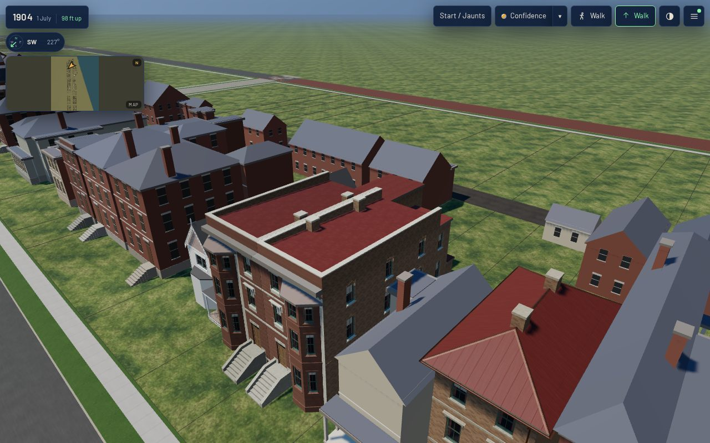

# 1634 and 1636 Prairie on one party line, their fronts on the traced outline (T-2392)

T-2348 and T-2347 each left the stone-front pair a question to answer once for both houses: where
the party line is, and where the front wall is. This reads both off the T-2328 trace and the raster
of Sanborn 1911 vol. 3 sheet 20, and moves the two K01 bodies onto them. Reading the front also
showed that 1634's bay was built at the wrong end.

*Sheet 20, raster px 2960-3240 × 3220-3590, enlarged 2×. Street (east) to the right. 1634 is the
upper house, 1636 the lower, and the yellow frame building below is 1638.*

## What the sheet says

Measured with `tools/draft_prairie_1904.py`'s `lot_frame` and `to_uv` through the T-1250 fit, in
1634's former record frame (u toward the street, v north):

| line | trace vertices | median | was built at |
|---|---|---|---|
| party line (1634 p2's south edge, 1636 p3's north edge) | v -0.54 … -0.76 | **-0.695** | 1634's south wall at 0; 1636's north wall at -0.885 |
| front (the outline's front edge, outside the bays) | u 15.32 … 15.41 | **15.38** | 13.75 for both |

- **The party line.** The two outlines share one edge. 1634's K01 body stopped 0.7 m north of it, and
  1636's stopped 0.19 m south of it, so the two blank party walls stood about 0.9 m apart.
- **The front.** The blue band along both fronts is the sheet's colour for a stone front, painted
  *inside* the building's outline. It does not mark ground in front of the house. The black outline
  on its outer side is the wall line, and both canted bays stand about 0.8 m beyond it, a bay's depth.
  Measured from the draft's 13.75 m they would stand 2.4 m out. Neighbouring K01 houses on the sheet
  (1604, 1628) put their fronts on the traced outline too.
- **The bays.** The sheet draws a canted bay at the **north** end of 1634's front and at the
  **south** end of 1636's, with the flat fronts, and so the doors, together at the party line. It is
  a mirrored pair. T-2350 had read the strip of band at 1634's south end (the draft's r3) as the bay
  and built a rectangular K08 bay there. T-2348 then followed it ("the pair repeats rather than
  mirrors").

Which side of the printed line the wall face takes is not resolvable at 1:600. The trace's polygon
edge is used, and the pair's relative accuracy is the trace's, about 0.1 m.

## Built

- **1634**: the origin moves 0.70 m south onto the party line (lot frame u 30.75, v -3.70). The body
  is 15.4 m deep and 7.45 m wide. The wing and its one-storey end stay where they were and now run to
  the party line (v 0-4.95), as the sheet draws them. The rectangular bay at the south is replaced by
  K08's canted bay at the north end (1636's bay, centred 2.2 m from the north corner). The door and
  stoop are at the south end, 1.85 m from the party line. The north-wall windows and chimneys are
  re-spaced to the deeper body.
- **1636**: the north wall moves 0.185 m onto the line (7.685 m wide), with its wing's north wall. The
  body is 15.383 m deep, so its front is flush with 1634's. Its door, rear window, wing rear window,
  south-wall windows and chimneys are re-placed to match.
- Both front yards are now 9.21 m (24.61 m street line less the 15.4 m body).
- `draft_prairie_1904.json`'s frontage rows 20-010 and 20-011 say the pair mirrors. Both
  liberties gain a T-2392 paragraph (append-only).

## After (`tools/qa_k01_t2392.mjs`)

Actual published `/1904/` app, desktop 1280×800 at full detail. 0 page errors, 0 failed requests,
every stand `withinBudget`. Load to ready 28.4 s, JS heap 31.5 MB, 1.86-3.19 M triangles. The masters
are 3.62 MB (1634) and 3.74 MB (1636); the web derivatives are 1.55 and 1.57 MB.

No *before* reading was taken here. T-2348's `after-*` stands are the before, from about the same spot.

## Image gate

No photograph, print or drawing of 1634, 1636 or the pair is known (T-2350's and T-2348's searches
of the Prairie library), so no camera is solved. Every form but the plan, the storeys, the stone
front and the bays' places is the kits'.
