# K15 on a named target: 1808 Prairie's chimneys (T-2313)

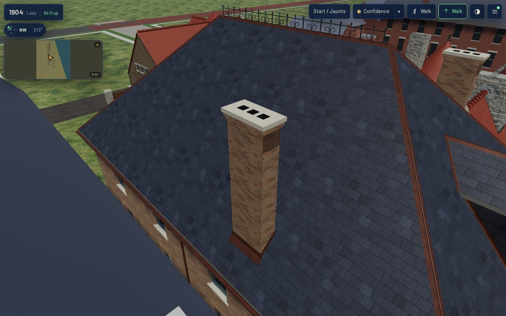

Piece 2 of T-1857 (package K15 of the T-1837 Prairie programme). Piece 1, T-2312, built the
chimney kit on a specimen board. This piece builds a named house's chimneys from it, in the 1904
scene.

## Acceptance (stated before work)

1. The target is named: **1808 Prairie** (`keith_house_1808_prairie`, register `pa-1808-6`), the
   K01 exemplar every kit has been applied to (owner, 2026-10-10).
2. **Number and position are the source's, not the kit's.** A source for this house is read. Each
   stack's place is taken from it and recorded as such. What the source does not show is built at
   the reconstructed tier and said to be.
3. Each stack is built by the kit's own code (`k15_chimneys.stack_solids`, `join_stack`) in the
   house's own K05 roof and joined into it. It is seated, its flues are dark recesses, its top
   meets the draught rule on the built covering, a wide stack on a slope has its cricket and every
   stack its flashing. `tools/check_chimney_kit.py --check` holds the house to those rules, as
   well as the specimen.
4. The joined roof stays closed, one shell, with no doubled, crossing or interior faces
   (`tools/check_roof_kit.py --check`). The K01 contract measure stays green on both tiers.
5. **The reduced tier keeps location and height.** Every stack's plan centre and top are read off
   the bytes of both shipped tiers and must agree.
6. Verified in the published `/1904/` app at 1280×800 (full) and 390×780 (light), from the front,
   an oblique, the rear and the roof, plus each stack close, with zero page errors, and with load,
   draws, triangles and a frame at every stand (`tools/qa_k15_t2313.mjs`).

## The source, and what it says

The February 1888 *Inland Architect* prints the house as a photographic plate, "Residence for
O. R. Keith, Chicago. Cobb & Frost, Architects", with its **first-floor plan** beneath it. The
copy read is the Internet Archive's scan, leaf n14. It is now a source record,
`data/sources/inland_architect_1888_02_keith_plate.json`.

- **The plan.** The street is on the left and the round library bay is at the top. The photograph
  fixes the top as south: the bay stands south of the entrance loggia, as the T-1837 register
  also reads it. The plan draws **three fireplaces**, each set across a corner:
  - the library's, where the round library meets the south wall and the music room's partition;
  - the hall's, against the north wall at the foot of the main stair;
  - the dining room's, on the rear range against the pantry.
- **The photograph.** It shows the stone front up to its pierced parapet and corner turrets, and
  nothing above the parapet. It was taken from the street, so a stack several metres behind the
  front would stand below the parapet's line from the camera. The photograph neither shows the
  stacks nor rules them out.
- **Rights.** The 1888 publication is public domain in the US. The scan carries no stated
  licence, so the record is `check_required` / `cross_check`, as the Glessner plate of the same
  issue is. Positions are read from it as numbers; nothing is traced or derived from the image,
  and the image is not committed. The use is banked in `tools/rights_derivation_baseline.json`
  (`measure_rights_derivation.py --update`): the attribute built from it is
  `form.chimney_positions`, inferred.

## What was built

| stack | stands over | where (u from the rear, v from the south) | built |
|---|---|---|---|
| `library` | the library's corner fireplace | u 12.1 (5.9 m behind the front), v 0.65, in the south wall | the kit's grouped brick stack (`k15.stack.ridge`), no pots: 1.155 × 0.525 m turned along the wall, 3 flues, 2 corbel courses, stone cap; top 16.8 m |
| `hall` | the hall's corner fireplace | u 13.6 (4.4 m behind the front), v 9.75, in the north wall | the same; top 16.8 m |

- **How the plan was read.** At the scale the house's recorded 10.4 m width gives it: 0.0193 m to
  the pixel on the 3480 px scan, to about ±0.3 m. Distances are measured back from the street
  front, which the plan and the record share. The plan's main block is 16.6 m deep at that scale,
  where the record's footprint is 18.0 m.
- **Where it was moved off the reading.** The plan puts the stacks 0.54 m (library) and 0.52 m
  (hall) in from their walls' faces. Both are set at 0.65 m. The footprint's margin asks at least
  0.56 m. And a stack's downhill face within a centimetre of the K05 eave box's line left a sliver
  at the front hip that the K01 contract refused.
- **The dining-room fireplace** stands on the rear range. This K01 record does not build that range,
  so it has no stack here.
- **Data.** `form.chimneys` (reconstructed) names each stack's kit variant, its pots, which way it
  is turned and its top. `form.chimney_positions` (inferred, sourced) says where each stands.
  `k01_frontage_params` refuses a stack with no position, one outside the footprint, or one whose
  top fails the kit's draught rule on the record's own roof. At 16.5 m it refuses: the rule asks
  16.6 m.
- **Generator.** `k01_frontage.Assembly.roof` builds each stack with `k15_chimneys.stack_solids`
  in a `k15_chimneys.Frame` over the hip's own covering. It joins the stack with `join_stack`
  (body and head each cut, then joined on the cap's bed) and unions it into the roof solid before
  the dormer's recess is cut.
  - **Roles to materials.** The shaft wears the side walls' K03 brick; the soot band is a darkened
    copy of it (`chimney_soot`, the one new slot); the cap is the front's limestone trim; the flues
    are the near-black `backing` a window's room uses; the flashing and cricket are the roof's own
    K04 flashing.
  - **The roof graph** reads every stack part as `chimney`, which K05 already classes as an
    abutment.
- **A weld, said.** The apron's planes lie 6 and 10 mm off a stack's face. They cut contour lines
  across the whole slope, and where those cross a hip the union leaves points about a millimetre
  apart. The contract's 1 mm grid would read the triangles between them as folded. So the joined
  roof is welded at 2 mm before it is emitted (`k01_frontage.SHELL_WELD_M`, `_weld_shell`), and
  any face the weld collapses is dropped. Two points can share one of the contract's 1 mm cells
  only within its √3 mm diagonal, and the web tier's 16-bit positions move a point by a fraction
  of a millimetre more. Nothing in the roof is built finer than K15's 6 mm flashing.
  `check_roof_kit.py` proves the welded shell still closed and one shell.
- **Gate.** `tools/check_chimney_kit.py --check` now builds every K01 house that carries K15 stacks.
  Its per-stack rules were factored out of the specimen's `verdicts` into `stack_verdicts`,
  unchanged, so the house and the specimen meet the same code. The house adds 11 rules, and the
  specimen's 69 are as before.

## Measured

`check_chimney_kit.py`: **80/80 rules hold** (4 variants and 1 house).

| rule | library | hall |
|---|---|---|
| seated | 0 stack triangles below the covering (both) | |
| flue | 3 recesses, each open at the top and at least 0.6 m deep | same |
| draught | cap 16.80 m; covering within 3 m 16.00 + 0.6; at the stack 13.26 + 0.9 | same |
| cricket | wanted (1.155 m on a slope), 6 cricket faces behind | same |
| flashing | stepped on both sides, 9 step levels each, apron below | same |
| budget | 459 triangles (budget 2,200) | 459 |

`check_roof_kit.py`: the joined roof is **closed, one shell, 0 doubled or degenerate, 0 crossings,
0 hidden**, 1,784 triangles. The graph is abutment 41, eave 6, hip 4, ridge 2, valley 2 and
verge 2. The main ridge is now one line: the T-2302 stacks that broke it into three are gone. K04
dresses every ridge, hip and valley.

**Both tiers keep each stack's place and height.** Read off the shipped bytes (cap course centre,
highest point):

| tier | library | hall |
|---|---|---|
| full (`assets/gltf/`) | (12.100, 0.650), 16.800 m | (13.600, 9.750), 16.800 m |
| web, every detail level (`assets/web/`) | (12.100, 0.650), 16.800 m | (13.600, 9.750), 16.800 m |

The house ships one mesh at every detail tier, because `web_derivatives.sh` never simplifies. So
there is no separate box tier like the kit's light stack: the reduced tier keeps every stack whole.

| asset (`k01_contract.mjs --measure-asset`) | before (T-2319) | after |
|---|---|---|
| triangles | 56,710 | 60,872 |
| draw primitives | 27 | 28 (`chimney_soot`) |
| master GLB | 6,791,952 B | 7,142,380 B |
| web GLB | 2,097,300 B | 2,133,112 B |
| verdicts | all ok | all ok (scale drift, origin, coincident, metric UV) |

**In the published `/1904/` app** (`browser-validation-*.json`): 0 page errors and no failed
requests at either viewport, and every stand is within the scene's budget.

| stand | desktop full: draws / triangles | mobile light: draws / triangles |
|---|---|---|
| front | 83 / 2,769,458 | 82 / 688,315 |
| oblique | 84 / 2,797,846 | 82 / 696,286 |
| rear | 86 / 2,798,733 | 79 / 691,459 |
| roof | 84 / 2,798,329 | 81 / 697,307 |
| library stack, close | 83 / 2,784,031 | 80 / 689,497 |
| hall stack, close | 82 / 2,762,767 | 79 / 688,937 |

- **Load to ready:** 25.4 s at 1280×800 and 13.3 s at 390×780.
- **Frame times** in the JSON are headless SwiftShader, read on a runner shared with other jobs, so
  they compare only with one another.
- **These are not a before-and-after.** The stands differ from T-2319's, and dev has gained
  buildings since. The asset table above is the like-for-like cost: 4,162 triangles and one draw
  call on this house.

| stand | desktop | mobile |
|---|---|---|
| front | 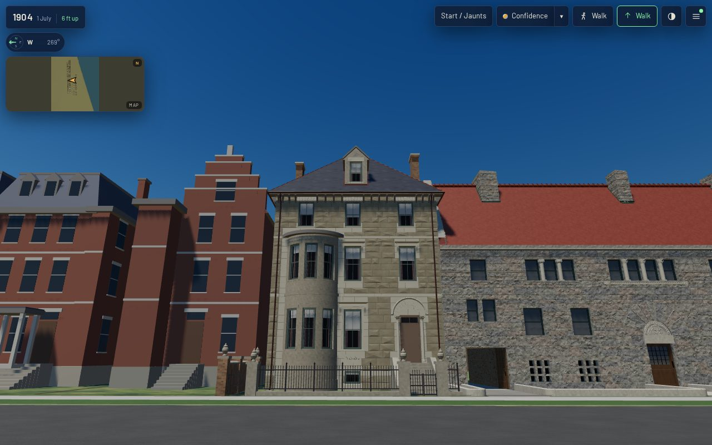 | 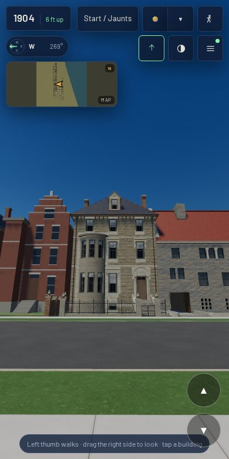 |
| oblique | 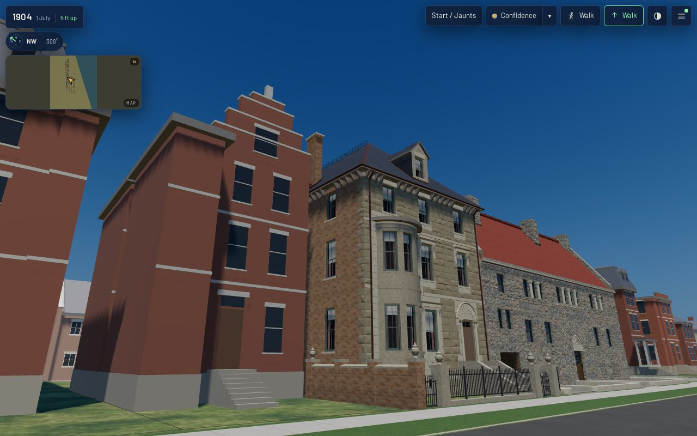 | 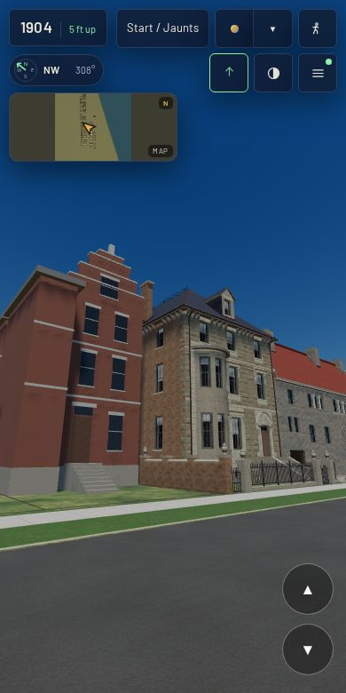 |
| rear | 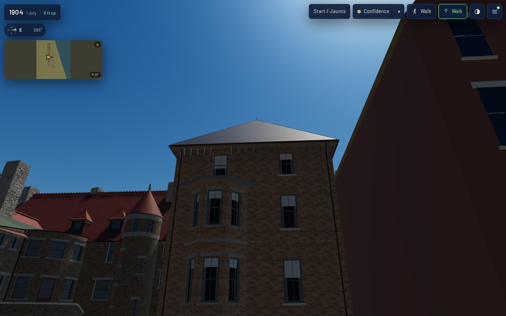 | 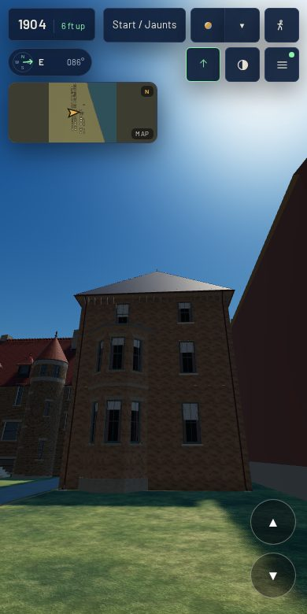 |
| roof | 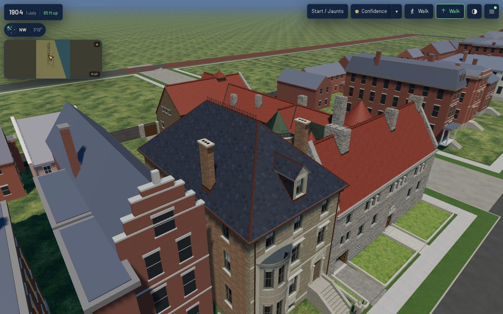 | 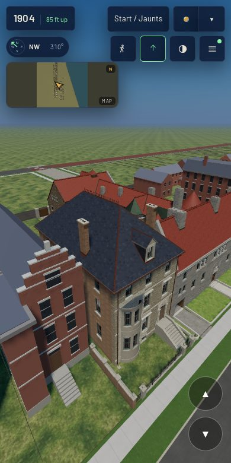 |
| library stack |  | 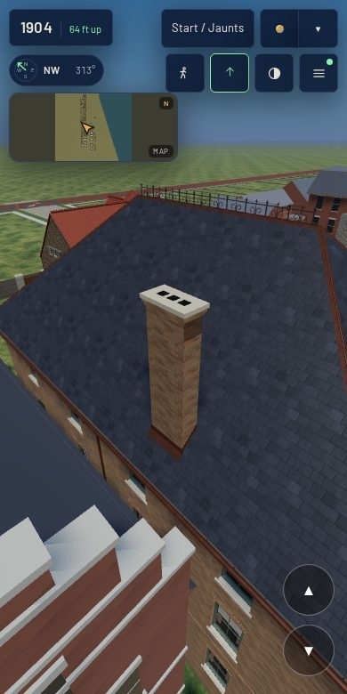 |
| hall stack | 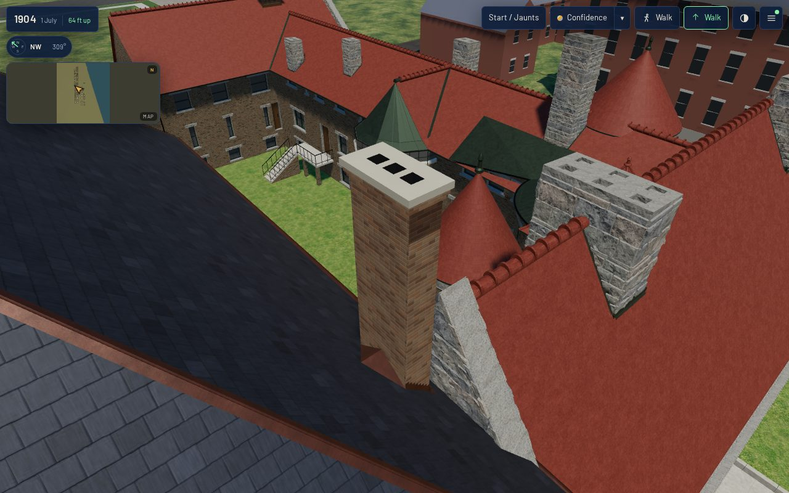 | 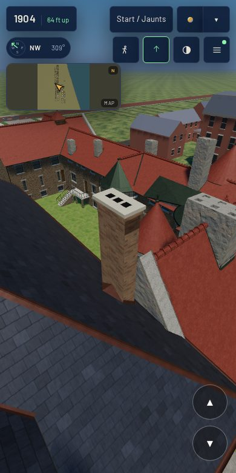 |

## Not done, said

- **The roof is still T-2302's reconstructed hip.** The plate shows a flat roof behind a pierced
  parapet (T-1882's). On a hip, the draught rule makes each stack rise about 4 m above the slope's
  eave side; behind a parapet it would be a short stack. When T-1882 lands, the record's `top_m`
  drops with the roof.
- **Height, size, flue count and cap are the kit's, not 1808's.** No source shows any of them.
  Upper-floor plans or a photograph of the roof or rear would replace them.
- **No pots.** The kit sets one only where a source shows it.
- **The dining-room stack** waits for the rear range to be built.
- **From the street the stacks stand back behind the eave**, so the front stands show little of
  them. The roof and close stands are where they read.

## Rebuild

    python3 generators/k01_emit.py --only keith_house_1808_prairie
    ./tools/web_derivatives.sh --only keith_house_1808_prairie__as_built_1886.glb
    node tools/k01_contract.mjs --measure-asset keith_house_1808_prairie
    python3 tools/check_chimney_kit.py --check
    node tools/qa_k15_t2313.mjs    # after tools/publish.sh; QA_VIEWPORT=desktop|mobile for one
