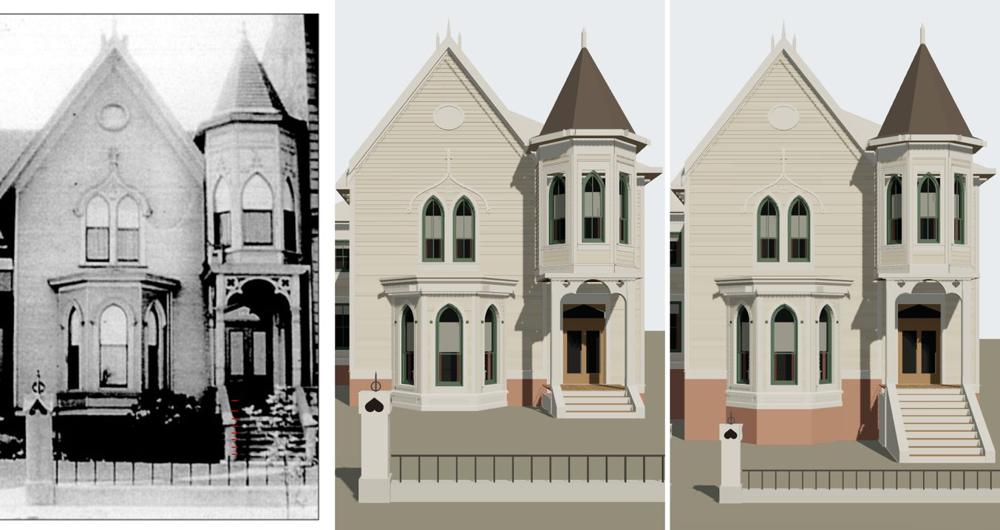

# T-2523 — 1638 Prairie raised on its basement to its photograph's steps

After T-2520 (piece 2 of T-2458), which settled the steps' run through the camera as the floor's
height and filed the build here. The house is matched through
`data/reference_views/shortall_gregory_house_1638_prairie_front/chicagology_front.json`.

*Left, the print (`chicagology_1638_prairie_photo`), T-2520's nosings ticked in red; middle, the
house on `dev` before this piece, through the old camera (the eye 20 m out); right, after, through
the camera re-solved here (the eye 30.71 m out). Both renders are `tools/photo_match.mjs`. The
fence draws smaller after: its re-read is T-2524's.*

**Acceptance, stated before the work:** the camera re-solved on the steps and the fence's base;
the floor raised onto a basement with every height over grade standing where the new camera reads
it; the stoop built as its ten risers and landing on the print's nosings within a few pixels,
rendered; the match record's steps item brought to `fixed`; nothing else on the house moved off
the print by the camera's change.

## The floor's height and the camera, solved together

Through a level camera square to the front, at 73 px a metre on the front's plane (f = 73 E for
an eye E metres out), with the horizon at 657 px:

- the door's foot on the floor (785 px, the model's 781) puts the eye **1.7 m over the floor** at any depth;
- the fence's base (1022 px), whose street face stands 10.75 m out at the walk's level, then fixes
  **E = 365 x 10.75 / (365 - 73 h)** for an eye h metres over the walk, h = floor + 1.7.

A tread j steps under the floor's edge (1.78 m out) stands at height F - j r and runs from
1.78 + (j - 1) g to 1.78 + j g; from 30 m it draws under 2 px deep, so a tread is a line and the
riser under it a 12 px band (the render shows them so: thin oiled treads between lit risers). The
print's eight bright rows are the treads. Fitted with every riser equal (r = F / n), the first
row read two steps under the floor (the cheeks hide the top step's tread against the floor's
edge), each row a tread's middle:

| floor over the walk | eye, out / up | ten risers of | best going | rms (px) |
|---|---|---|---|---|
| 1.40 m (the ticket's first reading) | 28.3 m / 3.10 m | 0.140 m | 0.46 m | 4.0 |
| 1.50 m | 29.9 m / 3.20 m | 0.150 m | 0.40 m | 3.6 |
| **1.55 m** | **30.7 m / 3.25 m** | **0.155 m** | **0.36-0.38 m** | **3.5** |
| 1.60 m | 31.6 m / 3.30 m | 0.160 m | 0.34 m | 3.3 |
| 1.65 m | 32.6 m / 3.35 m | 0.165 m | 0.30 m | 3.1 |

Ten risers throughout: with nine there are too few treads for the eight rows (9.7 px at best), and eleven want goings of half a metre (4.3 px at 1.55 m). The fit falls
slowly as the floor rises, so the print alone does not pin it inside 1.5-1.65 m; what decides it
is where the eye can stand. Prairie Avenue's street lines are 20 m apart
(`data/street_grid/1904.json`), so the far one is 30.8 m from the front: **1.55 m puts the
photographer on the far walk, just inside that line**; 1.6 m and over put him past it, in the
far front yard. The T-2520 table (computed with the print's 785 px foot and the stair's foot
on the walk) had the same flat floor from 1.3 m up; its 1.4 m is the low end of the band once the
risers are equal and land on the walk.

**Built:** a 0.95 m basement (the kit's 0.6 m floor + 0.95 = 1.55 m), ten risers of 0.155 m on
0.36 m goings (`stoop.max_riser_m` 0.16, `going_m` 0.36), its foot 5.0 m out. The camera: eye
`[30.71, 2.7, 3.25]`, f 2242 px; v and the principal point stay (the bay's cants fix them at any
depth).

**Rendered,** the treads' lines stand at 815.3, 829.6, 844.5, 859.8, 875.2, 891.4, 907.7 and
924.8 px against the print's 813, 834, 850, 865.5, 879.5, 892, 908 and 922.5: **3.7 px rms**, the
worst the print's top gap (813 to 834 px, 21 px where every other gap is 12.5-16) which no stair of
equal risers draws.

## The kit: a house on a basement (`form.basement`)

`generators/archetypes/k16_timber.py`: a record may name `basement: {height_m}`. Every other height
it carries is over the basement's top: the parts are built as before, the porch's floor the
basement higher with its half set down by it (so its lattice and its stoop reach grade), and then
the whole house is raised. Each foundation keeps its foot on grade, so it runs on down as the
basement's wall (its brick coursed on: the texture's v carried with it), and the canted bay, whose
plinth is timber, gets a ring of the same wall under it. The fence stays on the walk. Validated by
`k16_timber_params.basement_errors`; the other four K16 houses re-emit byte-identical.

## What the deeper camera moves: the porch and the tower re-read

At the front's plane both cameras draw 73 px a metre, so the gable, its lights, oval and the bay's
face read as they did. What stands out from the front draws smaller and nearer the middle through
the deeper camera: at the porch's face (1.72 m out) 77.4 px a metre where the old solve gave 80, so
the old numbers land 5-16 px off the print. Each reading is re-taken at its own depth (rows: the
print's pixel, then the model rendered through each camera; the after column is the build):

| reading | print px | before, old camera | old numbers, new camera | after, new camera |
|---|---|---|---|---|
| roof end S x | 657 | 656.3 (-0.7) | 649.6 (-7.4) | 653.2 (-3.8) |
| roof end N x | 859 | 856.6 (-2.4) | 843.1 (-15.9) | 859.6 (+0.6) |
| post S x | 676 | 677.1 (+1.1) | 670.6 (-5.4) | 677.3 (+1.3) |
| post N x | 830 | 829.0 (-1.0) | 818.0 (-12.0) | 831.3 (+1.3) |
| quatrefoil S x | 698 | 699.8 (+1.8) | 692.2 (-5.8) | 699.7 (+1.7) |
| quatrefoil N x | 809 | 809.2 (+0.2) | 798.1 (-10.9) | 810.7 (+1.7) |
| arch spring y | 617 | 617.1 (+0.1) | 618.3 (+1.3) | 616.8 (-0.2) |
| foil top y | 597 | 595.2 (-1.8) | 597.1 (+0.1) | 594.9 (-2.1) |
| crown y | 565 | 567.2 (+2.2) | 570.1 (+5.1) | 567.1 (+2.1) |
| porch roof top y (band under stage) | 555 | 554.9 (-0.1) | 558.4 (+3.4) | 555.3 (+0.3) |
| tower mid x | 745 | 735.6 (-9.4) | 733.3 (-11.7) | 743.0 (-2.0) |
| tower sill y | 495 | 493.3 (-1.7) | 498.5 (+3.5) | 494.6 (-0.4) |
| tower light point y | 350 | 345.5 (-4.5) | 355.4 (+5.4) | 349.2 (-0.8) |
| tower cornice y | 290 | 281.6 (-8.4) | 293.5 (+3.5) | 289.6 (-0.4) |
| spire point y | 80 | 88.8 (+8.8) | 93.5 (+13.5) | 80.2 (+0.2) |

The porch's middle comes from four readings that agree within 4 cm through the new camera (the
roof's ends, the posts, the quatrefoils and the tower's middle: 6.51-6.56 m), so **6.53 m**,
where 6.40 m was read through the old. Its floor steps by the kit's board pitch (0.083 m), so it is
14 boards (1.159 m a side) with the posts 0.045 m in from its ends; every size of the trefoil and
quatrefoils is 3.1 % larger, as the scale at that depth is. The tower's numbers stood 2-9 px off
the print through either camera (T-2396 read them at an assumed 77 px a metre, which happens to be
this camera's scale at its face); re-read, they land within 1 px. The bay's base (about 3 px) and
the porch roof's south end (about 4 px) are left.

**Not done here.** The fence: through this camera it draws about 1.37 times smaller than the print
(its readings were taken at the old camera's 158.7 px a metre on the street line, where this one
gives 116), which is **T-2524**. Liberty: `L-k16-1638-basement-2523`.
