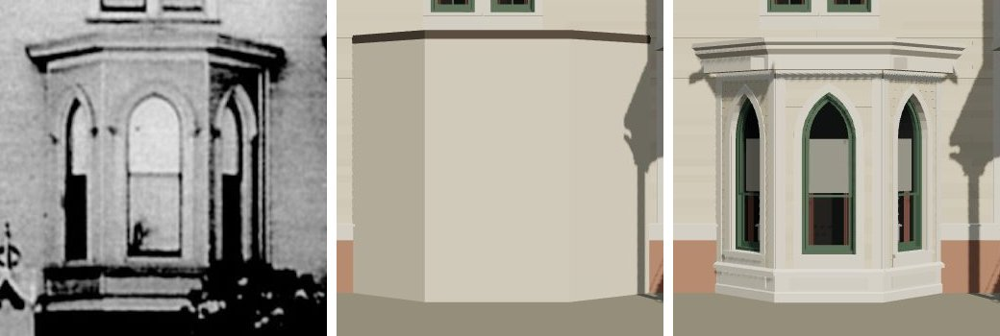

# T-2424 — 1638 Prairie's canted bay from its photograph

Piece 2 of 4 of T-1865 (1638's finished architecture). The plain stand-in block on the front
becomes the bay the print shows, built in the K16 kit's timber and read through the camera T-2423
solved.

*Left, the print (`chicagology_1638_prairie_photo`, committed at
`data/sources/assets/shortall_1638_photo_t2423/`); middle, the house on `dev` before this piece;
right, after. Both renders are `tools/photo_match.mjs` through the same camera.*

## The readings

At the bay's face (1.1 m nearer the camera than the wall) the print is 77 px a metre, grade at 835 px.

| | print | model |
|---|---|---|
| face | 407-517 px | 1.42 m, s 2.03-3.45 m |
| cants at the wall | 347 and 577 px (73 px a metre there) | s 1.16 and 4.32 m |
| depth | not shown by a front view | the 1911 sheet's 1.1 m, kept: cants 1.40 m |
| lights | three, pointed, between posts; centre 432-488 px, glass 788-618 px, rail 702 px | 0.73 m one-over-one, glass 0.63-2.83 m |
| arch | stops at about 655 px | the kit's equilateral head, spring 2.20 m (print about 2.33 m) |
| base | a dark band under the sill line, a row of panels (807-827 px) on a plinth | panelled base, sill course top 0.45 m |
| cornice | soffit 592 px, crown 557 px at the corners | 3.13-3.55 m, flat deck falling 0.07 m from the wall |

The sheet's drawn bay (4.28 m along the wall, a 1.95 m face) is coarser than the print; the
print is followed for widths. At the sheet's depth the three faces come out within 2 cm of each
other, which is what a bay of three equal lights would be.

## What changed

`generators/archetypes/k16_timber.py`: a `canted_bay` whose record names `lights` is built like
the tower: each face a kit `clapboard_wall` (`bay.0`-`bay.2`, measured by `check_timber_kit.py`
like every other part), its posts the kit's corner boards widened to `post_m`, a pointed light in
a pointed casing between them; the base, sill course and cornice are profiles carried round the
plan (`bay_ring`) so each angle mitres, and a deck closes the top. The kit wall now takes a pointed
surround's course-by-course cuts (the gable already did), and a cased window may name `panes`.
A bay without `lights` is still the plain block. `k16_timber_params.bay_errors` checks the record.

## What is still open

In the match record: the print's arches are a little blunter than the kit's equilateral head, and
the small dark stops at their springs are not built. The entrance (T-2425) and the fence (T-2426,
which brings the record to `matches`) are the remaining pieces. Liberties: L-k16-1638-bay-2424.
