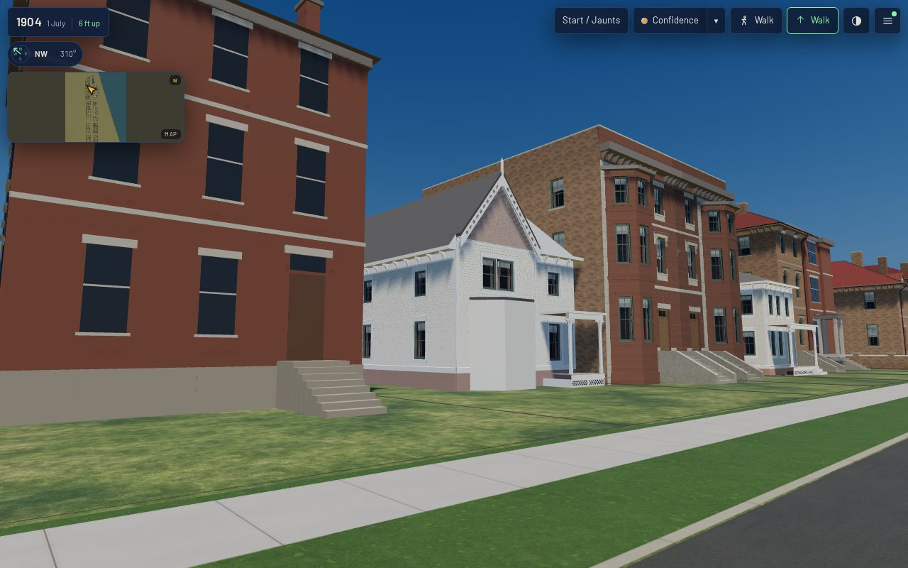

# 1638 Prairie's body closed in K16 timber (T-2395)

A piece of T-1864 (the 1638 envelope), split three ways in this run: **this piece** closes the body,
T-2396 builds the corner tower from the photograph, T-2397 the sheet's rear pieces. The record keeps
its id, `shortall_gregory_house_1638_prairie_front`, its placement and the T-2323 front unchanged; what
changes is the plain stand-in block behind that front, which T-2323 left for this envelope.

## What was built

All from the K16 kit (`data/components/prairie_1904/k16_timber.json`), on the plan T-2323 read off
sheet 20 of the 1911 Sanborn (the gable's range 5.21 m wide and 23.4 m deep, the north range 2.92 m
and 12.9 m):

| face | built as | openings (two-over-two, flat casing) |
|---|---|---|
| the gable range's south flank | two kit `clapboard_wall`s meeting at 13.8 m (one would pass the wall's 4,500-triangle budget), corner boards at both corners | five bays, ground and upper |
| its north flank, behind the north range | a kit wall, a corner board at the back | two bays |
| its back | a second kit `gable`: the front's pitch (52°), belt (6.4 m) and foundation, plain square shingle, pierced bargeboards and finial | two bays and an attic light |
| the north range's north side | a kit wall, on from the wing wall's 0.9 m return | two bays |
| the north range's back wall | a kit wall, a corner board at its outside corner | one bay |

Ground sash sit at sill 1.3 m, 1.75 m clear; upper sash at sill 4.2 m, 1.2 m clear. Every wall has
the kit's water table, frieze, boxed eave and scroll brackets.

**The roofs.** The main roof is the front gable's rake carried back to the rear gable: one plane each
side through the gable's verge line, 1 cm under the gable's own roof boards so the two never fight.
The flanks' wall top is therefore not chosen but solved: the roof comes down to the boxed eave's
fascia at 0.42 m out, so the wall stops at 6.03 m (`body_flank_top`), below the front's 6.4 m belt,
and the eave line runs 6.19 m. The ridge is 10.07 m. The north range has a 22° lean-to from its north
eave (the wing wall's 6.4 m) up into the main roof, which it meets 8.45 m up, 1.35 m inside the main
range's north wall. The wedges at the ends of each overhang are closed with painted board.

**What the generator learned** (`generators/archetypes/k16_timber.py`): a `clapboard_wall` with no
return can still end on an outside corner with its own corner board (`boards: [start, end]`); a front
record's `body` may carry `timber_walls`, and then `structure_parts` builds each face as kit parts
(`body.*`) and `structure_house` roofs them instead of standing the plain block; a long face splits at
`split_m`. `k16_timber_params.py` validates the five faces. `tools/check_timber_kit.py` holds every
`body.*` part to the kit's rules as it holds the front's — the rear gable measured in its own frame
before it is turned into place, so the pierced-bargeboard rule reads it as it reads the front's. The
1630 house and the kit specimen rebuild byte-identical.

## Pictures

The Prairie library's photograph of the house (`a16-cgy-1638-gothic-photo`, undated) was opened and
read. It shows the street front only: the steep gable with its oculus and hooded twin pointed
windows, the one-storey canted bay, and at the north end a polygonal tower over an arched entrance
porch under an octagonal spire. Nothing of the flanks, the rear or the roofs behind the gable is in
it, so it bounds nothing built here; the tower is why T-1864 was split, and is T-2396's. The two
1700-1706 photographs the ticket lists show 1638 at best at their edge. No camera is solved here:
the house's image gate is T-1865's.

## Before and after, the same stands (`tools/qa_k16_t2395.mjs`)

Actual published `/1904/` app; *before* is `dev` at 9ddba5457 (the stand-in body), *after* this
branch. Desktop 1280×800 at full detail, phone 390×780 at light. Stands: front (across Prairie),
oblique from the south and north walks, rear (from the alley, 6 m up), roof (the air) and the south
flank (16 m up over 1636). 0 page errors and 0 failed requests on all four runs; every stand
`withinBudget`. Frame times are software GL on the runner, a relative reading, not a device claim.

| | load to ready | JS heap | draw calls | triangles | frame (median of 12) |
|---|---|---|---|---|---|
| desktop before → after | 40.2 → 30.2 s | 31.7 → 31.7 MB | 135-169 → 135-169 (±0) | 1.877-3.136 M → 1.910-3.169 M (+33 k) | 3.39-5.65 → 3.48-5.82 s |
| phone before → after | 18.9 → 19.5 s | 31.7 → 31.7 MB | 98-166 → 98-166 (±0) | 468-956 k → 502-989 k (+33 k) | 0.85-1.71 → 0.89-1.79 s |

The house is 26.5 k triangles (front 10.0 k, body 16.4 k: south flank 5.1 k in two walls, rear gable
5.2 k, the rest 1-2.6 k each). The master is 2.66 MB (was 1.00 MB) and the web derivative 0.30 MB
(was 0.13 MB). It batches into the scene's existing material draws, so it costs no draw call at either
tier; K16 has no light derivative, so the phone draws the full body. Load swings by seconds between
runs on this runner and neither the fall nor a rise is a claim.

Screens: `before-*.jpg`, `after-*.jpg`; readings: `browser-validation-before.json` and
`browser-validation-after.json` (both viewports).

## Limits

- No side or rear of the house is pictured or described: every opening on those faces is spaced to
  the plan (`L-k16-1638-body-2395`).
- The south flank runs straight and the rear gable stands clear: the sheet's rear widening to 6.49 m,
  the south projection at the middle and the three one-storey rear pieces are T-2397's.
- No chimney, rear door, cellar lights, gutters or downpipes.
- The canted bay is still the plain stand-in, and the front's twin windows still flat-headed (T-1865).

Re-make: `python3 generators/k16_emit.py --only shortall_gregory_house_1638_prairie_front`, then
`tools/web_derivatives.sh --only shortall_gregory_house_1638_prairie_front__as_standing_1904.glb`, then
`python3 tools/compile_scene.py --all`.
