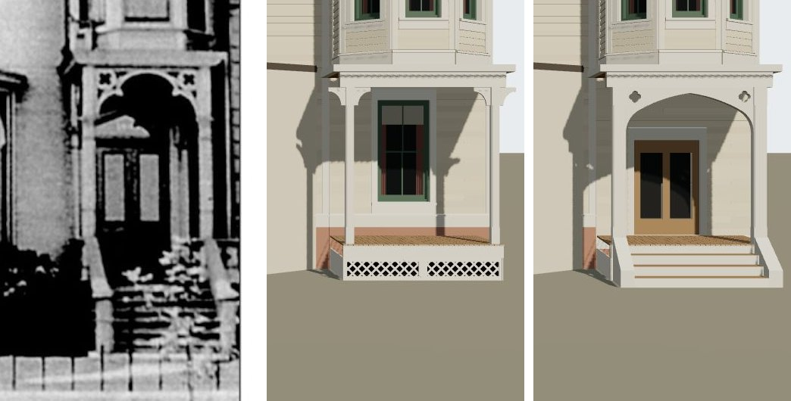

# T-2425 — 1638 Prairie's entrance under the tower from its photograph

Piece 3 of 4 of T-1865 (1638's finished architecture). The ground storey of the corner tower,
built to the print through the camera T-2423 solved.

*Left, the print (`chicagology_1638_prairie_photo`); middle, the house on `dev` before this piece;
right, after. Both renders are `tools/photo_match.mjs` through the same camera
(`data/reference_views/shortall_gregory_house_1638_prairie_front/chicagology_front.json`).*

## Readings

At the posts' face the camera gives 79.8 px a metre (18.3 m from the eye); at the wall's, 73 px.

| | print (px) | read |
|---|---|---|
| posts | 18 px across | 0.22 m plain piers |
| arch | springs 617, plate's foot 557, point 565 | springs 0.75 m under the plate, rises 0.65 m |
| quatrefoils | ~20 px, middles 12-15 px in from the posts, 15 px under the plate | 0.2 m, at [0.15, 0.16] m |
| door | 687-782 across, head 655, foot 785 | 1.2 m clear (1.3 m with its frame), 1.72 m high, foot on the floor |
| lights | 672-760, one per leaf | 0.29 m bottom rail, 0.23 m top rail |
| steps | nosings 14-15 px apart | the camera draws the kit floor's 0.15 m risers 15 px apart |

## What changed

| | before | after |
|---|---|---|
| posts | kit's 0.14 m chamfered posts with scroll brackets | 0.22 m posts, no brackets |
| head | the plate alone | a four-centred pointed arch in a board as deep as the plate, a pierced quatrefoil in each corner |
| wall behind | a two-over-two sash | a glazed double door at the floor; the wing wall's water table laid at the floor |
| front | lattice to grade | four risers between cheek walls in the posts' line |

The kit (`generators/archetypes/k16_timber.py`) gains a porch `arch`, `post_m` and `stoop`, and a
`glazed` door; `k16_timber_params.porch_errors` validates them. The arch's spandrel is cut with
K09's ear clipper, so `k09_trim.py` joins K16's inputs: the four K16 frame houses re-emit
byte-identical with new input hashes. Liberty: L-k16-1638-entrance-2425.

## Still open

In the match record (`chicagology_front.match.json`, verdict `differs`): the print's posts stand
1.72 m apart where the sheet's porch width puts the model's 2.11 m; the print's steps run on down
past the model's foot, some three risers more than a 0.6 m floor over the camera's grade allows,
which T-2426's fence (the camera's depth reading) should settle; and a pale gabled shape over the
door's south leaf is unidentified and unbuilt.
