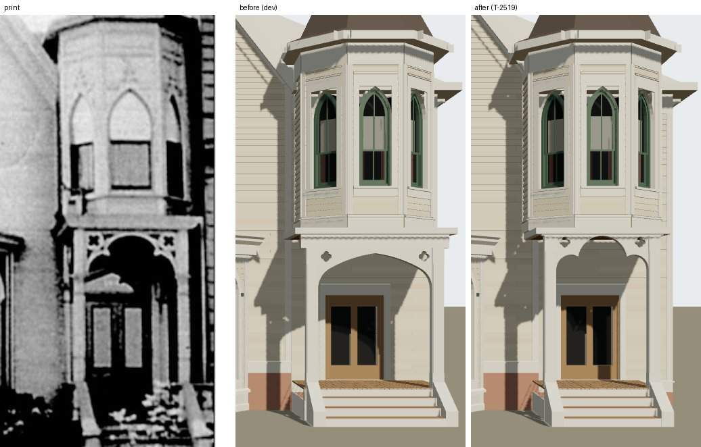

# T-2519 — 1638 Prairie's entrance narrowed to its photograph

Piece 1 of T-2458 (itself the last piece of T-2426, 1638's front from its photograph). The gable
width T-2457 left open and the entrance's opening T-2425 left open, built to the print through the
camera T-2423 solved.

*Left, the print (`chicagology_1638_prairie_photo`); middle, the house on `dev` before this piece;
right, after. Both renders are `tools/photo_match.mjs` through
`data/reference_views/shortall_gregory_house_1638_prairie_front/chicagology_front.json`.*

## Readings

The camera gives 73 px a metre at the wall (20 m from the eye), 79.95 at the posts' face and 80.9
at the porch roof's edge; the principal point (459 px) stands at 2.7 m along the front.

| | print (px) | read |
|---|---|---|
| gable | verges meet at 460, oval 459.5, pair 458, hood 458.5 (T-2457) | middle 2.725 m: 5.45 m wide from the south corner |
| porch roof's ends | 657, 859 (row 545) | middle 758 px, 1.25 m either side |
| posts | 667-685 and 821-840 (rows 640-760) | middles 676, 830: 6.40 m; faces 133 px apart |
| quatrefoils | dark 690-706 and 803-815, rows 566-581 | middles 698, 809 (6.40 m between them), 0.2 m across, 3.34 m |
| head | crown 565; half-width 8.5, 20.5, 27, 30.5, 33.5, 32.5 px at 568-596 | a round foil about 0.46 m in radius centred near 2.97 m |
| cusps | about 720 and 790, at 597 | where the head meets the side foils |
| side foils | tops 597, opening's edge 692 at 610-625, spring about 617 | 0.27 m foils springing at 2.80 m |
| tower | 745 px at its depth (T-2396) | 6.40 m |

Three independent things — the roof's ends, the posts and the quatrefoils — put the porch's middle
at 754-758 px, 6.40 m from the south end, which is where T-2396 had already read the tower's middle
before centring it on the porch's 6.55 m. So the porch and the tower are moved together.

Read at four times, the head is not the pointed arch T-2425 built: it is a **cusped trefoil**, a
round head foil from cusp to cusp, and below each cusp a side foil swinging out and down to the
post. And it sits higher than built: T-2425 read its spring "0.75 m under the plate's foot (617
against 557 px)", but 557 px is the roof's fascia line, not the model's plate foot (3.2 m, 585
px), so the head was built some 28 px low. In the print the board the head is cut from runs flush
up to the fascia, with no plate's foot under it.

## What changed

| | before | after |
|---|---|---|
| gable | 5.21 m, middle 2.605 m | 5.45 m, middle 2.725 m; apex 0.15 m higher |
| wing wall | 2.92 m | 2.68 m, the door unmoved on the front |
| porch, tower | centred 6.55 m; floor 1.325 m a side | centred 6.40 m; floor 1.076 m a side |
| posts | 2.11 m apart | 1.71 m apart, outer faces at the floor's ends |
| head | four-centred pointed arch, 2.45 to 3.10 m | cusped trefoil, spring 2.80 m, crown 3.424 m |
| plate | the kit's 0.25 m on a 2.6 m clear height | 0.02 m on 2.83 m: its top and the roof's unmoved |
| quatrefoils | 0.2 m at 3.04 m | 0.2 m at 3.305 m |

Measured on the render after: posts 664-688 and 820-840 px (print 667-685, 821-840), cusps about
(722, 600) and (790, 600) (print 720 and 790 at 597), crown 567 px (565), quatrefoils 572-585 px
(566-581).

The kit (`generators/archetypes/k16_timber.py`) gains an arch `kind: trefoil`
(`foil_radius_m`, `head_radius_m`, `head_over_spring_m`), a porch's own `plate` (`clear_m`,
`height_m`) and `post_inset_m`; `k16_timber_params.porch_errors` validates each, and the arch now
refuses a crown that stands in the plate. Every default is what the kit built before: the four
other K16 houses re-emit byte-identical with new input hashes. Liberty: L-k16-1638-entrance-2519.

## Still open

In the match record (`chicagology_front.match.json`, verdict `differs`): the open fretwork the
print shows dark round each quatrefoil (the model's board is solid) and the moulding that sets the
print's opening some 5 px inside the posts below the side foils; the steps' run and the pale shape
over the door (T-2520); the tower's smooth upper stage and the fence's caps and south run (T-2521);
the block south of the gable (T-2522).
