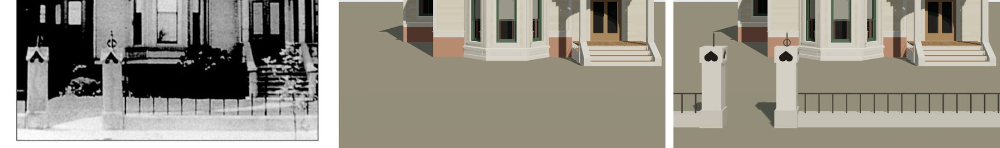

# T-2456 — 1638 Prairie's front fence and gate piers from its photograph

Piece 1 of T-2426 (itself the last piece of T-1865, 1638's finished architecture). The street
line in front of the Shortall-Gregory house, built to the print through the camera T-2423 solved.

*Left, the print (`chicagology_1638_prairie_photo`); middle, the house on `dev` before this piece;
right, after. Both renders are `tools/photo_match.mjs` through the same camera
(`data/reference_views/shortall_gregory_house_1638_prairie_front/chicagology_front.json`).*

## Readings

On the street line the eye is 9.2 m away (the camera's 20 m less the sheet's 10.8 m yard), so the
print draws 158.7 px a metre there. Across is read on that scale; heights through the camera,
`2.3 - (row - 657) x distance / 1460`, so they agree with the house's own readings.

| | print (px) | read |
|---|---|---|
| pier shafts | 75-131 and 282-336 | 0.34 m square, middles at s 0.46 and 1.76 m |
| gateway | between the plinths | 0.9 m clear, open, lawn and a shrub through it |
| plinths | to 975 | 0.30 m |
| caps | 842 to about 800, 63 px across | 1.14 to 1.40 m, 0.40 m square |
| hearts | point 808, lobes to 838, 39 px across | 1.35 m, 0.24 m |
| finials | south spike to ~753; north ring 776-798 on the cap, spike to ~753 | 1.68 m; ring's middle 1.47 m |
| base | 986 to the foot | 0.22 m |
| bars | 345, 384, 423 … 732 | 0.244 m apart, to the hedge line (939) and past it at the stoop (~926): 0.58 m |

Measured on the render after the build: shafts 79-131 and 285-337 against the print's 75-131 and
282-336; caps' tops within 3 px; plinths' feet within 2 px; the print's foot falls 4 px under the
camera's grade at the line (1026 against 1022), so the fence agrees with the depth T-2423 solved
the camera on to the precision that reading has.

## What changed

The K16 kit (`generators/archetypes/k16_timber.py`) gains a `boundary`: a stone base and iron bars
on a top rail from each lot line to a gate pier, and gate piers each a stone plinth, a painted
square shaft, a hollow cap of four boards pierced with an inverted heart (`heart`,
`pierced_board`, cut with K09's ear clipper as T-2425's quatrefoils were) under a low pyramid, and
an iron finial — a spike, or a spike through a ring. `k16_timber_params.boundary_errors`
validates it. The two new materials (`fence_iron`, `fence_stone`) are offered only to a house that
builds a boundary, so the four other K16 houses re-emit byte-identical (new input hashes).

1638's record gains `form.boundary` (reconstructed, citing the print and the 1911 sheet: read where the print shows it, invented past its edges), the match record
marks the fence fixed, and liberty L-k16-1638-fence-2456 admits what is carried past the print's
edges, the materials and the caps' depth.

## Still open

In the match record (`chicagology_front.match.json`, verdict `differs`): the print's caps flare
out at their lower corners like a hood, where the model's is a plain box; south of the south pier
the print shows a pale block with a pale rail, not the barred run. The fence also settles one
question T-2425 left: it lands where the print draws it, so the camera's depth stands, and the
entrance steps running on past the model's foot are a question of the porch floor's height over
grade (T-2458), not of the camera's datum. The gable and bay (T-2457) and the entrance, tower and
south block (T-2458) carry the rest.
