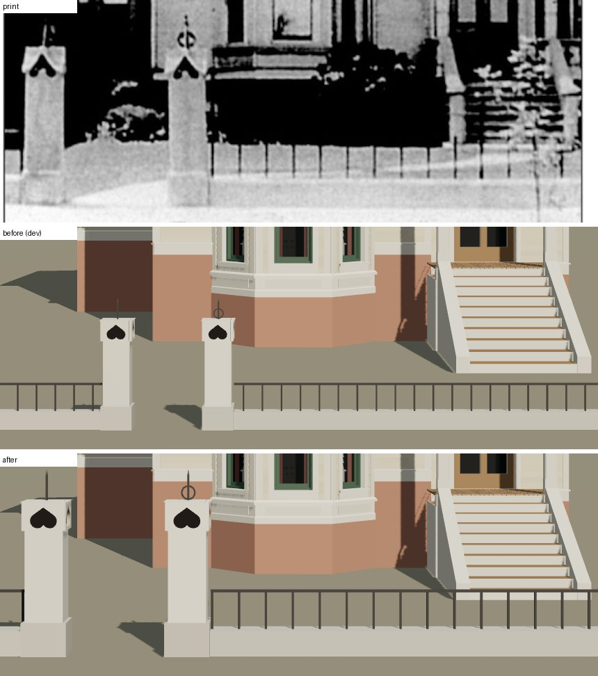

# T-2524 — 1638 Prairie's front fence re-read through the camera T-2523 re-solved

After T-2523, which solved the photograph's camera again on the front steps and the fence's base
(eye 30.71 m out, 3.25 m over the walk, f 2242 px, principal point 459, 657 px). T-2456 built the
fence from readings taken through the old camera (eye 20 m out), at 158.7 px a metre on the street
line; through the new one the line draws 112.6 px a metre, so the fence drew 1.44 times smaller
than the print. Matched through
`data/reference_views/shortall_gregory_house_1638_prairie_front/chicagology_front.json`.

*Top, the print (`chicagology_1638_prairie_photo`); middle, the house on `dev` (after T-2523);
bottom, after. Both renders are `tools/photo_match.mjs` through the same camera.*

**Acceptance, stated before the work:** every pixel T-2456 read off the print re-taken through the
new camera at the depth of the face it was read on; the fence rebuilt to those numbers; rendered,
the piers, caps and bars land on the print within a few pixels; the match record's fence item
restated in the new numbers; nothing else on the house moved.

## The re-reading

Through a level camera square to the front: across, `v = 2.7 + (column - 459) x depth / 2242`;
height over the walk, `3.25 - (row - 657) x depth / 2242`, the depth being 30.71 m less the face's
distance out. The plinths' street faces stand on the sheet's line (10.8 m out); the piers, bars and
finials stand on the plinths' middle line (10.51 m); the caps' faces 0.28 m in front of it. Read at
the old camera, T-2456 took every pixel at one scale; here each is taken at its own face (they
differ by under 0.5 %).

| | print (px) | T-2456 | T-2524 |
|---|---|---|---|
| shafts' faces | 75-131, 282-336 | 0.34 m, middles s 0.46, 1.76 | **0.49 m**, middles **s -0.47, 1.365** |
| gateway | between the plinths | 0.90 m clear | **1.255 m** |
| plinths | to 975 | 0.40 m square, 0.30 m | **0.58 m**, **0.43 m** |
| shaft's top / cap | 842 / about 800, 63 across | 1.14 / 1.40 m, 0.40 m | **1.61 / 1.98 m, 0.56 m** |
| heart | point 808, lobes to 838, 39 across | 1.35 m, 0.24 m | **1.91 m**, lobes to **1.64 m**, **0.35 m** |
| finials | spike to 753; ring 776-798 | 1.68 m; 1.475 m | **2.385 m; 2.085 m** (2.08 read; the least that clears the cap) |
| base | 986 to the foot | 0.22 m | **0.32 m** |
| bars | 345, 384 … 732; to 926 at the stoop | 0.244 m apart, 0.58 m | **0.349 m** apart, **0.83 m** |

The shafts give the ratio (0.49 / 0.34 = 1.44), and what T-2456 never read off the print — the
plinths' breadth, the finials' rod, point and ring bar, the caps' boards, eave and pyramid, the
bars' and rail's section — is carried by it, so the fence keeps the print's proportions. The base's
width is the one exception: it is set (0.48 m) so its street face stays 10.75 m out, where the
camera was solved on the base's foot (1022 px).

**The bars' phase.** The kit spread the bars evenly along each run, so their middles fell half a
pitch off the print's (362, 401, 440 … px against 345, 384, 423 …): the print's first bar stands
against the north plinth. `bars.first_m` (new in the K16 kit, `generators/archetypes/k16_timber.py`,
validated by `k16_timber_params.boundary_errors`) lays the bars from each gate pier at the record's
own pitch, the first that far off the plinth's face; 0.018 m here (345 px). No other K16 house
builds a boundary, so the kit change reaches none of them.

## Rendered

| | print (px) | after (px) |
|---|---|---|
| south shaft | 75-131 | 76-129 |
| north shaft | 282-336 | 282-335 |
| caps' top | about 800 | 797 |
| heart's point | 808 | 809-810 |
| ring's middle | 787 | 786 |
| bars | 345, 384, 423, 462 … 732 | 344.5, 383.5, 422, 460.5 … 731.5 |
| foot at the line | 1022 (camera) | 1023 |

## Still open (match record)

The caps' flared lower corners and the pale block south of the south pier (T-2521, which reads them
at the old scale; whichever lands second carries them through this camera). Liberty:
`L-k16-1638-fence-2524`.
