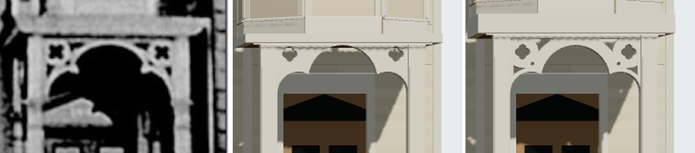

# 1638 Prairie's entrance board as open fretwork, and its match record brought to matches (T-2533, piece 2 of T-2522)



The match record had two items open when this piece was claimed: the entrance board's open
fretwork (*"in the print the board's field round each quatrefoil is dark, open fretwork … the
model's board is solid"*) and the pale upright at the south wing's corner that T-2532 left
unidentified. A third finding came with the claim: **#843 (T-2524) overwrote T-2532's three
readings** in the match record with the text it had branched from (its merge took its own side of
the file), so the record on `dev` described the wing as "not yet identified" while the GLB built
it. Those readings are restored verbatim from 2ec5ce5b5.

## The head of the entrance, read again

Through the camera T-2523 solved (eye u 30.71, v 2.7, 3.25 m over the walk, f 2242 px), the
board's face stands about 29.04 m from the eye: **77.2 px a metre** (the quatrefoils' middles, 111
px apart in the print, are 2 x 0.719 m apart in the model).

| reading | print | dev before | this branch |
|---|---|---|---|
| fascia, top and foot | 535 / 556 px | 555 / 564 px | 534 / 554 px |
| board's top, under the plate's shadow line (557-560 px) | 561 px | 570 px | 562 px |
| quatrefoils' middles | 698.3 / 808.8, 573.7-574.5 px | 699.3, 577.4 px | 699.3 / 810.4, 573.6 px |
| wedge under the plate | 718.6 / 788.8, 567 px | solid | 719.8 / 791.3, 565-567 px |
| eye in the tie | 710.6 / 797.2, 585.6 px | solid | 709.6 / 799.6, 586.1 px |
| opening by the post | 691.3 / 815.9, 592-593 px | solid | 693.3 / 815.7, 592 px |

Fascia rows are read down column 760; dark blobs were measured by threshold and flood fill (print < 90, render < 150 grey) over
x 686-825, y 561-600; the arch's crown and spring did not move (the spring is lowered under the
plate by exactly the plate's rise, 0.13 m).

So the plate stands **3.0 m clear** (was 2.87), the fascia is **0.26 m** (`roof_m`, was the kit's
0.12), and the board is cut as fretwork (`arch.fret`): what stands is a band round the head foil
(0.155 m) and the side foils (0.05 m), a ring out to 0.215 m round each quatrefoil, a tie 0.24 m
broad from it to the cusp with a 0.05 m eye 0.21 m from the quatrefoil's middle, and a 0.045 m
frame on post and plate. The print draws each opening in 7 to 15 px, so the outlines are a
geometry chosen to put the openings where the print does, recorded as such in
`L-k16-1638-fretwork-2533`.

The generator (`k16_timber._fret_openings`) finds each opening as a connected region on a 5 mm
grid of the clearance (an exact distance to the union of bands, ring, tie and frame), keeps it if a
circle `min_opening_m` across fits, and traces it from its widest point by marching rays out to the
solid; it refuses an opening its own trace does not hold. Every other K16 house is byte-identical.

## The item's moulding, not found

Item 22 also read *"the print's opening stands some 5 px inside the post's face below the side
foils, a moulding not built"*. Column means across rows 700-760:

```
x       682 683 684 685 686 687 688 | 819 820 821 822 823 824
print   172 162 146 122  70  13   3 |   0   3   1  57 107 146
dev     206 206 206 204 204 207 207 | 201 201 134 111 144 176
```

The print's opening edge stands at 685-686 and 822 px, which is where the posts' faces already are.
A 0.065 m jamb strip was tried and put the edge at 691 px, 5 px wrong; it is not built.

## The south wing's corner

T-2532's open item: a pale upright about 0.6 m wide under the eave (95-135 px, 502-655 px) and a
third narrow light at 110-124 px. The wing's corner line (v -3.0 m on its face, 37.4 m from the
eye) draws at x = 459 + 60.0 x (-3.0 - 2.7) = **117 px**: both straddle it, so neither can be on the
east face, and the south face is not seen by an eye 5.7 m north of it. The upright stops under the
eave (no chimney), is pale where the wall behind is in shade, and has a ragged south edge like the
planting's. It is something in the yard catching the sun, not the house: `not shown`. The wing's
face is dark because 1700 Prairie (4.4 m south, outside this record) shades it.

## Verdict

Every difference is now `fixed` (32) or `not shown` (4: the wing's corner, 1700 Prairie's flank,
the yard's planting in front of the basement and stoop, and colour). The record's verdict is
**matches**.
