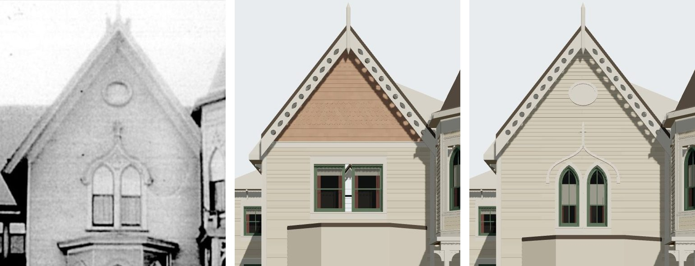

# T-2423 — 1638 Prairie's gable from its photograph

Piece 1 of 4 of T-1865 (1638's finished architecture). The first camera solved for the house's
only photograph, and the gable built to it.

*Left, the print (`chicagology_1638_prairie_photo`, the image store's copy, committed at
`data/sources/assets/shortall_1638_photo_t2423/`); middle, the house on `dev` before this piece;
right, after. Both renders are `tools/photo_match.mjs` through the same camera.*

## The camera

`data/reference_views/shortall_gregory_house_1638_prairie_front/chicagology_front.json`: level and
square to the front, looking west; 73 px a metre at the front's plane from the Sanborn's 8.13 m
front; grade at 825 px, the datum T-2396's tower heights were read against; the eye 20 m in front
of the house and 2.3 m over grade, from grade at the house against the fence's base on the street
line (1022 px). Residuals 0-4 px at the front's ends, the tower's sides, the oval and the lights'
points; 12 px at the gable's apex. The depth rests on one reading and is good to a few metres.

## What changed

| | before | after (read off the print) |
|---|---|---|
| twin windows | kit's flat-headed paired sash, sill 4.45 m | two pointed lights 0.63 m, sill 4.0 m, points 5.87 m, casings round the heads |
| hood | none | ogee hood from stops at 5.45 m to 6.5 m, finial to 7.2 m |
| oval | none | 0.89 x 0.74 m at 8.04 m, moulded ring, blind field |
| gable field | belt at 6.4 m, square and fish-scale shingle | clapboard to the rake, no belt |
| bay (stand-in) | 3.9 m block, burying the new sills | 3.55 m block, top at the print's 3.67 m |

The kit gains the parts (`generators/archetypes/k16_timber.py`): a `surround: pointed` casing
whose clapboard is cut course by course to the arch, `field: clapboard`, `hood` and `oculus`,
checked by `k16_timber_params.gable_errors`. No other K16 record uses them, so no other asset moves.

## What is still open

The match record (`chicagology_front.match.json`, verdict `differs`) lists what the later pieces
own: the bay's pointed lights, cornice and base and its narrower plan (T-2424); the entrance's arch,
pierced spandrels, doors and stoop (T-2425); the fence and gate piers (T-2426, which brings the
record to `matches`). The gable keeps four: the plain verge board, the three-pointed finial, the
hood's tracery and volute stops, and the apex 0.16 m high. Liberties: L-k16-1638-gable-2423.
