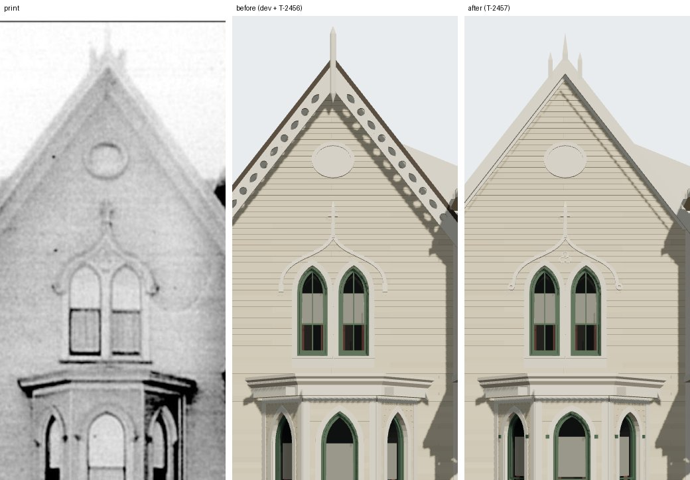

# T-2457 — 1638 Prairie's gable and bay from its photograph

Piece 2 of T-2426 (itself the last piece of T-1865, 1638's finished architecture). The six
gable and bay differences T-2423 and T-2424 left open in the match record, built to the print
through the camera T-2423 solved.

*Left, the print (`chicagology_1638_prairie_photo`); middle, the house before this piece (dev
with T-2456's fence); right, after. Both renders are `tools/photo_match.mjs` through
`data/reference_views/shortall_gregory_house_1638_prairie_front/chicagology_front.json`.*

## Readings

At the verge's plane (0.3 m in front of the wall) the print draws about 74 px a metre. Edges
were read on the blurred print against a fixed threshold, and the verge's depth on a profile
taken square to the rake and averaged along 80 px of it.

| | print (px) | read |
|---|---|---|
| verge board | sky to field 17 px square to the rake; a paler strip 4-5 px at its foot | plain, 0.23 m from the roof's top line; bead 0.05 m |
| pinnacles | middle at 460, side ones at 438-442 and 482-486; points at 36 and about 66 | middle 0.48 m over the verges' meeting; sides 0.30 m out, points 0.08 m over it |
| under the apex | dark (155-170) where the boards' inner edges meet | no pendant |
| hood | ends curl; a pale cusped figure about 14 px across between the heads, at about 386 | volutes; a trefoil at 6.02 m |
| bay heads | stops at about 655, points at 618 | spring 2.33 m, point 2.83 m: a drop arch, radius 0.72 of the span |

Measured on the render after the build, from each picture's own verge apex: the middle pinnacle's
point 34 px over it against the print's 36, the side points 5.6 px against 5.7, the side
pinnacles 22 px either side of the middle in both. The bay's stops land at the print's 655 px.

## The apex, re-measured

The match record said the apex stood 12 px (0.16 m) over the print's. Fitting both verges' outer
edges on rows 130-260 (slopes within half a degree of each other and of the model's 52) puts the
print's verge apex at (460, 72) and the model's at (451, 81): the print's is 9 px **higher**, not
lower, and 9 px north. The print's oval (459.5), window pair (458) and hood (T-2423's own stops,
380 and 537 px, 458.5) stand on that same middle, and its south verge agrees within 3 px. The
earlier reading was the boards' inner meeting under the pinnacle cluster. What the print shows is
a gable about 0.24 m wider than the sheet's 5.21 m, its middle 0.12 m north, at the same pitch.
Widening it moves the wing wall and the porch's south post, which is the entrance's narrower
opening (T-2458, the next piece), so the width is left open in the match record with this
reading, and this piece builds nothing on it.

## What changed

- **K06** (`generators/archetypes/k06_windows.py`): a pointed `Head` takes a `radius_ratio`; under
  1 its two arcs are centred nearer the middle (a drop arch). A variant's `head_radius_ratio`
  reaches it. At 1, the default, nothing changes: every committed K06 and K13 asset re-emits
  byte-identical.
- **K16** (`generators/archetypes/k16_timber.py`): a gable's `verge` builds a plain beaded board
  in place of the pierced bargeboard; `pinnacles` a cluster in place of the kit finial;
  `hood.stop.kind: volute` and `hood.tracery` the curled ends and the trefoil; a light's
  `head_radius_ratio` and `stops` the drop head (casing and clapboard cut to it) and its stops.
  `k16_timber_params` validates each. No other K16 record uses them: the four other houses
  re-emit byte-identical.
- **1638's record** gains those fields, with the readings in its notes; the match record marks
  the five built items fixed and rewrites the apex item as above.
- **Liberty** L-k16-1638-gable-bay-2457.
