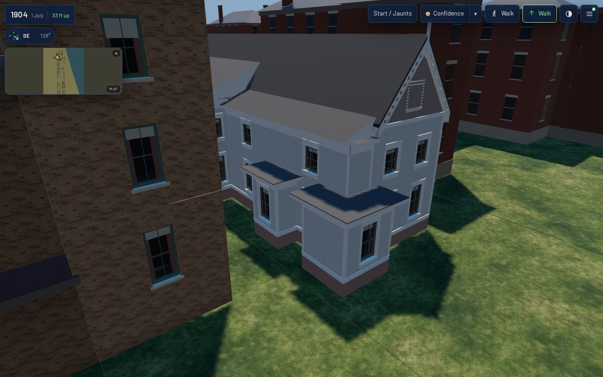
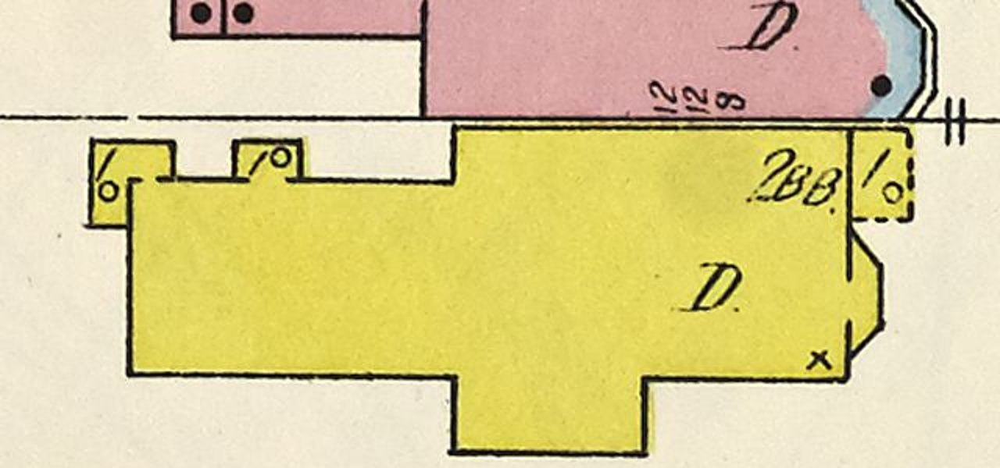

# 1638 Prairie's rear pieces from sheet 20 (T-2397)

Piece 3 of T-1864 (the 1638 envelope): T-2395 closed the body, T-2396 builds the corner tower, and
**this piece** stands the pieces sheet 20 draws against the body. The record keeps its id,
`shortall_gregory_house_1638_prairie_front`, its placement, the T-2323 front and the T-2395 body.

## Read off the sheet

The committed raster of sheet 20 of the 1911 Sanborn (`sanborn_1911_vol3_sheet_20.jpg`, public
domain), each line picked as the peak of a median darkness profile across it, at the fit's
0.050779 m a pixel, about the front's south end (column 3103.3, row 3722.7); u east, v north:

| line | pixel | metres |
|---|---|---|
| the rear range's north wall | row 3596 | v 6.43 (T-2323 read 6.49; the record keeps 6.49, one pixel apart) |
| the projection's south wall | row 3770 | v −2.40 |
| its east end / west end | columns 2972 / 2850 | u −6.67 / −12.86 (the north range's back line, 2849: taken as −12.9) |
| the ell's west / east | columns 2618 / 2670 | u −24.64 / −22.00 |
| the ell's north / south | rows 3570 / 3625 | v 7.75 / 4.96 |
| the shed's west / east | columns 2710 / 2752 | u −19.97 / −17.84 |
| the shed's north | row 3570 | v 7.75 |

The house is printed `2BB` once; the projection carries no number of its own, so it is taken at the
house's two storeys (a liberty). The two pieces at the back each carry a `1` and a small circle, the
Sanborn key's slate or tin roof, against the `x` (shingle) on the house. The ell is one L-shaped
outline round the back's north corner; with the shed that is the "three one-storey rear pieces" of
T-2323's note read as three blocks: the ell behind the rear wall, the ell along the north flank, the
shed.

## What was built

| piece | built as |
|---|---|
| the rear range widened to 6.49 m | the north flank moved out to v 6.49 behind the north range, a short kit wall beside the rear gable, the north range's back wall shortened to 1.64 m (its sash re-centred), a 22° lean-to from the flanks' eave (6.19 m) into the main roof, meeting it 6.95 m up, its back end closed in board |
| the south projection | a kit block against the south flank: west, south and east walls in clapboard to the flanks' 6.03 m wall top, two bays a storey on the south face and one on each end; a 22° lean-to from its south eave up into the main roof's south slope, meeting it 7.61 m up, 0.69 m inside the flank; the flank's two bays it covers taken out |
| the ell | two kit blocks meeting on the rear wall's line: behind the back (north, west, south walls) and along the north flank (east, north), one sash in the west wall, a 3.65 m wall top, one flat deck over both |
| the shed | a kit block on the north flank (east, north, west), one sash in its north wall, the same deck |

**What the generator learned** (`generators/archetypes/k16_timber.py`): a timber body takes
`rear_width_m` (the range behind the wing widened past the gable's) and `annexes`, blocks in the lot
plan's frame walled by `frame_house_parts` exactly as a whole frame house's later block is, so the
gate measures each annex wall as it measures every other kit wall (`body_part_keys`); a block may
leave a side `open` where it joins another; `annex_roofs` decks a flat block (overhanging only where
it has a wall) or runs a lean-to up into the main roof. `k16_timber_params.annex_errors` validates
them. The four other K16 houses and the kit specimen rebuild byte-identical.

## Before and after, the same stands (`tools/qa_k16_t2397.mjs`)

Actual published `/1904/` app; *before* is `dev` at 3e5e943e2 (T-2395's body), *after* this branch.
Desktop 1280×800 at full detail, phone 390×780 at light. Stands: front (across Prairie), the
projection down the side gap from Prairie, rear (17 m up over the coach house), the north side from
behind 1636, and the roof. 0 page errors and 0 failed requests on all four runs; every stand
`withinBudget`. Frame times are software GL on the runner, a relative reading, not a device claim.

| | load to ready | JS heap | draw calls | triangles | frame (median of 12) |
|---|---|---|---|---|---|
| desktop before → after | 20.4 → 14.9 s | 32.3 → 32.3 MB | 130-181 → 130-181 (±0) | 1.929-3.296 M → 1.943-3.310 M (+13.9 k) | 1.69-2.71 → 1.76-2.91 s |
| phone before → after | 10.9 → 11.1 s | 32.3 → 32.3 MB | 109-153 → 109-153 (±0) | 569-921 k → 583-935 k (+13.9 k) | 0.43-0.65 → 0.45-0.68 s |

The house is 33.4 k triangles (was 26.5 k): the annex walls 7.3 k and the rear range's short back
wall 0.4 k, less the two flank bays the projection covers (the scene's reading counts about twice
the house's own triangles at both tiers, as T-2395's did). The master is
3.35 MB (was 2.66 MB) and the web derivative 0.37 MB (was 0.30 MB); it batches into the scene's
existing material draws, so it costs no draw call at either tier. Load swings by seconds between runs
on this runner and neither the fall nor a rise is a claim.

Screens: `before-*.jpg`, `after-*.jpg`; readings: `browser-validation-{before,after}-{desktop,mobile}.json`.

## Limits

- No picture shows a side or the rear: the projection's storeys and roof, both lean-tos, the pieces'
  height and every opening are reconstructed (`L-k16-1638-rear-2397`).
- The decks take the house's roof covering; no painted-tin material of their own.
- No door or steps to any piece, no chimney, gutters or downpipes.
- The projection's lean-to stops at its end walls' planes, so their boxed eaves stand past its verges.

Re-make: `python3 generators/k16_emit.py --only shortall_gregory_house_1638_prairie_front`, then
`tools/web_derivatives.sh --only shortall_gregory_house_1638_prairie_front__as_standing_1904.glb`, then
`python3 tools/compile_scene.py --all`.
