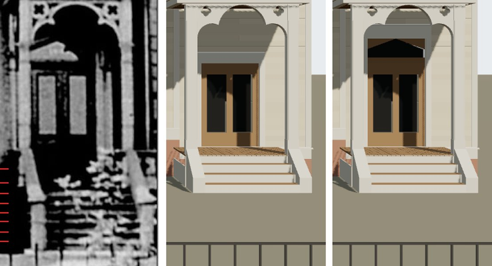

# T-2520 — 1638 Prairie's steps and the shape over its door, from its photograph

Piece 2 of 4 of T-2458 (1638's entrance, tower and south block). Two questions the match record
left open under the entrance, both read through the camera T-2423 solved
(`data/reference_views/shortall_gregory_house_1638_prairie_front/chicagology_front.json`).

*Left, the print (`chicagology_1638_prairie_photo`), the nosings read below ticked in red; middle,
the house on `dev` before this piece; right, after. Both renders are `tools/photo_match.mjs`
through the same camera.*

**Acceptance, stated before the work:** the steps' run settled one way or the other through the
camera, with the readings and the fit that settle it, and the consequence filed as its own ticket
if this piece does not build it; the pale shape identified, and built where it lands on the print
within a few pixels, or argued not shown.

## The pale shape over the door: a glazed transom

| | print (px) | read at 73 px a metre |
|---|---|---|
| the shape's extent | 686-757 across, 622-650 high | starts on the south jamb's line |
| its foot | 649-651 at every column | the light's foot, 0.12 m over the leaves' head (659) |
| the dark under it | 650-659 | the transom bar |
| its south slope | 634 at 692, 627 at 710, 622 at 725 | a fall of 0.36, 20 degrees |
| its apex | 622 at 725 | 0.39 m over the bar, 9 px south of the door's middle (734) |
| north of 737 | dark but for a lobe falling 637 → 646 to 757 | what the glass reflects |
| its tone | 150-185 | the leaves' lights are 150-170; the porch round both is 0-5 |

Glass, not light through the arch. A patch of sun on the wall over the door would show the wall's
boards and would not stop on the jamb's line or on a level foot; this one does both, and it is the
tone of the leaves' own lights, which are glass, in a porch that is black everywhere else (so no sun
is reaching that wall). And 1.72 m leaves (T-2425's reading, short for a principal door of the
1870s) under a 0.51 m transom make a 2.23 m opening, which is what a door of the period is.

Built in the K16 kit (`generators/archetypes/k16_timber.py`, `_door_transom`): a door's optional
`transom` (`bar_m`, `side_m`, `apex_m`, validated by `k16_timber_params.transom_errors`) raises the
opening over the leaves by its bar and apex; one light under a low gable sunk as the leaves' lights
are, the hall dark behind it, the corners over the slopes painted board to the opening's square
head, the casing and drip cap carried up. 1638's door: bar 0.12 m, sides 0.17 m, apex 0.39 m. The
other four K16 houses re-emit byte-identical (no door of theirs has a transom).

Rendered after: the light's south slope at 631, 627 and 623 px (columns 700, 710, 720) against the
print's 631, 627.5 and 624; its foot at 646 and apex at 618, 4 px high, about the offset the door
already carries; its apex at the door's middle, 10 px north of the print's. Liberty:
L-k16-1638-transom-2520.

## The steps' run: the floor's height, about 1.4 m over the walk

The print's nosings, the bright rows on columns 712-775 between the cheek walls: **813, 834, 850,
865.5, 879.5, 892, 908, 922.5 px**, about 15 px apart, down to the fence's rail (about 930 px). The
model's stoop (T-2425's four risers of 0.15 m from a 0.6 m floor) reaches the ground at about
853 px.

The door's foot (785 px at the wall, 73 px a metre) fixes the eye 1.753 m over the porch floor
whatever the camera's depth. The fence's base, on the street line 10.8 m in front of the house (the
sheet), stands at 1022 px. With D the floor's height over the walk at the fence, those two fix the
eye's distance from the front: **E = 54 / (3.247 - D)**, so the present solve (E = 20 m) is D of
about 0.55 m, and any other D moves the eye. A nosing k steps down from the floor's edge (1.78 m in
front of the wall) stands at row 657 + 73 E (1.753 + k r) / (E - 1.78 - k g). Fitted for riser r
from 0.14 to 0.20 m and going g from 0.26 to 0.36 m, the stair not to run below the walk:

| D, floor over the walk | E, eye from the front | best r, g | risers | rms (px) |
|---|---|---|---|---|
| 0.6 (the present solve) | 20 | none reaches 922 px | — | — |
| 1.0 | 24.0 | 0.14, 0.36 | 8 | 25 |
| 1.2 | 26.4 | 0.15, 0.36 | 8 | 9.4 |
| 1.3 | 27.7 | 0.14, 0.35 | 10 | 3.1 |
| 1.4 | 29.2 | 0.155, 0.26 | 10 | 3.0 |
| 1.5 | 30.9 | 0.155, 0.28 | 10 | 2.9 |
| 1.6 | 32.8 | 0.16, 0.26 | 10 | 2.8 |

Even letting the present camera's stair run on below the house's grade (a fall in the yard with the
eye kept at 20 m), the best stair is 8 risers of 0.155 m on 0.27 m goings at 5 px rms, and it puts
the stair's foot 0.7 m under the grade the fence's base is solved on, which the fence then
contradicts. So the camera's depth moves. From D = 1.3 m up the fit is flat at about 3 px, so the
nosings alone do not pin D closer than 1.3-1.6 m. What they do pin is the eye: **28-33 m from the
front, on the far walk of Prairie Avenue** (its street lines stand 20 m apart, `data/street_grid/1904.json`,
so the far line is 30.8 m out), where the present solve stood it in the middle of the carriageway.
The eye is then 3.1-3.3 m over the walk: a camera raised on a stand or a carriage, as the 2.3 m of
the present solve already needed.

**Which of the two.** The print cannot split D between a higher floor and a fall in the ground
between house and fence: the hedge hides where the house meets the ground, and the fence's own
readings (T-2456's piers, bars and caps) were taken on the camera's scale, so they do not test its
depth. The 1911 sheet's '2BB' (two storeys and basement) does: a basement under a frame house of
the 1870s raises its principal floor four or five feet, and this city raised its streets above its
lots, not the other way. **It is the floor's height**, about 1.4 m over grade on the basement, the
stoop some ten risers.

**Not built here.** Raising the floor moves every height over grade the record carries, re-solves
the camera every 1638 reading stands on, and re-scales the fence (on the street line the print then
draws about 116 px a metre, not 158.7). That is more than this piece's one demonstration, so it is
filed: **T-2523** (the camera re-solved, the floor raised, the ten risers built, the match record's
steps item to fixed) and **T-2524** (the fence re-read through the new camera). The match record's
steps item stays open with this reading and those two tickets in it.
