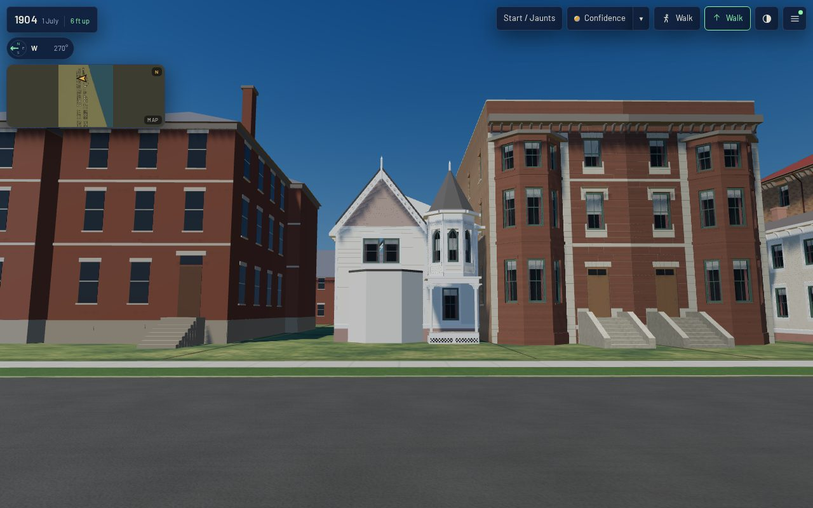
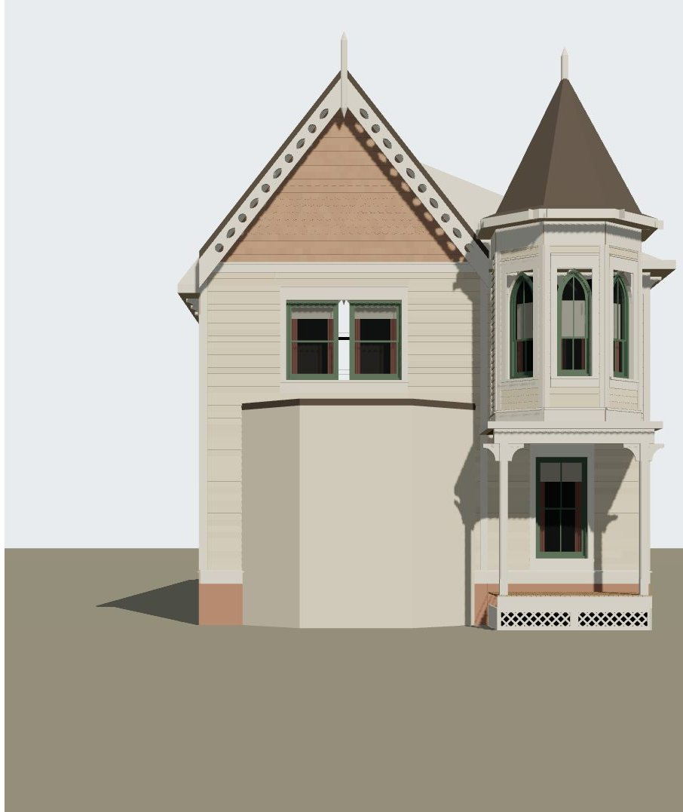

# 1638 Prairie's corner tower from its photograph (T-2396)

A piece of T-1864 (the 1638 envelope), split three ways by T-2395: T-2395 closed the body, **this
piece** builds the corner tower from the photograph, T-2397 builds the sheet's rear pieces. The record
keeps its id, `shortall_gregory_house_1638_prairie_front`, and its placement.

## What the photograph shows

The Prairie library's photograph of the house (`a16-cgy-1638-gothic-photo`, chicagology, undated;
now the source record `chicagology_1638_prairie_photo`, read from the image store's reference copy
and not committed here, its rights being "unknown — link only") shows the street front only. At its
north end: an arched entrance porch on posts with pierced spandrels, double doors behind it and a
stoop before it; over the porch a **regular octagonal** upper stage with a pointed light in each of
its three street faces; a cornice; an octagonal spire to a finial whose point stands a little over
the gable's apex.

## How it was read

No camera is solved (that is T-1865's image gate). Proportions were read off the print:

| what | pixels in the 900 × 1077 print | reading |
|---|---|---|
| the front, gable's south corner to where the north neighbour cuts it off | 260 → 855 | 595 px for the sheet's 8.13 m: 73 px/m at the wall |
| the stage's front face : its two diagonal faces | 90 : 55 : 45 of 190 | an octagon seen nearly square-on (0.41 : 0.29 : 0.29); the south face wider, so the camera stands to the south, about 6° off the tower's axis, some 30 m away: close to an elevation |
| the stage, across its flats | 190 | 2.5 m (at about 77 px/m, 1.7 m nearer the camera than the wall) |
| its middle | 745 | 6.4 m from the front's south end; built on the porch's 6.55 m |
| the porch's posts | 665, 850 | the porch's middle 6.5–6.65 m (the sheet's dotted porch: 6.67 m); it stood at 6.86 m |
| the stage's foot (the porch head) | y 555 | the kit porch's roof, 3.57 m |
| a light's sill / point | y 495 / 350 | 4.35 m / 6.2 m |
| the cornice | y 290 | 7.0 m |
| the spire's point | y 80 | 9.9 m, a little over the gable's apex |

## What was built

`generators/archetypes/k16_timber.py` learned a `tower` on a K16 front (`tower_parts`, `tower_roof`):

- **The stage.** Eight kit `clapboard_wall`s, one per face of the octagon, each with a corner board at
  both angles and the kit's water table as the band the stage stands on. Their own straight eaves and
  brackets are left off, because eight straight eaves cannot meet at an octagon's angles.
- **The lights.** A K06 pointed two-over-two sash in a K16 casing in each of the three street faces,
  0.6 m wide: as wide as a 1.04 m face allows inside its corner boards and casing. A window may now set
  its own `clear_width_m`; nothing else that is built changes.
- **The cornice and spire.** A soffit and fascia mitred round the octagon at a 0.3 m eave. The spire's
  covering is kicked out over them, then rises to its point. The kit's chamfered finial goes through
  the point.
- **Its place.** The tower is centred on the porch, and its front face stands on the porch plate's front,
  so the porch is its ground storey. A front record's porch may now place its middle (`centre_m`). The
  wing wall loses its upper sash, which is inside the tower now.
- **Params and gate.** `k16_timber_params.py` validates the tower (`tower_errors`).
  `tools/check_timber_kit.py` holds all eight faces to the kit's rules, as it holds every other part.
  The kit specimen and the other four K16 houses rebuild byte for byte. Only their manifest input
  hashes are re-stamped, because the generator they hash changed.

**Provenance.** `form.tower` is `inferred`: its reasoning is in the record's note. What is invented is
admitted in `L-k16-1638-tower-2396`:

- the five faces the print cannot show;
- the clapboard, where the print shows the stage smooth with incised ornament;
- the kit's equilateral head, on a narrower light than the print's;
- the colours;
- the kit porch, where the print shows an arch, doors and a stoop (T-1865).

## Against the photograph

This render comes from a working camera, not a committed solve: 30 m out across the street, level,
f = 2190 px. In `tools/photo_match.mjs`'s neutral render the stage's foot and cornice, the tower's and
the porch's widths and the spire's point land within a few pixels of the print. The differences still
open are T-1865's:

- the arch, spandrels, doors and stoop under the tower;
- the incised ornament on the stage;
- the lights' more acute heads;
- the gable's hood moulds and oculus;
- the canted bay's pointed lights.

## Before and after, the same stands (`tools/qa_k16_t2396.mjs`)

These readings come from the actual published `/1904/` app. *Before* is `dev` at 6864b1ffe; *after*
is this branch, desktop 1280×800 at full detail and phone 390×780 at light.

- Stands: across Prairie, obliques from both walks, the tower close from the north walk, and the roof
  from the air.
- Every run had 0 page errors and 0 failed requests, and every stand was `withinBudget`.
- Desktop: +4,648 triangles at every stand and ±0 draw calls.
- The web GLB grows from 299,600 to 326,652 bytes.

Readings are in `browser-validation-*.json`, screens in this folder.
