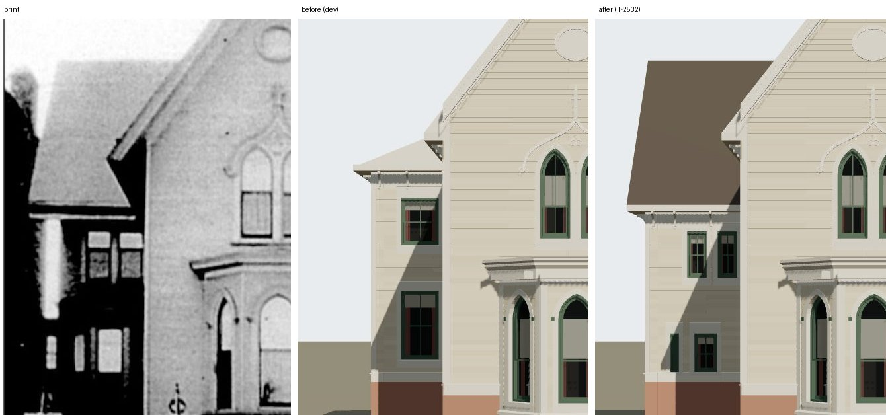

# 1638 Prairie's south wing from its photograph (T-2532, piece 1 of T-2522)

The match record's item 29 read: *"South of the gable the print shows a two-storey block with a
hipped roof, a pale stack and a two-light window over a door: the register's 'separate lower
wing' or the neighbour, not yet identified."* This piece identifies it and builds it.

## Whose block it is

Sheet 20 of the 1911 Sanborn (the committed raster, 0.050779 m a pixel about the front's south
end, column 3103.3, row 3722.7) draws south of the 1638 lot **1700 Prairie**, a three-storey brick
house (`3B`, pink): its north wall at row 3810 (v −4.43 m), its front at about column 3133, some
1.5 m forward of 1638's. Through the camera T-2523 solved (eye u 30.71, v 2.7, 3.25 m over the
walk, f 2242 px, looking west) a point at v −4.43 on that front draws at x = 459 − 2242 × 7.13 /
29.2 ≈ −88 px: **all of 1700 is left of the frame**. Its north flank, in shadow, and a tree are
the dark mass at the print's left edge. So the block between about 85 px and the gable stands on
1638's own lot, and the only thing the sheet draws there is the **south projection** (T-2397:
6.67 to 12.9 m behind the front, 2.40 m out of the south flank).

## What the print says about it

Each line picked off the print's grey profile (900 × 1077 px), read on the sheet's east face,
37.38 m from the eye, where a metre is 60.0 px:

| reading | px | metres |
|---|---|---|
| the eave's drip | row 482 (columns 140-220) | 6.13 m over the walk at the drip, 0.42 m out: wall top **5.03 m over the basement's top** (5.98 over the walk), against the flanks' 6.03 |
| a pale band under the soffit | rows 496-503 | the wall's frieze, 5.9 m over the walk |
| the roof's top | row 264, level from 140 to 290 | a ridge running north (a level line at one depth), so the roof faces the street |
| the south rake, against the sky | (125, 275), (120, 300), (115, 330), (110, 360) | 0.176 px a px; meets the drip at **88.5 px**: the verge at v −3.42 m |
| the upper lights | 179-209 and 224-256 px, rows 522-592 | 0.50 and 0.53 m wide, centred v −1.72 and −0.95, sills 3.38 m, heads 4.55 m over the basement's top |
| the lower lights | 154-167 and 190-225 px, rows 677-737 | 0.22 and 0.58 m wide, centred v −2.28 and −1.50, sills 0.97 m (feet hidden by the planting) |

With the ridge on the plan's middle (u −9.79, 40.50 m from the eye) the 264 px top is a ridge
9.40 m over the basement's top, so from the 5.19 m eave over a 3.535 m half-span the pitch is
**50.0°** (the front gable's is 52°).

**It is a lower wing.** The house stands on T-2523's 0.95 m basement, so the projection T-2397
built to the flanks' wall top had its eave at about 7.1 m over the walk — 430 px through this
camera, where the print draws 482. The print's wing is a metre lower than the house: the T-1837
register's "separate lower wing".

**It is wider than the sheet draws.** Under the kit's 0.42 m verge the drip's corner at 88.5 px puts
the wall at v −3.0 m; the sheet's line is −2.40 m (row 3770). That is 12 sheet pixels, more than
any reading of a Sanborn line moves. Keeping the sheet's width would need the face about 4 m
further forward (u −2.4), against the sheet's own column 2972; no depth between those keeps both.
The print is the picture the house is matched to, so the wall goes to −3.0 m and the sheet's east
face and west end stay. Recorded in the footprint's note and `L-k16-1638-wing-2532`.

## What was built

- `generators/archetypes/k16_timber.py`: an annex may take `roof.kind: "gable"` with `ridge: "v"`
  (`_annex_gable`). Its two slopes run from the walls' eaves up to a ridge on the plan's middle; north
  of the main eave's edge each stops on its **valley** with the main roof's south slope
  (y = ye + (v + P) tan 52°), and under that eave it runs on to the flank. The south end is closed
  under its verge (soffit and fascia, as `_gable` closes an end), and the gable wall over the south
  wall is the kit's `gable_end`, which `frame_house_parts` already builds for a gabled block.
  `k16_timber_params.annex_errors` accepts it on a block against the south flank with a v ridge, a
  20-65° pitch and a numeric wall top (it stands under the flanks').
- The record: `south_projection` at `rect_uv [−12.9, −3.0, −6.67, 0.0]`, `wall_top_m` 5.03, the
  gable at 50°, the east face's four lights read off the print, the south (two a storey) and west
  (one) walls' sash re-spaced to the lower storeys. The footprint's south line moves with it.

Built: the ridge runs into the main roof at v 2.09 m, under the main ridge (10.22 m).

## Rendered against the print

`node tools/photo_match.mjs data/reference_views/shortall_gregory_house_1638_prairie_front/chicagology_front.json`,
measured on the render:

| | print | render |
|---|---|---|
| ridge | 264 px | 263 px |
| drip | 482 px | 480-483 px |
| the drip's south corner | 88.5 px | 88 px |
| the rake at row 275 / 300 / 330 / 360 | 125 / 120 / 115 / 110 | 118 / 114 / 110 / 105 |
| the four lights | (above) | within 3 px |

The rake's top lands 5-7 px south of the print's: the print's rake leans more steeply than a ridge
on the plan's middle draws, which a ridge some 0.8 m further back (an unequal roof) would close.
That is left, and said in item 29.

**Still open in the match record:** a pale upright about 0.6 m wide at the wing's south corner
(502-655 px, soft-edged — a lit corner, a downpipe or a trunk) and a third narrow lower light at
110-124 px, neither identified nor built. The wing's face is dark in the print, in 1700's shadow,
where the render lights it. The record's verdict stays `differs`: items 21, 25, 27 and 28 are the
porch board's fretwork and T-2521's tower and fence (PR #839), and T-2524 re-reads the fence; the
record is brought to `matches` by T-2533 once those land.
