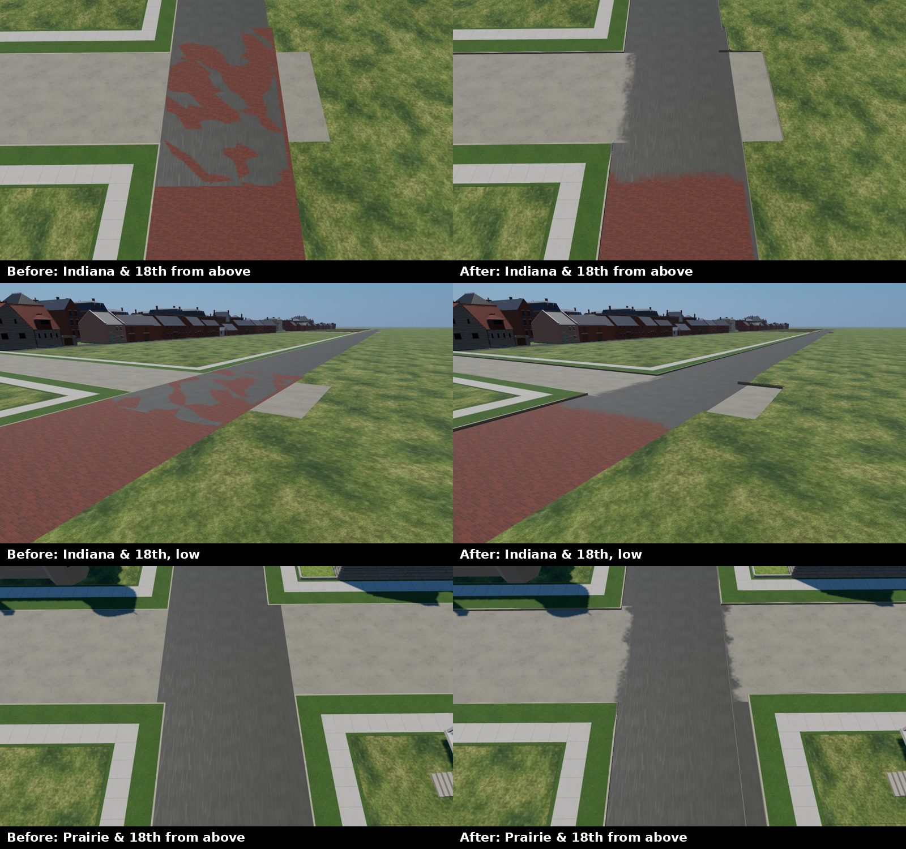

# The 1904 street seams: one paving per crossing, worn into the next (T-2475)

The owner, 2026-10-13: *"when flying or walking over street areas that are transitional between
surfaces it looks jagged and harsh, that should fade, in some way there should be a transition"*.
Later, with a screenshot of Indiana Avenue at 18th Street: *"This intersection still looks jagged
bad it should be faded"*.

## What was wrong

The grid's carriageways run through their intersections (`data/street_grid/1904.json`, T-0474).
Indiana Avenue is two segments that overlap for 20 m across 18th Street: vitrified brick to the
north and sheet asphalt to the south (T-1728). Both were drawn there, and so was 18th Street's
macadam. They sat a few millimetres apart. Each was draped on the terrain through its own
triangles, so the surfaces crossed each other by centimetres, and from any distance the brick and
the asphalt broke through each other in blotches. That is the jagged patch in the owner's
screenshot. Every crossing had the same fault in a milder form: the cross street's macadam lay
under the avenue's asphalt.

## What was built

`renderers/web/js/street-grid.js`:
- **Ranking.** Each roadway piece is ranked by its `priority` in `data/street_surfaces/1904.json`,
  then by its order in the grid.
- **Cutting.** Each piece is cut out from under every piece ranked above it. This is exact
  convex-polygon clipping. The pieces left are tessellated on the roadway's own frame, so the
  triangle count is unchanged: 46,056 before, 47,036 after.
- **The seam.** Where a lower roadway runs on past the edge of a higher one, a strip 1.6 m deep
  under that edge is drawn over the higher roadway in a blended overlay. It is opaque at the
  edge, gone 1.6 m on, and ragged in between, from two octaves of world-space noise. One overlay
  draw per paving: +3 draw calls.
- **Slivers.** Two segments of one street are never traced to the same width. Indiana's differ by
  0.3 m at 18th. A piece narrower than 0.6 m left beside a roadway is paved as that roadway, so
  no thin line of the other paving shows down its side.

All of it is a liberty: `docs/LIBERTIES.md` L-prairie-paving-seams-2475.

## Side by side

