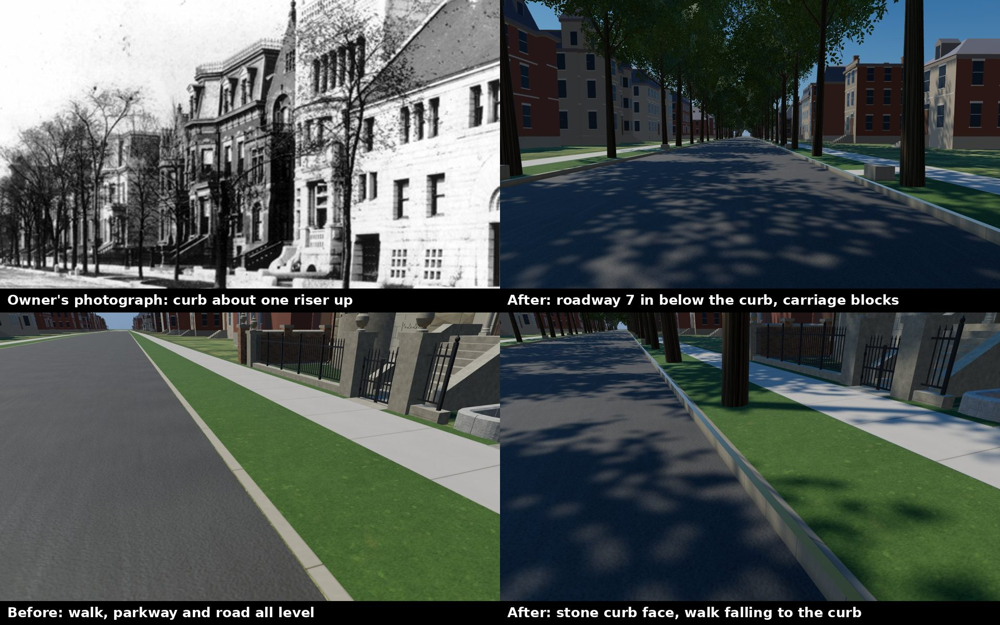
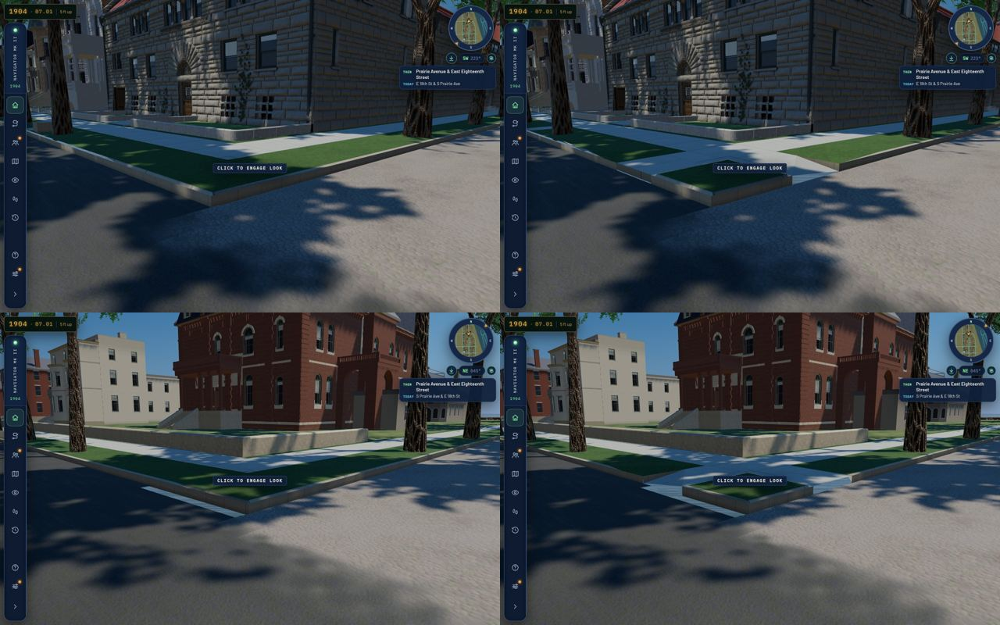

# The 1904 street section: the curb's reveal, the walk's fall, carriage walks (T-2474)

The owner, 2026-10-13, with the postcard of Prairie Avenue looking south from 18th Street:
*"Look at the curb height and make sure we are correct on that, with correct carriage walk
ways"*; then, with a second photograph, *"it shows the curbs nicely"*.

## What was read

| source | what it shows | carried as |
|---|---|---|
| `chicago_revised_municipal_code_1905`, the 'Slope' sections | the sidewalk space's grade: "a uniform incline from the street line toward the curb line, with a fall of one inch in every three feet" | the fall, inferred for 1904 |
| `picturesque_chicago_1892_prairie_avenue` (the 1887-91 view south from 18th Street; the owner's postcard copy) | a pale dressed stone curb standing above a smooth roadway; a paved crossing of the parkway from the walk to the curb | the reveal's order of size; that crossings existed |
| the owner's second photograph (`data/sources/assets/prairie_streetscape_owner_2026_10/owner_prairie_avenue_curbs_photo.jpg`; publication not identified) | the curb's top about one stoop riser above the roadway, walk and parkway level with the curb's top | the reveal's order of size |
| `views_of_chicago_1905_prairie_michigan` | dressed stone carriage blocks along the parkway's edge | that blocks existed |

No source read states the reveal as a number. A stoop riser of the period is about 7 in, so the
reveal is **7 in, reconstructed** (`docs/LIBERTIES.md` L-prairie-curb-reveal-2474).

## What was built

- `tools/lay_prairie_1904_street_section.py` writes `data/street_section/1904.json`: the fall,
  the reveal, the roadway's level (0.30 m below the lot line on a 66-ft street), and **91
  carriage walks**, one at the middle of every lot at least 40 ft wide, each 5 ft wide from the
  walk to the curb with a 3 x 2 ft, 18-in carriage block beside it at the curb
  (L-prairie-carriage-walks-2474). `check.sh` re-lays and diffs it.
- `renderers/web/js/street-grid.js` draws every band at its fall and every roadway at its level,
  a dressed stone face down from each curb, and a stone edge wherever a roadway at the district's
  edge meets no drawn sidewalk. It cuts the field's own ground out under all of it
  (`terrain.setGroundCut`: a 0.5 m coverage mask, a discard in the ground's shader behind a uniform
  switch, so no other scene's program changes) and tells the walker how far down the street is.
- The parkway elms stand on the parkway's fall and keep clear of the carriage walks.
- L293 (the street section) gains a line saying the section is now drawn.

## Side by side

## The carriage blocks withdrawn; posts only where pictured (T-3198, 2026-10-27)

The owner, 2026-10-27: *"i dont need to have those carriage steps at every house. i dont see that in
photos of prarie anywhere"*, then *"what you keep you should vary them in appearance so that they do
not look like clones"* and *"they mostly should go i think because i dont see them in photos, unless
you do"*.

Read again, `views_of_chicago_1905_prairie_michigan` and the Flinn view show the **lot-line coping**
along the walk's inside edge (rounded stone copers), not blocks at the curb; the Pullman views
(`a16-pullman-det-4a08065`, `a16-ghm-blog-pullman-completed`) show the parkway's edge clear. Two
pictures do show stones at the curb:

| picture | source | what stands | carried as |
|---|---|---|---|
| `a18-cgy-1815-sears-two-views` | `chicagology_1815_sears_two_views` | a square post with a domed top beside 1815's crossing | one square domed post, attested |
| `a20-glessner-2100-block-west-side-1890s` | `glessner_blog_2100_block_looking_nw_1890s` | round white domed posts: two before 2112, one before 2110, a row on the east curb at the right edge | 3 posts at 2112/2110, attested; 9 along the east curb before 2109-2115, inferred |

So the 91 rule-placed blocks are gone and 13 carriage posts stand (`carriage_posts` in
`data/street_section/1904.json`, laid by the same tool), 0.38 m in from the curb's face, stood clear
of any elm by 0.85 m. Each post is varied by a seed on its id: height 0.78-1.06 m, width, the cap
(plain dome, dome over a collar, flattened dome), a lean of 0.4-2 degrees, its turn and its stone's
tone. The paved carriage walks stay: 1815's, the 2100 block's and Glessner's (HABS no. 2) are pictured.
Amended liberty: L-prairie-carriage-walks-2474.

## The corner crossings and their ramps (T-3200, 2026-10-27)

The owner, 2026-10-27, with J. W. Taylor's photograph no. 2135: *"there are ramps down into the
street. they appear to be stone"*.

| picture | source | what it shows | carried as |
|---|---|---|---|
| `a18-rba-taylor-2135-glessner-ne` | `taylor_2135_glessner_exterior_1887_1889` | the Glessner corner (18th and Prairie, SW): the walk carried across the parkway to the curb, two broad slabs sloping from the curb's top to the roadway, one each way across, the lamp's footing between | that corner's two crossings, attested |
| `a16-pullman-det-4a08065` | `loc_det_4a08065_pullman_residence` | the Pullman corner (NE): the walks carried across the parkway either side of a curbed grass corner with the lamp, down to the roadway | that corner's two crossings, attested |

So at each of the 28 corners where two faces of a block meet (Calumet's curve at 18th is a bend and
has none), each face's walk runs straight on across the other street's parkway and curb at its own
width, and its last 1.35 m (0.92 m on 16th Street's narrower parkway) is a stone slab ramping down to
the roadway: `corner_crossings` in `data/street_section/1904.json`, 56 crossings, laid by the same
tool. `street-grid.js` cuts the parkway and the curb out under each crossing, lays the walk and the
ramp, breaks the curb's face where the ramp runs through it, closes each ramp's sides with a stone
cheek, and gives the walker the ramp's slope. The corner lamp's plot stands between each pair
(T-3199). Liberty: L-prairie-corner-crossings-3200.

