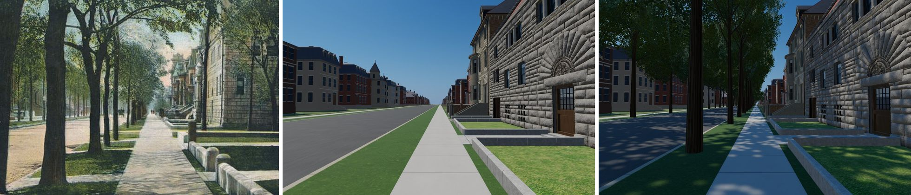
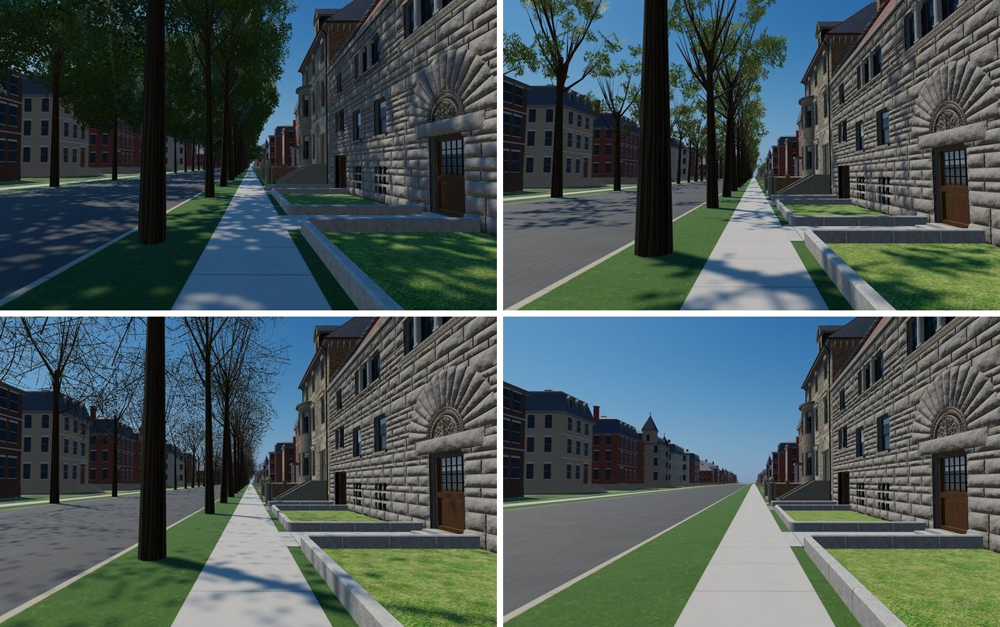
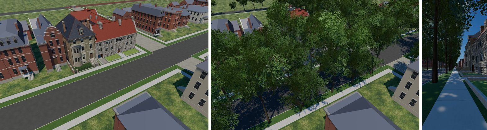

# The 1904 Prairie Avenue parkway elms (T-2473)

The owner, 2026-10-13, with the postcard of Prairie Avenue looking south from 18th Street:
*"we want to emulate this … add street foliage trees correctly, would be nice to in options to
be able to hide trees or make them spring trees barely blooming so you can see the house with
the trees shown but you can still see the house, default should have the correct trees, you
should be able to use the models from 1835 for flora as a base."* And: *"I want the default to be
nice trees with summer leaves like the photo but an option to make them spring trees, winter bare
trees or make them all disappear."*

## What was read

| source | what it shows | tier carried |
|---|---|---|
| `picturesque_chicago_1892_prairie_avenue`: the west-walk view south from 18th Street beside Glessner, negative Dec. 1887 to 1891 (Flinn 1891, Picturesque Chicago 1892, Flinn 1892/93, the Holzman postcard postmarked 1908; the owner's copy is `data/sources/assets/prairie_streetscape_owner_2026_10/`) | one file of tall elms per parkway, standing nearer the curb than the walk; boles clear to about a third of their height; crowns meeting high over the walk; spacing very roughly 25-35 ft; a file on the far side too | the file, its side of the parkway, the habit: inferred for 1904 |
| `views_of_chicago_1905_prairie_michigan`: L. H. Nelson, 1905 | "a single row of closely spaced elms" in the parkway, around the scene date | the single file in 1904: inferred |

Neither names the species. Elm is the reading of crown and bark in the prints, and it is the
1835 scene's own American elm model that draws them, as asked.

## What was built

- `tools/plant_prairie_1904_street_trees.py` plants **418 trees on 31 block faces** into
  `data/street_trees/1904.json` from the parkway bands of the street grid (T-0474): one file per
  face, 62 % of the way from walk to curb, about 30 ft apart, 10.5 m clear of each face's end,
  3.5 m clear of an alley mouth, about one young tree in twelve and one gap in twenty-five.
  `check.sh` re-plants and diffs it.
- `renderers/web/js/street-trees.js` draws them with `trees.js`'s own builder (the 1835 elm in
  a high-crowned, clear-boled "gallery" form): 12 mature and 3 young crowns, instanced in one
  batched draw call that casts and takes shadows and sways with the 1835 wind.
- **Settings › Street trees**: *Summer — full leaf* (the default), *Spring — first leaf, see
  the houses* (sparse pale leaf on bare limbs), *Winter — bare limbs* (the summer crown's sprays
  drawn from a twig-only copy of the 1835 leaf atlas, painted the first time winter is picked),
  *Hidden*. It shows only in a scene with street
  trees (1904 today). Clicking a trunk opens the tree's card with this reading and the liberty.
- Every position is reconstructed: `docs/LIBERTIES.md` **L-prairie-parkway-elms-2473**.

## Side by side

The owner's postcard, the street before, and after (desktop, same stand: the west walk at
18th Street looking south):

The four settings at the same stand (summer, spring; winter, hidden):

From 30 m up before and after, and the phone (390 x 780) at the postcard stand:

**Matches:** one file per parkway on both sides; tall clear boles; crowns meeting over the walk;
the rhythm of the trunks down the block; dappled shade on walk and roadway.
**Differs, and where it goes:** the postcard's trunks are slimmer and more irregular than these
fluted dark columns, and its trees stand a little nearer the curb; the paved crossing of the
parkway, the curb's step above the roadway and the carriage blocks are T-2474; the hard
seams between street surfaces and lawn are T-2475. Bushes and planting at the house fronts are
left to each house's own pass.

## Cost

Measured on SwiftShader at the postcard stand, full detail: the frame goes from 3.63 M to
3.92 M triangles and from 205 to 207 draw calls; the JS heap after a forced collection is
unchanged (678 MB both ways, 678 MB on the phone viewport). Hidden returns the frame to 3.63 M.
Winter draws the same triangles as summer; picking it the first time paints the twig atlas, about
23 MB of heap, which the summer and spring settings never pay.
At `balanced`/`light` each crown has fewer leaf sprays and the phone build drops the leaf
atlas's top mip.

## Where a picture places them (T-1934, 2026-10-29)

The rule above places every tree. Where solved pictures see a stretch of parkway, they now
place it instead: `data/street_trees/pictured_1904.json` names the stretch, every trunk read on
it, and the camera it was read through, and `tools/plant_prairie_1904_street_trees.py`
withdraws the rule's trees there (after their draws, so no other tree moves) and plants the read
ones (`<face>#pNN`, `"placed": "pictured"`). The first is 18th Street before the Pullman estate:

| stretch | seen by | trees read | rule trees withdrawn |
|---|---|---|---|
| `e18th__prairie_ic_16_18` 46.9 m to the corner | the 1894 Inland plate (x 0-2000), Taylor's 16555 (x 0-1200) | 51.3 (both), 58.8 (the plate; Taylor's dead trunk 1.2 m east), 64.1 (Taylor) | `#04` |
| `calumet__prairie_ic_16_18` 0-13.3 m | Taylor's 16555 | 3.3, 10.3 | `#00` (a young tree at 11.3) |
| `e18th__prairie_calumet_18_20` 0-21.9 m | Taylor's 16555 (0-12.6), the plate (13.7-21.9, whose foreground a trunk would cross) | 1.3 | `#00`, `#01` |

Each trunk's x in the picture is carried to the face's planting line through the picture's own
camera, which is reliable along the street (the cameras are fitted on the wall's piers just
behind it) and the plate's predicts the trunks' feet within 1-7 px. Taylor's 16555 had to be
re-solved first: its eye stood on the south walk, and the print's near-side ground (the gate
piers' feet, the walk the man stands on, the near trunk's foot) fell hundreds of pixels from the
build's; fitted on that ground too, the eye stands 11.7 m further back, in the garden across
the street, with a 1192 px lens. The two pictures disagree over two trees (Taylor's at 56.3 m and
his dead one at 60.0 m against the plate's one living tree at 58.8 m), and the build is the
plate's, the later of the two. Taylor's 16554, the wide winter view from the south-west, sees
the same street but its camera cannot tell its parkway trunks from the yard's, so nothing was
read from it. `L-pullman-18th-street-trees-1934` is what is chosen.

### The glasshouse ground's gate (T-3164, 2026-10-30)

The 1894 Inland conservatory plate and Lowe's c. 1897 print look south through the gate of the
estate's glasshouse ground across 18th Street (cameras in
`data/reference_views/pullman_glasshouse_1800_calumet_pavilion/`). They add a stretch and move a tree:

| stretch | seen by | trees read | rule trees withdrawn |
|---|---|---|---|
| `calumet__prairie_calumet_18_20` 264.0 m to the corner | the conservatory plate (x 320-1343), Lowe (x 0-904) | 266.9 (the plate; Lowe 267.5) | none (`#27`, at 259.9 m, is outside it) |
| `e18th__prairie_calumet_18_20` (above) | now also the conservatory plate (0-2.5 m) and Lowe | 1.3 moved to 3.0 | — |

The south parkway's corner tree was Taylor's alone, read at 1.3 m, which would stand it before
the gate's west pier; the plate sees that place, and the parkway to its right edge, clear.
Taylor's camera was solved on the north side's ground, and it stands the gate's west pier (placed
off the plate, the uncropped picture) about 180 px west of where the print draws it, so its
readings of the near parkway carry that offset. Read against the pier, the print's trunk stands
1.7 to 3.5 m along; Lowe reads 3.0 m; the plate rules out anything nearer the corner than about
2.9 m. It is planted at 3.0 m.

**Size.** These two trunks are slim: about 0.31 m across at breast height in the plate (45 px at
13.6 m) and 0.26 m in Taylor's print, where the renderer's elm draws about 0.66 m at scale 1. A
pictured tree may now carry its own `scale`; both carry 0.6, which draws the bole about 0.39 m and
puts the first fork at about 4 m (the pictures' limbs leave at about 3.3 m in the plate, 4.2 m in
Taylor's). Lower would match the girth better and the fork worse. The crowns are still the rule's
elm, where both pictures show a broad, low, leafy head: that stays open in the match records.
