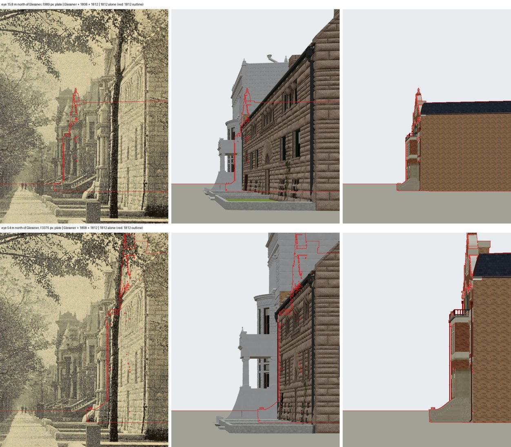

# 1812 Prairie — the package close-out (T-1885)

T-1885 is package C02B of the Prairie Avenue programme (T-1837): George H. Wheeler's
shaped-gable house at 1812 South Prairie Avenue (Burnham & Root, 1884), refined in place from
the district draft (T-2159). The building itself was done by the pieces that came before this:
T-2543 refined the draft against Albert Levy's photograph and retired 1812 from the draft's
block liberty; T-3034 solved the c. 1955 photograph; T-3061 to T-3144 worked both match
records down; and T-3093 signed the house off against both photographs on 2026-10-25, under
the photo-ticket stopping rule the owner chose that day (T-3153). `node tools/image_gate.mjs
--ticket <T-1885>` reads "wheeler_house_1812_prairie match every reference view".

This note does the two things the package still asked for: it reads the pictures the
ticket lists that no piece had read, and it measures the house in the published app.

## The pictures nobody had read

The ticket lists five pictures beyond the two that are solved.

**`cgn-1812-tribune-1915-mabel-wheeler-young`** (Chicago Tribune, 16 July 1915) is a
half-tone portrait of Mrs. Lawrence Young, "photo by Steffens", with no building in it. It
says nothing about the house; no camera can be solved from it.

**The one negative looking south on Prairie's west walk from 18th Street** — Taylor #9974
(`a18-rba-taylor-9974-prairie-south-from-18th`), Flinn's 1892 plate
(`st-flinn-1892-looking-south-prairie-from-18th`), Picturesque Chicago's p. 199
(`st-picturesque-chicago-1892-prairie-avenue-p199`) and the 1908 postcard
(`st-ghm-postcard-1908-prairie-south-at-18th`). T-2371 moved these four from the coach house
to the house, because they show "this house's front, small and far down the row". This run
tried to solve the negative's camera on the widest, sharpest copy, Flinn's plate (2000 x 1431 px,
public domain), with Glessner, 1808 and 1812 rendered together in the 1904 scene
(`tools/photo_match.mjs` with `also_render`), and found two things.

1. **The camera is under-determined.** Glessner's north face, which faces the camera square
   on, fits equally well at every distance tried. Its NE corner foot lands at (1422, 855) px
   and its small first-storey window within about 10 px, from an eye 15.8 m north of the face
   with a 989 px focal length or 54 m north with 3375 px. A square face only fixes the ratio
   of focal length to distance, about 62.5 px per metre. The depth would have to come from
   the receding row, and there the plate and the 1904 scene disagree. The plate shows
   Glessner's sunlit east face only about 85 px long (x 1336-1420), with 1808's porch piers
   and stoop at x 1264-1328 beside it. Every candidate renders that face two to three times
   longer, with 1808's porch 100-170 px further left. That gap belongs to Glessner's
   14.7 ft setback (T-1731) or 1808's reconstructed front line ("not read to the foot for
   this lot"), not to 1812. This ticket does not move either one to fit an under-determined
   camera.
2. **1812's front is hidden from that walk.** On the 1911 sheet, 1812's front stands about
   2.8 m behind the building line that Glessner's east face and 1808's front share. Take an
   eye on the west walk (about u 24 in 1812's frame, 1.6 m up) looking at the gable's finial
   (17.5 m). The sightline crosses that shared line about 0.31 of the way out from 1812, at
   12.6 m. That is below 1808's wall head (14.84 m) and Glessner's roofs, and the fraction
   does not depend on how far north the eye stands. So the front, gable included, is behind
   1808 and Glessner from every candidate camera. The figure shows the near and the far
   camera: the plate, the three houses rendered together, and 1812 alone with its outline in
   red.

   

   The plate does show a pointed gable at about (1175, 455) px. From the near camera, 1812's
   finial projects to that point, but only because it was one of the two points that camera
   was fitted to, so it is no evidence. In the plate that patch is open sky beside the
   gable, and in the render 1808's upper storey fills it. Either the gable is 1808's or a
   house further down, or 1808's upper front in the 1904 scene stands wider than the plate
   draws it. The plate cannot tell which until the camera is pinned. Pinning it is 1808's
   and Glessner's question.

So no camera is committed for this negative, and 1812 has no new match record. A camera
that matched Glessner and 1812 only because it was fitted to them would make the image gate
read a comparison that never happened. What this negative can say about 1812 at its best is
a gable tip about 60 px tall in a half-tone. Both photographs that see the front square on
are already at `matches`.

## The house in the published app (acceptance 3)

The assets, read from the GLBs in the tree:

| tier | file | bytes | triangles | primitives / materials | textures | encoding |
|---|---|---:|---:|---:|---:|---|
| full (master) | `assets/gltf/wheeler_house_1812_prairie__as_built_1884.glb` | 4,402,612 | 24,965 | 29 / 29 | 17 | — |
| web | `assets/web/wheeler_house_1812_prairie__as_built_1884.glb` | 3,707,276 | 24,965 | 29 / 29 | 17 | meshopt, quantized, basisu |

One mesh with 29 primitives, so about 29 draw calls in the colour pass, plus its share of
the sun's pass. There is no separate light tier; only Glessner's v4 package carries one. The
app's light detail serves the same web GLB, and the browser readings below are taken at light
on the phone.

The browser readings are `browser-validation-after-<viewport>-<a|b>.json`, from
`tools/qa_k01_t1885.mjs` (after `tools/publish.sh`; `QA_VIEWPORT` and `QA_PART` split it,
since one stand takes about 1.5 minutes on this runner's software GL). It reads the published
`/1904/` app at 1280 x 800 (full) and 390 x 780 (light) from five stands: the front from
across Prairie Avenue, obliques from the north-east and the south-east, the rear yard looking
up the south side, and the roofs from 30 m behind the house. Each stand records the camera,
`stats()`, the budget verdict and a median of three timed renders. Each viewport records
load to ready and the JS heap after a forced GC. The screenshots are
`after-<viewport>-<stand>.jpg`.

| viewport | load to ready | JS heap | stand: draw calls / triangles / frame ms (software GL) | budget | page errors |
|---|---:|---:|---|---|---:|
| desktop, full | 65-66 s | 74.8 MB | front 4,260 / 2.89 M / 14,729; NE 5,964 / 2.31 M / 14,906; SE 4,236 / 4.39 M / 16,027; rear 2,168 / 2.99 M / 14,904; roof 3,341 / 2.88 M / 15,265 | within, all five | 0 |
| phone, light | 38-39 s | 110.5 MB | front 1,907 / 0.64 M / 3,091; NE 1,940 / 0.54 M / 3,348; SE 2,431 / 0.88 M / 3,855; rear 1,771 / 0.90 M / 2,998; roof 2,237 / 0.74 M / 3,129 | within, all five | 0 |

These are whole-scene readings at stands that look at 1812, not 1812's own share. The
house's share is the asset table above. The GLB byte count in the JSON reads 0 because the
local server streams without a content length. The frame times are relative readings on a
CPU rasteriser, not a device claim. Nothing in the views needed fixing: the front and both
obliques show the house as the two match records describe it, between 1816 and 1808's stone
front.
